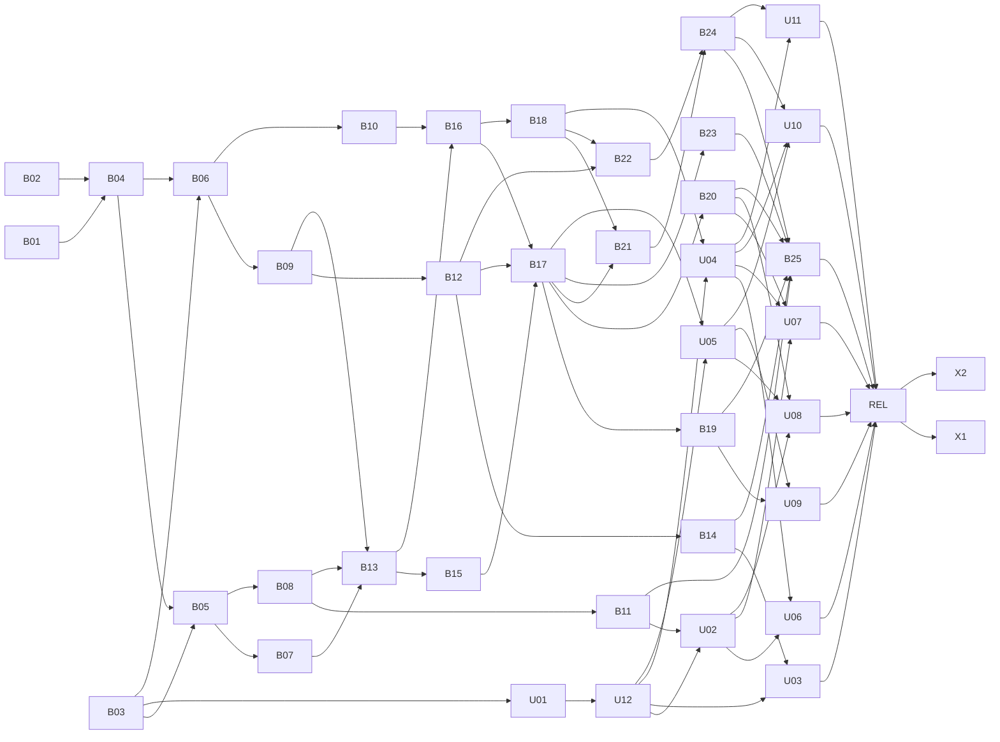

# Data Model v2

> Historical record: this document preserves the v2 planning, migrations, incidents, and decisions as written. For the current contract, see [Data Model](../design/data-model.md).

## Cutover context

The v2 rollout froze production on the previous release until the new UI and backend could ship together. Asset and tag migrations normalized duplicate names, migrated legacy session data, and replaced label-based game references with immutable lineups and rule versions. Migration 0073 transformed saved filter payloads; 0075 removed the legacy source tables. The migration choreography, completed tasks and decisions below preserve that history. The current schema and contracts are in [Data Model](../design/data-model.md).

## 15. The old UI, the freeze and the new UI

B03 deletes the old API-dependent UI once, before API-breaking tasks. It removes feature routes/screens/hooks and tests that call a v2-affected procedure or import its types, including the released Cryst cockpit. It keeps authentication and account flows (login, sign-up, passkeys, OAuth consent/continuation, linked accounts, set-password), authenticated shell with placeholder home, PWA/persisted-cache infrastructure, theme tokens including Cryst scope, production-used API-free shared primitives such as PageHeader and shadcn components, tRPC/QueryClient setup, and unaffected update notes. B03 points every kept navigation that targeted a deleted screen at the placeholder home `/`: the signed-in redirects of `/` and `/login`, post-sign-in, post-sign-up and preview auto-login n…

**SA2-427 (user decision, superseding B03's primitive-retention policy):** delete unused UI parts regardless of whether they are shadcn-standard or custom. Production-used parts stay until U12 (SA2-421). This includes deletion of the unused Cryst components and their otherwise-unused dependencies; the v2 UI phases re-add components from the design system when needed.

**U12 position (2026-10-23 user decision):** U12 runs right after U01 and before U02–U05. After B03 the only kept screens are authentication, settings, update notes and the shell/home; U01 and U12 move them to Cryst, and U12 then moves the Cryst values into `:root` / `.dark` and deletes `cryst-tokens.css` and the `.cryst` scope, so U02 onward build on Cryst as the only theme and no old-UI look survives except logic. SA2-230's reason for withdrawing a whole-app switch (unmigrated screens changing at once) does not apply after B03.

B03 records every deleted test's protected contract and the last old-UI SHA on U01; it updates AGENTS.md and rule reference implementations (web-architecture, web-ui, web-hooks-separation, web-forms, web-data-fetching, web-theme), keeping check:rules meaningful. It does not create a hidden replacement screen project.

All screen requirements, persisted-cache buster/reload behavior, client formula removal, new asset/statistics/entry/multi-day/hand/tag screens, lineup screens and self-player UI move to the UI v3 phases U01–U12, outside this project. Production does not deploy intermediate v2 API states. The new UI defines its own route structure and display names from the supplied `.dc.html`; v3.5.2 paths are not preserved and no redirect layer is added. Two paths stay fixed: `/login`, the MCP OAuth login page configured in `apps/server/src/auth-options.ts`, and `/`, the PWA `start_url`. Retired v3.5.2 paths render the router's default not-found fallback. Hotfixes during the freeze branch release/vX.Y.Z from origin/main and merge main back into dev. Current dev is not released before B01/B02 (§20.1 item 9); the next normal release is v2 plus the new UI.

## 16. Migration history (completed) and operational runbooks

This section records the historical migration, audit and release plan, not current tables, active APIs or binding runbooks. Current procedures are in [deployment](../deploy.md) and [data audits](../design/data-audits.md).

### 16.1 Order and one-home cutovers

The order is a dependency DAG (§18), not a requirement to serialize independent tasks. Its backbone is B01/B02 → B04 → B06 (also after B03) → B09/B10; B03 + B04 (after B01/B02) → B05 → B07/B08; B07/B08 + B09 → B13 → B15/B16 → B17 → B19/B20/B21/B23; B16 → B18 → B22 → B24; everything → B25 → REL. B04 lands before every data cutover and every populated rebuild except B02, so each of those is audited on the dev deploy that ships it; B02 runs before the runner exists and relies on its in-migration gates (counts, restored links, uniqueness, foreign_key_check). B01 and B02 are independent; whichever merges second rebases its schema/migration snapshot. PR #704 is closed: B06 ports only its migration and migration test from head 3d6f3dfa onto B01/B02, renumbers 0059 and writes before_deadline as 0/1. It does not port the router changes, legacy-output tests or old spec edits.

| Task | What it leaves authoritative | End-of-migration gate |
| --- | --- | --- |
| B01 | Final empty v2 schema, lineups and versions, with interim nullable detail rule ids | emptiness precondition, shape/constraint inventory, foreign_key_check |
| B02 | asset under its final name, constraints in Drizzle | source/target counts, restored links/children, name uniqueness, foreign_key_check |
| B06 | Port #704's migration/test; migrate entry, kind details, days and events; delete old entry/live APIs and MCP registrations | A-3, A-4 and foreign_key_check |
| B09 | Migrate ledger lines and categories; no API wiring | A-5, line assets, wallet and category correspondence, foreign_key_check; A-11 reported, not a failure gate |
| B10 | hand rows replace hand_count/dealer_seat | A-10 |
| B05 | game_variant composite ownership, expression label indexes | child counts/links, normalized uniqueness, foreign_key_check |
| B07 | ring_game with current_rule_id NOT NULL; immutable cash rules | no NULL current ids, A-13 master half, stake coverage, counts/FK |
| B08 | tournament current rule, whole levels/prices | no NULL current ids, A-13 master half, stake/price coverage, counts/FK |
| B11 | game_group required flags; built-in Big Bet without Straddle | abort if any Big Bet stake has blind3; built-in flag values |
| B12 | ev_diff projected for open live cash entries | A-6 open-entry EV comparison enabled in B04's runner |
| B13 | Entry versions, ledger price ids and final NOT NULL leaf details; rule creation/read services, not router wiring | no NULL ids, counts, A-13 entry half, coverage, foreign_key_check, no Big Bet stake with blind3 in any cash/tournament version, master or entry (B11's condition, repeated because B11 may precede B07/B13) |
| B18 | four tag definitions/links by id | A-12 mapped link sets and FK |
| B15 | Every payload v2; remove v1 from projector and registry before B17 | SQL version/count gates; A-6 replay and A-15 run by B04 after migration |
| B23 | rule-based stand-in cleanup, no seed exception | A-16, FK/lineup duplicate check, A-6 after migration |
| B22 | filter_preset rebuilt with json_valid CHECK and final stats-filter payloads | equal row counts, foreign_key_check, every payload parses with the final filter schema |
| B25 | All remaining retired schema/code removed, including todo | final table/column inventory, row preservation, FK, all final audits |

Runtime code reads and writes only its final tables. Retired tables are migration sources, not an intermediate backend for final APIs. Old routers whose replacements have not landed (including stats, currency, currencyTransaction, transactionType, sessionTag, ringGame and tournament) continue using their own old tables until their replacement PR. Rows those old routers write in dev after migration are not carried forward: every dev deploy rebuilds the database from production (`dev-deploy.yml:107`). Rebuilt tables omit retired columns; B13 rebuilds only leaf detail tables, and B25 removes all remaining retired tables/columns and code.

After B06, no code writes old entry child tables, so no compatibility parent row is created. B06 deletes the old entry/live routers and their MCP tools together. Dev has no entry/live API until B16/B17 add the final APIs; production remains on v3.5.2 until the joint release.

### 16.2 Empty-schema precondition and asset rebuild

B01 first asserts that all v2 target tables are empty. Migrations 0054–0058 are unreleased and services are not router-wired before B06, so every fresh production replay reaches it empty. A local test database with invented target rows is reset, not silently copied or discarded in production. B01 drops/recreates empty targets with every composite key, G1–G7 guard and index. A target whose existing DDL already equals its final shape is not recreated: user_setting and hand_board are unchanged, and play_session, entry, hand, hand_seat and ledger_category gain only their new UNIQUE indexes; the shape inventory in `schema-migrations.test.ts` and `db:generate` reporting no change prove the result is the final DDL either way. Referenced asset is currency or asset according to whether B02 already merged; rebase to one final snapshot, do not create a second asset table.

F3 is resolved by **B02 before B06**, not a file-wide rebuild trick. Enumerate and stage only legacy inbound children: currency_transaction rows and currency_id links on game_session, ring_game, tournament, plus anything the actual merge-time Drizzle schema adds. V2 entry/ledger/rate/price/setting children are still empty. Clear nullable legacy links and remove staged leaf children before DROP. Rebuild under `currency` with final kind/decimals CHECKs and name uniqueness; restore staged rows and links; then RENAME TO asset so SQLite rewrites child FK targets. Rename the Drizzle export/imports mechanically. Do not depend on disabling FK checks or a PRAGMA surviving across migration statements. Verify counts, exact restored ids/links and foreign_key_check, including duplicate-name suffix collisions.

### 16.3 Populated rebuild staging

D1 keeps FKs enabled and DROP TABLE fires inbound CASCADE/SET NULL. For **each** rebuild, enumerate inbound references from the actual Drizzle schema and classify CASCADE rows, SET NULL links and NO ACTION blockers, including transitive children. Stage rows/links in ordinary migration stage tables; detach or remove blockers before DROP; restore parents before dependents, and prove counts and links afterward. A stage is not a compatibility data store and is dropped after its gate. No migration file transaction, deferred-FK group, trigger or disabled-FK assumption is permitted.

B05 stages game_mix_variant and any hand.variant_id links (B10 may have merged). ring_game has session_cash_detail and entry_cash, plus its cash_rule ownership references. tournament has session_tournament_detail, entry_tournament, blind_level, tournament_chip_purchase, legacy tournament_tag, tournament tag links if already created, and tournament_rule. The snapshot is not an exhaustive future list: actual schema enumeration is an acceptance condition. Stage cascaded descendants too; never discover lost levels after rebuilding.

The master/current-version cycle uses nullable **version→master** links, never nullable current_rule_id. Before rebuilding, stage legacy masters, snapshots and children; insert the backfilled versions with master id NULL; detach existing version ownership links if necessary; rebuild the empty master with final NOT NULL current_rule_id and the owned current-version FK. Restore masters pointing at those existing versions, set the versions' master ids, then restore children. Migration-only assignment of the master id is the sole bootstrap update; runtime rule content remains INSERT-only. A-13 master half proves current version belongs to that master at every audit run. Runtime master create uses the same version(NULL master) → master → version-owner-link bootstrap in one batch. Entry/parent same-master FKs remain DB-enforced. Master legacy rule columns are omitted in B07/B08.

B13 resolves every entry rule and price id, then rebuilds entry_cash and entry_tournament with rule ids NOT NULL. They are leaves, so stage a copy, drop the old table, create the final one and copy back (the final CHECKs name the final table, so a renamed successor is not used); prove equal row counts and foreign_key_check. No placeholder rule-id default is introduced.

### 16.4 Migration authorship and abort gates

Use db:generate for shape changes, hand-written SQL for backfill/checks/renames/destructive choreography, and update Drizzle meta snapshots so a subsequent generation has no schema changes. Production streams statements; a failure leaves the prefix applied and d1_migrations unadvanced. The v2 exception uses restore-and-fix, **not** replay from the middle or applyThrough tests. Other migrations keep the repository's replay-safe rules.

Backfills must be unable to abort on known legacy dirt: owner-qualified joins; CASE before json_each on malformed/non-array JSON; deterministic duplicate merging; ROW_NUMBER renumbering; invalid optional values normalized to NULL and invalid nonnegative breaks to 0. Do not use INSERT OR IGNORE to hide data loss. Keep titles/memos/event type strings without adding destructive length/type CHECKs. Required source rows, mismatched ownership resolution and actual migration omissions are caught by explicit gates.

A migration gate is a final assertion on expected rows, not a procedural RAISE trigger:

```sql
CREATE TABLE _migration_check (v INTEGER NOT NULL);
INSERT INTO _migration_check(v)
SELECT NULL WHERE EXISTS (
  SELECT 1 FROM game_session gs
  LEFT JOIN entry e ON e.id=gs.id AND e.user_id=gs.user_id
  WHERE e.id IS NULL
);
DROP TABLE _migration_check;
```

Use the named cutover query in place of this example. Check foreign_key_check through an equivalent failing assertion or the migration runner's explicit result gate; merely printing nonempty rows is not success. On a failed gate restore the recorded database point, fix the migration and rerun the complete chain on a fresh copy.

### 16.5 Backfill SQL and normalization

B06 retains entry ids, seq-1 play_session ids and event ids. Port only PR #704's migration `packages/db/src/migrations/0059_entry_p1_cutover.sql` and its migration test from head 3d6f3dfa; its number changes after B01/B02. Do not port its router or legacy-output test changes. Representative final-name SQL follows. Legacy currency_id columns remain source names, but their parent is already asset.

```sql
INSERT INTO entry
 (id,user_id,kind,source,status,room_id,asset_id,title,played_on,memo,created_at,updated_at)
SELECT gs.id,gs.user_id,
 CASE gs.kind WHEN 'cash_game' THEN 'cash' ELSE 'tournament' END,
 s.source,CASE gs.status WHEN 'completed' THEN 'settled' ELSE 'open' END,
 r.id,a.id,
 CASE WHEN rg.id IS NULL AND t.id IS NULL
      THEN COALESCE(scd.rule_name,std.rule_name) END,
 CASE s.source WHEN 'live' THEN
      strftime('%Y-%m-%d',COALESCE(gs.started_at,gs.session_date),'unixepoch','+9 hours')
      ELSE strftime('%Y-%m-%d',gs.session_date,'unixepoch') END,
 gs.memo,gs.created_at,gs.updated_at
FROM game_session gs
JOIN __stage_0061_source s ON s.id=gs.id
LEFT JOIN room r ON r.id=gs.room_id AND r.user_id=gs.user_id
LEFT JOIN asset a ON a.id=gs.currency_id AND a.user_id=gs.user_id
LEFT JOIN session_cash_detail scd ON scd.session_id=gs.id
LEFT JOIN ring_game rg ON rg.id=scd.ring_game_id AND rg.user_id=gs.user_id
LEFT JOIN session_tournament_detail std ON std.session_id=gs.id
LEFT JOIN tournament t ON t.id=std.tournament_id AND t.user_id=gs.user_id;
```

`s.source` is the declared source rule below. Every entry receives its kind detail even if the legacy detail was missing. entry_tournament is populated before deriving the day end_state, so normalized placement, not dirty legacy placement, decides finished/busted. Normalize total_entries below 1 to NULL; placement to NULL when below 1, beyond a valid total, or before_deadline=1. before_deadline is CASE old=1 THEN 1 ELSE 0, never NULL. An open live tournament (its last lifecycle event is not a session_end) instead takes placement NULL, before_deadline 0 and total_entries from its latest update_stack carrying totalEntries, as projectTournament does. Owner-mismatched optional room/asset/master references become NULL; title comes from the legacy rule name whenever the entry has no *owned* master after that normalization, so dropping a foreign master link keeps the name. Cash ev_diff is set only when settled, then B12 replaces this bridge with always-on projection. A live entry takes the projector's value (§12.3): a recursive CTE adds the migrated all_in terms one at a time in `(occurred_at,sort_order,id)` order, because SQLite sum() compensates and can land on the other side of .5 from the projector's plain addition, and rounds the total with `CAST(floor(x + 0.5) AS INTEGER)` to match Math.round (SQLite round(-0.5) differs); without all_in it is 0, as in the projector. A live entry does not read ev_cash_out, whose `cash_out + Σ` already rounded the sum once. A manual entry keeps `CAST(floor(ev_cash_out - cash_out + 0.5) AS INTEGER)` when ev_cash_out is recorded.

```sql
INSERT INTO play_session
 (id,user_id,entry_id,kind,seq,local_date,started_at,ended_at,break_minutes,
  status,end_state,end_stack,clock_started_at,created_at,updated_at)
SELECT gs.id,gs.user_id,e.id,e.kind,1,e.played_on,d.started_at,d.ended_at,d.break_minutes,
 CASE gs.status WHEN 'completed' THEN 'ended' WHEN 'paused' THEN 'paused' ELSE 'active' END,
 CASE WHEN gs.status<>'completed' THEN NULL
      WHEN e.kind='cash' THEN 'cashed_out'
      WHEN et.placement=1 THEN 'finished'
      WHEN e.source='live' OR et.placement>1 THEN 'busted'
      ELSE 'finished' END,
 d.end_stack,std.timer_started_at,gs.created_at,gs.updated_at
FROM game_session gs JOIN entry e ON e.id=gs.id AND e.user_id=gs.user_id
JOIN __stage_0061_day d ON d.id=gs.id
LEFT JOIN entry_tournament et ON et.entry_id=e.id AND et.user_id=e.user_id
LEFT JOIN session_tournament_detail std ON std.session_id=gs.id;
```

`d` holds the declared day values. A manual day normalizes the legacy columns: an invalid ended_at becomes NULL, a negative break becomes 0, and a completed cash day's end_stack is cash_out, NULL when negative. A live day takes started_at, ended_at, break_minutes and the cash end_stack from its v1 lifecycle events exactly as the projector folds them: started_at is the first session_start; ended_at and end_stack (the session_end cashOutAmount, NULL when negative or unreadable) exist only when the last lifecycle event in `(occurred_at,sort_order,id)` order is a session_end; break is the paused seconds floored to minutes, where a later pause overwrites the open pause start, a resume closes it, and a pause still open at the closing session_end closes there. The legacy live columns kept seconds the minute-floored events lack and a separately recomputed break, so copying them failed A-6 on most production live days (SA2-391). status and end_state still come from the legacy status, because event-derived status could leave two unfinished days for one user and abort on the one-unfinished-day index. A live tournament without placement ends busted; a manual one without placement uses finished. A-4 compares the declared normalized expectation, not invalid source bytes.

B06 copies v1 events as an explicitly temporary migration source; every row supplies its version and source mirror:

```sql
INSERT INTO play_event
 (id,user_id,entry_id,entry_source,play_session_id,type,schema_version,
  occurred_at,sort_order,payload,created_at,updated_at)
SELECT se.id,e.user_id,e.id,'live',e.id,se.event_type,1,
 se.occurred_at,se.sort_order,
 CASE WHEN NOT json_valid(se.payload) THEN '{}'
      WHEN json_extract(se.payload,'$.playerId') IS NULL
        OR EXISTS (SELECT 1 FROM player pl WHERE pl.id=json_extract(se.payload,'$.playerId') AND pl.user_id=e.user_id)
      THEN se.payload
      ELSE json_remove(se.payload,'$.playerId') END,
 se.created_at,se.updated_at
FROM session_event se JOIN entry e ON e.id=se.session_id AND e.source='live'
WHERE se.event_type<>'purchase_chips'
   OR (CASE WHEN json_valid(se.payload) THEN json_type(se.payload,'$.sessionChipPurchaseId')='text'
        AND json_extract(se.payload,'$.sessionChipPurchaseId')<>'' END) IS 1;
```

A payload playerId the user does not own is removed, as owner-mismatched references become NULL elsewhere; the key is optional in player_join/player_leave. A purchase_chips event without a non-empty sessionChipPurchaseId fails the v1 payload schema (A-15) and is not migrated (SA2-391 user decision). The one production row (an AddOn costing 2000) has no session_chip_purchase_result count, so the legacy P/L formula A-5 compares against never charged it, and B09's live ledger stays consistent with A-5 without it.

Pre-audit identifies legacy events attached to non-live entries; normalize their source classification according to event-backed provenance before inserting rather than violating INV-13 or dropping facts. The declared rule: a game_session with any session_event migrates as `live` (and takes the live played_on rule); otherwise the source is kept. A-3 checks entry.source against that rule and exempts the unmigrated purchase_chips events above. The shipped migration is `0061_entry_p1_cutover.sql`; its end gates are A-3, A-4 and foreign_key_check, and it enables A-3, A-4, A-6 (core), A-8 and A-9 in the runner.

B09 first moves categories and maps duplicates, then money. Live lines are built in migration SQL from the v1 event payloads, reproducing the projector's v1 money fold with ids `<event_id>:<n>`; there is no TypeScript backfill step, and A-6 runs the real projector on every dev deploy and fails on any difference; manual lines come from columns. Missing legacy asset uses `unassigned:<user_id>` as an ordinary asset; new API writes must supply actual asset ids. Representative manual cash rows:

```sql
INSERT INTO ledger_line
 (id,user_id,asset_id,quantity,role,effect,entry_id,play_session_id,occurred_at,created_at,updated_at)
SELECT 'm:'||e.id||':'||v.role||':0',e.user_id,
 COALESCE(e.asset_id,'unassigned:'||e.user_id),v.qty,v.role,'real',e.id,ps.id,
 COALESCE(ps.started_at,CAST(strftime('%s',ps.local_date||' 12:00:00') AS INTEGER)),
 unixepoch(),unixepoch()
FROM entry e JOIN play_session ps ON ps.entry_id=e.id AND ps.seq=1 AND ps.user_id=e.user_id
JOIN (
 SELECT session_id,'buy_in' role,-buy_in qty FROM session_cash_detail WHERE buy_in>0
 UNION ALL SELECT session_id,'chip_remove',chip_remove_total FROM session_cash_detail WHERE chip_remove_total>0
 UNION ALL SELECT session_id,'cash_out',cash_out FROM session_cash_detail WHERE cash_out>0
) v ON v.session_id=e.id WHERE e.source='manual';
```

Tournament manual backfill similarly creates buy_in/fee/prize/bounty and expands purchase counts with a recursive CTE; zero amounts write no line. Wallet currency_transaction rows without a session become same-id adjustments; zero rows are counted/reported and excluded. Nonzero wallet rows whose only category was the excluded reserved category retain value with category_id NULL, not a fake reserved ledger category. B09 migrates and audits the ledger without API wiring: entry/live use it in B16/B17, balances in B12, and statistics in B22. B14 deletes currencyTransaction/transactionType routers, MCP registrations and DEFAULT_TRANSACTION_TYPES while adding the final wallet/category API.

The shipped migration is `0063_ledger_cutover.sql`. A live tournament's first session_start pays the session's buy-in and fee, else its tournament master's, exactly as the projector's context does; only the day's closing session_end pays a receipt, and a tournament result pays only when its payload parses. Manual purchase units are numbered across purchases in `(sort_order,id)` order. Unassigned is created per user only when one of that user's entries has lines and no asset; the entry then points at it so the projector replays the same asset, and an entry without lines keeps its NULL asset. A user who already has an asset named Unassigned gets `Unassigned (migrated)`. Its end gates are categories_match (same ids, oldest representative, no reserved category), wallet_lines_match (same-id adjustments with remapped category, no session-linked row), line_assets_match (every entry line pays in its entry's asset), profit_loss_matches (A-5's formula over every settled migrated entry) and foreign_key_check; it enables A-5, A-6's projected-line comparison and A-11 in the runner. D1 caps a compound SELECT at five terms, so the backfill stages each group of roles through `VALUES` or a separate INSERT.

B10 expands old hand_count to `h:<play_session_id>:<n>` count rows on seq 1, played_at NULL, last row button=dealer_seat (a dealer_seat outside 0–9 becomes NULL, and A-10 compares the same normalized value). Pre-audit checks the maximum against the 5,000 expansion cap; a value above the cap must be fully handled, never silently truncated to make A-10 pass. B10 precedes B17 and therefore B19. The shipped migration is `0062_hand_count_cutover.sql`; its end gates are A-10 and foreign_key_check, and it enables A-10 in the runner.

B12 replaces B06's settled-only EV bridge: the projector computes ev_diff for open live cash entries too, and `0064_open_live_cash_ev.sql` sets each open live cash entry's ev_diff to the same running all_in sum rounded like Math.round (0 without all_in), leaving settled and manual entries alone. Its end gate is A-6's open cash EV comparison, which it enables in the runner.

B07/B08 create deterministic master rules (`cr:<ring_game_id>` / `tr:<tournament_id>`); B13 shares identical snapshot versions under the same master or creates child versions (`cr:e:<entry_id>` / `tr:e:<entry_id>`). Unlinked snapshots create parentless rules. Price correspondence uses the resolved version and snapshot ordinal, not an assumed id prefix. B15 takes priceId from the ledger_line for the **same event**; master-shared prices need not have entry-prefixed ids. B15 also maps Hero seat events to the self player id and rewrites every payment/seat payload before deleting the v1 reader.

B15's shipped migration is `0070_self_player_event_v2.sql`. Each existing user gets the self player `self:<user_id>` named `Hero`; a new user gets one from the sign-up hook, and `player.getSelf` ensures it lazily. Payments are copied from the event's own lines `<event_id>:<n>` (asset, quantity, role, effect, price), so an event without a line pays nothing; chips_add_remove takes its asset and effect from its line; a zero-cost purchase_chips (no line) takes the addon price at its session chip purchase's snapshot position, as B13 priced lines, and label/chips come from that price. A v1 player_join/player_leave with neither playerId nor isHero (B06 stripped its unowned id) is deleted; A-3 exempts it. update_stack keeps chipPurchaseCounts.

B08's shipped migration is `0066_tournament_final.sql`; it stages the legacy tournament and its inbound children while rebuilding the master and backfilling immutable rules, lineups, levels, stakes and prices.

B13's shipped migration is `0069_entry_rule_versions.sql` (after B11's `0068_required_blinds.sql`). It resolves cash snapshots with B07's label rules and tournament snapshots with B08's, after seeding owners that have no game masters with B11's builtin defaults. Equality with the master's **current** version, and between entries of the same master, compares one fingerprint of the ordered lineup (mix id, group positions/game groups, variant positions), stakes by group position, scalars, levels by ordinal (inheritance, own lineup, stakes) and prices by ordinal (kind, asset, amount, fee, chips, label); house rules compare after CRLF/CR to LF and trimming ASCII and Unicode spaces. A child reuses a lineup of its master's current structure with the same composition. Each price pays in the entry's asset, else the master's default asset, else the owner's Unassigned asset, so an entry paying in another asset gets a child. A live entry without its own buy-in and fee takes the master's entry price, as B09 folded its lines; a manual entry uses only its own. Tournament buy_in/fee lines take the version's entry price; chip_purchase lines take the addon price at the session chip purchase's (sort_order, id) position: manual lines by unit number, live lines by the event's sessionChipPurchaseId, or, for an early event without one, by the session's only purchase with the event's name, cost and chips (production had one such line). Every tournament chip_purchase line must end with an addon price of its own version in its asset, so a dangling purchase id aborts. The audit's A-13 entry half compares scalars, levels, addon and entry prices and flat stakes for entries and versions unchanged since the migration.

B07's shipped migration is `0067_ring_game_rule_versions.sql`; it stages the legacy ring game and its inbound references while rebuilding the master and backfilling immutable cash rules, lineups and stakes.

B23 starts with category counts posted to its issue and Needs Input. Only the owner's mapping of their rows is task-start input. Use rule-based transformations that rerun against the release-day production copy, never a hardcoded list of dev ids. Defaults: Unassigned stays an ordinary asset named Unassigned, archived stand-in masters stay archived unless the user names a target, migrated JST-derived live dates are recomputed where userSetting.timeZone differs (Asia/Tokyo is a no-op). Any asset/master remap updates event payload references as well as relational columns and reprojects. Recheck variant/lineup duplicates before merging master mappings. Remove the seed placeholder exception completely. B23 follows B15/B17/B13/B12/B04 and precedes B25, while original snapshots are available for comparison.

B23's shipped migration is `0074_stand_in_cleanup.sql`, applying the owner's rule recorded on SA2-410: a reference to `unassigned:<user_id>` in a room moves to the one other asset that room's entries use, otherwise to the asset named after the room (created as `room-asset:<room_id>` unless an asset with that normalized name exists). Entries, their ledger lines, their events' payment and chips `assetId`, tournament rule prices (by the master's room, else the single room of the entries using the version) and master default assets move together, so A-6 replays unchanged. A room-less entry, a line without an entry and a price without a room keep Unassigned as an ordinary asset. The production copy had no stand-in masters, so no master is remapped and the lineup duplicate check has no subject. SQLite cannot evaluate an IANA zone and `user_setting` is empty on the release copy (0059/0060 gates), so instead of recomputing, the migration aborts if an owner with a non-Tokyo zone has a migrated live play_session; NULL and Asia/Tokyo are no-ops. End gates: payload `assetId` equals the line asset for every remapped entry, every priced line pays in its price's asset, and foreign_key_check. No seed placeholder special case existed in code; A-16 checks that no Unassigned asset or `sv:`/`sm:` stand-in is created after the cleanup.

B18 backfilled tags with mapped ids and deduplicated link sets (§10). B25 shipped as `0075_retire_legacy_schema.sql`: it dropped `session_chip_purchase_result`, `session_chip_purchase`, `session_blind_level`, `session_to_session_tag`, `currency_transaction`, `session_cash_detail`, `session_tournament_detail`, `session_event`, `game_session`, `session_tag`, `transaction_type`, the old `tournament_tag`, `player_to_player_tag`, `blind_level`, `tournament_chip_purchase` and `todo`; dropped `game_mix.games`; and renamed `tournament_tag_def` to `tournament_tag`. Its gates check row preservation, foreign keys and the final table inventory. No compatibility view or legacy source remains.

### 16.6 Dev rehearsal and pre-audit

The following describes the v2 rehearsal plan at the time; current dev deployment and audit procedures are in [deployment](../deploy.md#preview-and-dev-database-seeding) and [data audits](../design/data-audits.md).

Every dev-deploy rebuilds a fresh production copy and replays **all** unreleased migrations. The freeze grows that pending chain to all of v2. The last step of `dev-deploy.yml`'s db-migrate job runs `bun scripts/audit-data-model.ts --remote --database sapphire2-db-dev --config apps/server/wrangler.toml`; a violation or a failed query fails the job, so deploy-api (which needs it) never runs, and the step summary records every audit's status and row count for the cutover issue. It does not patch data. Local D1 and remote D1 via wrangler run the same script and registry/projector (`--local` / `--remote`; `--persist-to` selects a non-default local state directory).

Optional production pre-audit informs normalization: NULL/cross-owner links, malformed JSON, invalid placements/times, negative breaks, missing details, duplicate normalized asset/category/tag/game labels, events on non-live entries, NULL asset entries, zero wallet quantities, maximum hand counts, stand-in masters and date assumptions. B23's categorized counts are mandatory because they request the owner's mapping. Gates remain mandatory whether the optional pre-audit ran or not.

### 16.7 Retired audits

Migration 0075 removed the legacy source tables and their one-time parity checks. The last results are recorded on SA2-418. A-3 compared source sessions and events with migrated entries and plays; A-4 compared timing and state; A-5 compared settled P/L; A-10 compared hand counts and button seats; A-11 compared balances; A-12 compared tag links. A-1 and A-2 became redundant with owner NOT NULL constraints, and A-7 with composite ownership foreign keys. Historical content comparisons in A-13 also depended on retired sources. The current catalogue is in [data audits](../design/data-audits.md).

### 16.8 Final release runbook

This was the v2 release plan, not a current runbook. For current release and recovery procedures see [deployment](../deploy.md#production-deployment).

Commands run from the repository root with a Cloudflare token for the account (`CLOUDFLARE_API_TOKEN`, `CLOUDFLARE_ACCOUNT_ID`); `-c apps/server/wrangler.toml` resolves `sapphire2-db`.

1. Finish the dependency graph and the new UI; rehearse the complete pending migration chain plus B04 on a fresh production copy (the dev deploy of the release's `dev` head). Record no unresolved failing audit. Run the read-only production dry run `bun scripts/audit-data-model.ts --remote --database sapphire2-db` and record its summary in the release issue; before migration it reports the v2 parts as not-introduced and runs FK.
2. Freeze data entry; run `bunx wrangler d1 time-travel info sapphire2-db -c apps/server/wrangler.toml` immediately before migration and record the bookmark in the release issue. Keep the previous tag deployable.
3. Merge the release PR. `release.yml` dispatches `production-deploy.yml`, whose `db-migrate` job runs `db:migrate:remote`. The old Worker must receive no writes during the migration/deploy window.
4. Its `audit` job runs `bun scripts/audit-data-model.ts --remote --database sapphire2-db`, including A-6 replay and the final-state catalogue, and `deploy-api` needs it, so `deploy-web` cannot run either. The same command can be rerun by hand. **A failed migration or audit means Time Travel restore**, not patch-forward or deploying over it: `bunx wrangler d1 time-travel restore sapphire2-db --bookmark=<bookmark> -c apps/server/wrangler.toml`, then redeploy the previous tag if its Worker was replaced (`gh workflow run production-deploy.yml --ref <previous tag>`), fix the migration on `dev` and rehearse again.
5. Only after the audit passes, the workflow deploys the new Worker and new UI together; verify the release's actual user flows under the normal release process before allowing data entry. The new UI invalidates persisted old cache and reloads old bundles as its own release acceptance.

Time Travel loses writes after the restore point; avoid those writes and record any manual re-entry needed. Non-v2 fixes currently on dev (SA2-274/275/277/281/295 and tooling) wait for this joint release (§20.1 item 9). During the freeze a hotfix branch `release/vX.Y.Z` starts at `origin/main`, not frozen `dev`; after it ships, merge `main` back into `dev`.

## 17. Task breakdown

This is the final task list, numbered in execution order (rebuilt on 2026-10-17; the old T/L/UI identifiers map to these ids in §20.4). B is backend work, U is a new-UI phase, REL is the joint release and X are post-release issues. Estimates are XS=1, S=2, M=3, L=5; nothing is XL. Each API task owns its MCP registration, schema/description updates and both MCP catalogues in the same PR. DDL and runtime cutovers belong together except the deliberate empty-schema B01/B02 foundation. Completed prep migrations/services are inputs, not extra waiting tasks. Blocked by lists direct prerequisites only; §18 holds the same edges.

| Task | Issue | Project | Scope / end state | Estimate | Blocked by |
| --- | --- | --- | --- | --- | --- |
| B01 | SA2-385 | Data Model v2 | Empty final DDL, versions/lineups, G1–G7; interim nullable entry rule ids | 5 | — |
| B02 | SA2-386 | Data Model v2 | Early asset rebuild/rename; Drizzle CHECKs and unique names | 3 | — |
| B03 | SA2-387 | Data Model v2 | Delete API-dependent old UI, transfer test contracts and rule references | 5 | — |
| B04 | SA2-388 | Data Model v2 | All A-x audit runner, projector replay, dev-deploy/release gate | 3 | B01, B02 |
| B05 | SA2-389 | Non-NLH games | Game-master archive/restore and includeArchived, API only; composite game_variant rebuild, expression UNIQUE, no label/JSON triggers | 5 | B03, B04 |
| U01 | SA2-390 | UI v3 | Shell, route map, home, Undo toast base (`useUndoableMutation`), persisted-cache buster; receives B03's last old-UI SHA and test-contract ledger and assigns each row to a phase | 5 | B03 |
| U12 | SA2-421 | UI v3 | Authentication/account/update notes moved to Cryst; Cryst values move to `:root` / `.dark`, and `cryst-tokens.css` and the `.cryst` scope are removed | 3 | U01 |
| B06 | SA2-391 | Data Model v2 | Port #704's migration/test, migrate entry/day/events, A-3/A-4; delete old entry/live APIs and MCP | 5 | B03, B04 |
| B07 | SA2-392 | Non-NLH games | Cash master version/lineup backfill and ring_game rebuild/final API | 5 | B05 |
| B08 | SA2-393 | Non-NLH games | Tournament version/levels/prices with invocation-budget maxima and master rebuild/final API | 5 | B05 |
| B09 | SA2-394 | Data Model v2 | Ledger/category migration, A-5 and A-11 reporting; no API wiring | 5 | B06 |
| B10 | SA2-395 | Data Model v2 | Hand backfill/final hand counter API, A-10, player delete guard | 5 | B06 |
| B11 | SA2-396 | Non-NLH games | Required blind flags and built-in defaults, remove Big Bet Straddle; shared new-stake validation, API/MCP, no UI | 5 | B08 |
| B12 | SA2-397 | Data Model v2 | Final asset/rate/settings API, always projected EV, delete currency API | 3 | B09 |
| B13 | SA2-398 | Non-NLH games | Entry versions, NOT NULL leaf details, price ids and rule creation/read services; no router wiring | 5 | B09, B07, B08 |
| U02 | SA2-399 | UI v3 | Games screens (archive/restore) and the shared id-based game/group/mix and stakes/lineup editors, including Must/Optional blind display and ante type input | 5 | U12, B11 |
| B14 | SA2-400 | Data Model v2 | Final wallet/category API and guarded archive/delete; delete currencyTransaction/transactionType routers, MCP and DEFAULT_TRANSACTION_TYPES | 3 | B12 |
| B15 | SA2-401 | Data Model v2 | Self-player DDL/backfill, getSelf and opponent exclusions; backend only; rewrite all v1 payloads with resolved price/self-player ids; remove v1 from projector and registry | 5 | B13 |
| B16 | SA2-402 | Data Model v2 | Final entry API, playSessions/payments with invocation-budget maxima; wire B13 services and drift; delete privateData only (old session API already removed); entry_tag/entry_tag_link tables, backfill and entryTag list/create/update/delete pulled forward from B18 | 5 | B10, B13 |
| B17 | SA2-403 | Data Model v2 | Final live/playEvent/tablePlayer, including self/Hero seat source; B13 service wiring; no v1 branch; zoned dates, event-time/terminal-order guards, initialStack and server progress | 5 | B12, B15, B16 |
| B18 | SA2-404 | Data Model v2 | Four tag factories and APIs/MCP for tournament/hand/player tags plus entryTag reorder; mapped ids, A-12 (entry part shipped in B16) | 5 | B16 |
| U03 | SA2-405 | UI v3 | Asset, wallet, rate and settings screens | 5 | U12, B14 |
| B19 | SA2-406 | Data Model v2 | endPlay/startNextPlay and undo, ended-day state machine | 3 | B17 |
| B20 | SA2-407 | Non-NLH games | Entry/live rule-operation APIs, including restoreRule and live.createAndAssignRingGame/Tournament | 3 | B17 |
| B21 | SA2-408 | Data Model v2 | Summary/full replacement writes and all_in hand link, hand.update tagIds/tagReviews, API only | 3 | B17, B18 |
| B22 | SA2-409 | Data Model v2 | Final settled-only stats modes/date axes/tags/presets/reporting; rebuild filter_preset with JSON CHECK and row-count/FK gates | 5 | B12, B18 |
| B23 | SA2-410 | Data Model v2 | Rule-based stand-in cleanup and seed-exception removal | 3 | B17 |
| U04 | SA2-411 | UI v3 | Management and pickers for the four tag kinds; the other screens use these pickers from the start | 3 | U12, B18 |
| U05 | SA2-412 | UI v3 | Live cockpit: table, events, summary and P/L | 5 | U12, B17 |
| B24 | SA2-413 | Data Model v2 | bb/100 and hands/hour; opponent full-hand count and VPIP/PFR, API only | 3 | B22, B21 |
| U06 | SA2-414 | UI v3 | Rooms and ring-game/tournament rule editing | 5 | U02, U04 |
| U07 | SA2-415 | UI v3 | Entry list, detail, share and manual entry wizard | 5 | U02, U04, B20 |
| U08 | SA2-416 | UI v3 | Live rules and blinds: Basics, Blinds and BlindLevelBar | 5 | U05, U02, B20 |
| U09 | SA2-417 | UI v3 | Live multi-day: end sheet, next day and resume | 3 | U05, B19 |
| B25 | SA2-418 | Data Model v2 | Remove every remaining retired schema/code path, including todo; final docs/rules, every SA2-334 compromise row and obsolete-name sweep | 5 | B14, B11, B19, B20, B24, B23 |
| U10 | SA2-419 | UI v3 | Hand and opponent screens | 5 | U05, U04, B24 |
| U11 | SA2-420 | UI v3 | Statistics and presets | 5 | U04, B24 |
| REL | SA2-422 | Data Model v2 | v4.0.0 joint release: gates, Time Travel restore point, `db:migrate:remote`, production B04 audit, Worker and new UI deploy | 2 | B25, U03, U06, U07, U08, U09, U10, U11 |
| X1 | SA2-423 | UI v3 | Balance-history sparkline (SA2-32). After the release | 3 | REL |
| X2 | SA2-424 | UI v3 | Automatic mix rotation every N hands. After the release | 3 | REL |
| Record | SA2-334 | Data Model v2 | Z1/Z2, principles, resolutions/tasks/cancellations and this documentation change | 2 | — |

B04 precedes every data cutover and populated rebuild except B02 (in-migration gates only), so each is audited on the dev deploy that ships it. U01 only needs B03, and U12 only U01; U12 keeps its number but runs second (2026-10-23), so U02–U05 wait for U12 and every U phase after it also waits for its final APIs. REL waits for B25 and the U phases; U12 is a release condition through U03. X1 and X2 are not release conditions. #704 is closed and its issue SA2-303 (the first T07) was canceled with it; the later T07 issue SA2-368 is a Duplicate of B06; B06 ports only #704's migration and migration test. SA2-334 records the restructure rather than adding another implementation phase.

Canceled work is fully reassigned: T16 (SA2-315)→B16/B17/U07/U05; T19 (SA2-317)→B19/U09; T20 (SA2-318)→B16/U07; T33 (SA2-320)→B22/B18/U04; L3 (SA2-246)→B07/B08/B13/B22/B16/B17; L4a/b/c (SA2-247/248/249)→U06/U08/U07 and U02; L5 (SA2-250)→B07/B08/B13/B05/B16/B17/B25. Historical T03→T02, T08/T09→T07, T34/T36 canceled, remain recorded in the decision log, not active tasks. SA2-242's design deliverable is complete; its old phase table is superseded by this one. B11 owns Must/Optional blind-field validation after B08; the screens are U02's shared stakes components.

### 17.1 Finding-to-task resolution

Every audit finding has a final resolution; none is a task-start design question. User row mappings in B23 are the only input exception, with explicit defaults.

| Finding | Final resolution and home | Owning task |
| --- | --- | --- |
| C1 | Settled-only stats (§12) | B22 |
| C2 | Default asset composite FK NO ACTION (§5) | B07, B08 |
| C3 | Live outputs use entry shape (§14/API reference) | B17 |
| C4 | Zoned live local_date; asset delete archive guidance (§7/12/14) | B17, B12 |
| C5 | Date strings/played_on date axes (§12) | B22 |
| C6 | Hours summed per day (§12.3) | B22 |
| C7 | 1 BI = first buy_in+fee, not re-entry (§12.3/20.1) | B22 |
| C8 | Delete row-level level/purchase routers; whole versions (§5) | B08 |
| C9 | Version NOT NULL without default; explicit v2 writers (§8) | B01, B17, B15 |
| C10 | Owned player_tag_link (§10) | B18 |
| C11 | Owned variant→group NO ACTION (§5) | B05 |
| C12 | Expression UNIQUE instead of label triggers (§5) | B05 |
| C13 | Delete unused series/privateData (§14) | B06, B16 |
| C14 | Asset names unique; category archive/unique; no reserved machinery (§5/7) | B02, B01, B09, B14 |
| C15 | Preset migration, id tags, four-kind MCP, includeArchived, string cursors (§10/14) | B22, B18, B05, B10 |
| F1 | Same-id category move and deterministic dedup/remap (§7/16) | B09 |
| F2 | Event price id from its existing ledger line (§16) | B15 |
| F3 | Asset rebuild before backfills (§16.2) | B02 |
| F4 | Every audit and real projector replay executed by one runner (§16.7) | B04 |
| F5 | State from day status including day_end (§13) | B19 |
| F6 | Rule-based cleanup after v2/zoned writers, before drop (§16) | B23 |
| F7 | Enumerate inbound children, counts+FK, concrete cyclic bootstrap (§16.3) | B07, B08, B05 |
| F8 | Hands precede live final API and multi-day (§18) | B10 |
| F9 | Manual playSessions[] API (§6/13) | B16 |
| F10 | API version-id drift, no web work (§5) | B13 services; B16/B17 wiring |
| F11 | Master current NOT NULL; every retired column dropped (§5/16) | B07, B08, B25 |
| F12 | Walk every SA2-334 compromise row (§19/20) | B25 |
| F13 | Coherent full documentation rewrite (§1–20) | SA2-334 |
| U1 | lines/totals/valuation (§12/API reference) | B16 |
| U2 | Three stats modes, tournament ROI (§12) | B22 |
| U3 | Selected-asset lines, report multi-asset entries (§12) | B22 |
| U4 | Undo last end/empty last day, no reopening wrapper (§13) | B19 |
| U5 | Continuation start and re-entry payments one batch (§13) | B19 |
| U6 | Apply/push/override/relink keepRule and restoreRule (§5/API reference) | B20 |
| U7 | Explicit asset prices entry/reentry/addon (§5) | B08 |
| U8 | Counter add/undo active only (§9) | B10 |
| U9 | Every line explicit asset; migration stand-ins only (§6/16) | B16, B23 |
| U10 | Balance, duplicate rate conflict, referenced kind immutable, epoch ledger times, from/to exchange (§7/12) | B12, B14 |
| G1 | Entry and parent same-master composite FKs; master current-rule ownership plus API/A-13 membership (§5/6) | B01, B07, B08 |
| G2 | Inherited lineup mirror CHECK+FK (§5) | B01 |
| G3 | Detail kind mirror CHECK+FK (§6) | B01 |
| G4 | Event source mirror CHECK+FK (§8) | B01 |
| G5 | Ledger role/column CHECKs (§7) | B01 |
| G6 | Same-play-session all_in hand FK (§8/9) | B01 |
| G7 | Rule/price/current-rule FK indexes (§5–9) | B01, B07, B08 |

## 18. Dependency graph

The graph contains every authoritative blockedBy edge between the tasks of §17 (direct prerequisites only; an edge implied by a longer path is omitted, and Linear holds the same edges).



## 19. Test strategy

Follow [testing.md](../../.claude/rules/testing.md): expectations come from this contract and known failures, never copied implementation output. Name the plausible regression and loss before admitting a permanent test. No declaration, forwarding/wiring, workflow-YAML restatement or superficial snapshot-preservation tests. Do not duplicate one contract at every layer.

| Contract / plausible regression | Best layer and observation | Tasks |
| --- | --- | --- |
| Composite ownership, G1–G6, CHECKs, partial UNIQUE | Real D1 API/DB integration: foreign owner's and missing ids uniformly forbidden; raw mismatched-owner/kind/master/day inserts rejected; read persisted rows | B01/B02, B07/B08/B13, B18 |
| Schema ledger matches final DDL | Existing schema-migrations test compares columns, FK column order/actions, expression-index contracts and Drizzle CHECKs; no separate declarations-only test | Every DDL task |
| Parent rebuild silently cascades history | Real migration SQLite plus real D1 rehearsal: representative inbound CASCADE/SET NULL/NO ACTION rows survive; row counts and foreign_key_check detect a lost child | B02, B05, B07/B08 |
| Bad legacy data aborts or is silently lost | migration-*.test.ts on real history: missing details, invalid placement/break/end, duplicate normalized names, dirty JSON, owned links and gates; statement-by-statement failure is not presented as rollback evidence | Cutovers |
| Event/projection partial failure | Real D1 batch: fail a middle statement and read back no event or projection change | B19/B17 |
| Replay/state machine errors | Pure unit tests for distinct event business transitions, day_end rejecting append, busted re-entry/bagged next day, undo and deterministic breaks; final v2 only; temporary v1 cases removed by B15 | B19/B15/B17 |
| Same-time concurrent append loses fact | Real concurrent pending writes, not sequential awaits; distinct event orders persist, A-6 exposes projection drift | B17/B04 |
| Monetary conversion and exclusions | Unit valuation: §12 example, inverse/two-hop, effective boundary including 0, old line without rate, real vs virtual exclusion, ±0.5 rational rounding | B22 |
| Multi-day stats use wrong population/time/date | Real caller/D1: open excluded; two timed days and differing breaks summed; date strings and weekday/month/year at UTC boundary; mixed-asset selected-line sums and reporting; first-buy-in BI excludes re-entry | B22/B24 |
| Wallet category move/exchange integrity | Real migration/caller/D1: duplicate categories remap, reserved category amount retained, referenced deletion rejected, pair update/delete atomic, entry lines forbidden | B09/B12/B14 |
| Hand count/source divergence or details destroyed by undo | Real D1 hand add/undo active gate, count-only undo, delete renumber, linked-hand CONFLICT; §12 stats over rows | B10/B21/B24 |
| D1 100-parameter failure after DELETE | Integration: large full hand and long purchase/line/level replacement, failure preserves prior data; use actual batch helpers | B10/B21/B08 |
| Tag identity/ownership/link loss | Migration and caller/D1: deterministic merge/remap with color/position/reviewed metadata, every tag kind owned; preset restored final ids | B18/B22 |
| Hero leaks into opponents or moves as separate state | D1 caller: one self row, hidden opponent lists, tablePlayer seat folding, payload backfill matches it | B15/B17 |
| Audit misses projector drift or source removal | Runner integration on local D1: plant projection/structural drift and observe named failing audits. B25 retired historical source comparisons; their final results are recorded on SA2-418. | B04/B25 |
| MCP diverges from API | Existing coupling/serialization/auth tests use real caller and schema identity; update expected final catalogue and errors, no unchanged-snapshot criterion | Every API task |
| Old UI contract deletion | Record protected contract→replacement/existing check→remaining risk and last SHA on U01; no screen tests inside backend work | B03 |

Keep `test:unit --project=!api-integration` and migration test runner discovery by migration-*.test.ts glob. Types/lint/check:rules protect static rules instead of additional wiring assertions. D1-specific semantics need D1 evidence, not a transaction-wrapped local SQLite (`node:sqlite`) claim. A bug fix demonstrates the known failure at its direct layer; refactors reuse protection. Removing tests records the contract and replacement first, especially legacy fold, transaction sync and hand-count regressions. B25 walks every row of SA2-334's compromise table and the finding matrix; an old-name grep alone is insufficient.

Implementation PRs run types, lint, check:rules and the relevant Vitest/migration/integration scopes. This documentation restructure does not claim those implementation checks have been executed. Dev production-copy rehearsal and release production audit are operational gates in addition to tests, not replacements.

## 20. Risks, decision log and user decisions

### 20.1 Decisions confirmed by the user

The user confirmed all fourteen items on 2026-10-16: items 1–8 as recommended, item 9 declines the pre-B01/B02 release, item 10 changed from D1 Free to Workers Paid because the user's Cloudflare account subscribes to Workers Paid ($5/month), and items 11–14 fix required blinds, Undo, the deferred sparkline and data-first implementation. A later change updates the binding section/task before implementation proceeds. Item 9 is a release choice, not a product rule.

| Item | Decision | Rejected alternative | Binds |
| --- | --- | --- | --- |
| 1 (C7) | 1 BI is the first buy_in + fee; exclude re-entry and chip purchases | Include all bullets/purchases in the normalization unit | B22 |
| 2 (U2) | ROI over tournament entries only; cash uses bb/100 | Blend cash into ROI | B22, B24 |
| 3 (C14) | Asset names unique per user ignoring case/outer spaces; deterministic available numeric suffix for duplicates | Permit duplicate asset names | B02 |
| 4 (U4) | Undo by deleting the last end event / discarding the otherwise-empty highest day; no reopen API | Separate reopening operation retaining contradictory end facts | B19 |
| 5 (C15) | MCP list/create for all four tag kinds | Keep player/hand tag creation unexposed | B18 |
| 6 (C1) | Statistics count settled entries only (fix already approved; listed for visibility) | Count open paid buy-ins as current result | B22 |
| 7 (C4,Q7) | New live local_date from userSetting.timeZone, NULL→Asia/Tokyo; old migration assumes JST | Browser-local or fixed-JST dates for every new user | B17, B23 |
| 8 | B23 keeps Unassigned as an ordinary asset named Unassigned by default | User supplies a rule mapping all/by date/etc. to another asset | B23 |
| 9 (P7) | Do not release current dev before B01/B02; its unreleased non-v2 fixes (SA2-274/275/277/281/295 and tooling) and 0054–0058 wait for the joint v2/new-UI release | Ship current dev once before the first B01/B02 merge | Release owner; B01/B02 |
| 10 (D1 plan) | Target Workers Paid: D1 allows 1,000 queries per Worker invocation ([D1 limits](https://developers.cloudflare.com/d1/platform/limits/)); the higher default Workers subrequest limit is not relied on. Every mutation stays within 1,000 queries, counting auth/session reads and every batch statement. B08 fixes and enforces tournament levels × lineup groups/prices maxima; B16 does likewise for manual days/payments; both record them in the API reference. Every mutation's owning task proves its maximum admitted input (nested rules and days/payments at those maxima) with a real D1 integration test counting statements, and tightens only its own procedure if needed (API reference §1 lists the owners, e.g. B20 for live.createAndAssignTournament with its relink cost). B25 replaces the "Free plan OK" prerequisite in docs/deploy.md and docs/deploy.ja.md with Workers Paid | Target D1 Free's 50-query budget with correspondingly small maxima | B08, B16, B17, B18, B20, B21, B25 |
| 11 (SA2-396) | Limit Small Bet/Big Bet and Big Bet SB/BB are Must; Stud Small Bet/Big Bet are Must, Bring-in Optional. Remove Big Bet Straddle. User-created structures default all flags to Optional; ante is excluded. Enforce labeled/required fields on newly written stakes only; existing-version reuse is exempt. Reject required unlabeled fields with BAD_REQUEST and label removal with saved values with CONFLICT | UI-only required fields, retaining Straddle or revalidating historical versions | B11, B07/B08 shared write service, B13; U02 and the stakes forms of U06/U07/U08 |
| 12 (SA2-236) | Non-destructive new-UI mutations show an in-flight toast and Undo for 6 seconds after success. Build compensation from the pre-mutation cache snapshot used for optimistic rollback; last write wins (R4). A documented rejection shows "Couldn't undo" without changing state. No redo, hard-delete/live.discard Undo or non-persistent-operation Undo; hard deletes use a confirmation Dialog only. restoreRule reuses saved versions to preserve ids/drift | Optimistic concurrency control, delete Undo without an exact restore API | API reference §1; B16/B17/B12/B05/B07/B08/B20; U01 (base) and every UI phase |
| 13 (SA2-32) | Balance-history sparkline is a separate post-release issue, not a joint-release condition | Add the sparkline to the joint-release scope | X1; release owner |
| 14 (Data-first) | B06 deletes old entry/live APIs with migration; old tables remain migration sources. Final APIs wire once to migrated tables; B13 services precede B16/B17, B20 owns rule operations. B15 precedes B17, which has no v1 branch. No intermediate legacy-output API or compatibility parent rows; dev entry/live API gap is intentional | Rewire legacy APIs and tests to new tables, then replace them again; release intermediate dev states to production | §16–18; B06/B09/B10/B13/B20/B15/B16/B17/B14/B25 |

### 20.2 Stable question register

Every old Q identifier remains stable; decisions are not reopened merely because API names changed.

| ID | Resolution | Binding task |
| --- | --- | --- |
| Q1 | All tournament re-entry bullets remain one entry; per-bullet facts are lines/days | B19 |
| Q2 | Items excluded from real P/L, included only in virtual valuation | B22 |
| Q3 | Rates are effective-time history; historical correction intentionally revalues affected lines | B12 |
| Q4 | +1 is a hand row, count and button have one source | B10 |
| Q5 | Use immutable rule versions rather than copied per-owner stakes | B07/B08/B13 |
| Q6 | Missing legacy asset uses per-user Unassigned; default final cleanup is ordinary retained asset | B09/B23 |
| Q7 | Historical live dates assume JST; new writes use setting with Asia/Tokyo fallback | B06/B17/B23 |
| Q8 | Rename MCP tools without aliases, including entry, asset and tag names; publish final mapping once | B12/B18/B16/B17 |

### 20.3 Risks

| ID | Risk | Mitigation |
| --- | --- | --- |
| R1 | A write path still targets retired data | API cutover ownership checklist, end gates, B25 inventory and compromise walk |
| R2 | Stake migration is built twice | Rule-version design is authoritative; canceled parallel lineup paths are not implemented |
| R3 | Long transition grows dual writes | One home at each commit; production freeze; one final joint release |
| R4 | Concurrent reads compute stale projection | SQL append allocation prevents lost event; next write rebuilds; A-6 every deploy/release detects drift; optimistic locking is not claimed implemented |
| R5 | Mid-file D1 failure leaves committed prefix | Restore pre-release Time Travel point; do not retry partial migration |
| R6 | Balance drops during live buy-in | Explicit real-line balance contract and release explanation, independent settled-only stats |
| R7 | More joins slow queries | Required FK/filter indexes, page bulk enrichment, no N+1; profile representative 10,000-entry data |
| R8 | Historical JST assumption misdates foreign play | Rule-based B23 setting correction and recorded mapping; never silently reinterpret manual dates |
| R9 | Old PWA sends removed contract | U01 cache/reload acceptance; no old API aliases |
| R10 | Restore loses post-restore-point writes | No data entry during release; record/manual re-enter any exceptional writes |

### 20.4 Decision log

Every earlier decision is retained below with its present disposition. Historical rows are records, not competing final contracts; the numbered sections above govern implementation.

| Date | Decision | Reason / current disposition |
| --- | --- | --- |
| 2026-10-13 | The hand tables change before T22 wires them (T21, section 9): `hand.hero_net` is dropped for the net of Hero's seat; `hand.stakes` takes the rule stake keys `blind1-3 / ante / anteType`; boards move to the child table `hand_board` (up to 4, for run-it-twice and double board); `hand.rake` is added; `hand_seat.showed` means the hole cards are known because the seat showed them, and stays beside the `show` / `muck` actions | User decision after a review of the structure. hero_net and Hero's net held one value in two places. `{sb, bb, ante, straddle}` could not hold a Stud bring-in or Limit bet sizes, which the game groups already name. One board per hand could not hold a run-it-twice. The kinds of `post` (ante, small blind, big blind, dead) stay one value: the seats of the blinds are not enforced by the structure, so a finer kind could not be kept consistent |
| 2026-10-09 | A summary hand is a live note of a hand worth remembering, for the hand list, the all_in link, and a later raise to full. No statistic reads summary values: the hand count comes from rows of every detail, and VPIP / PFR from full hands only (T21, section 9) | User decision. The spec named the three levels but not what reads summary. Values typed at the table without the action are too uneven to aggregate, for example Hero's result by hole cards, so analysis stays on full hands. The alternatives were dropping summary (count and full only) and also analysing Hero's results from it |
| 2026-10-09 | The hand service renumbers the later hands when a hand is deleted, lets undo delete only a count hand, and refuses with CONFLICT to delete a hand that a play_event links (T21, section 9) | INV-18 makes hand_no a sequence, so a delete in the middle cannot leave a gap. Undo is the "−1" of the counter and should not destroy details. `play_event.hand_id` is NO ACTION, and dropping the link silently would orphan the all_in's `handId` |
| 2026-10-09 | The CHECKs on `currency.kind` (currency / item) and `currency.decimals` (0 to 4) are column constraints written by hand into the ADD COLUMN statements, outside the Drizzle schema. The schema test compares the expression index `UNIQUE (user_id, lower(name))` of ledger_category against a named expression contract (T10) | **Current disposition:** Superseded by T42: asset CHECKs are in Drizzle and the table is rebuilt before T07. **Original rationale:** Drizzle declares a CHECK only on the table, and adding one to an existing table makes `db:generate` rebuild it. currency is a parent, so its DROP would cascade into its children. The D1 integration test covers both CHECKs. RENAME TO asset (T35) keeps them; a rebuild must restate them |
| 2026-10-08 | T06 puts the SQL over the new tables in `services/entry-session.ts` and `services/entry-live-reads.ts`, and exports procedure-shaped prep functions next to each procedure (`createSessionViaEntry`, `updateSessionViaEntry`, `deleteSessionViaEntry`, `listSessionsViaEntries`, `getSessionViaEntry`, the live `*FromEntries` / `*FromEntry` readers, `listSessionEventsFromPlayEvents`). T07 replaces each procedure body with its prep function and deletes the old path | **Current disposition:** Prep history only; final API contract is T40/T41, with no legacy output preservation. **Original rationale:** The prep functions reuse the router's validation, rule resolution, and enrichment instead of copying them, and a service cannot import from a router. The detail planners split their patch into the moved columns (to the entry tables) and the rest (still to the detail tables), so one rule computation feeds both |
| 2026-10-08 | The minimal game_session row keeps its real kind and source, status `'completed'`, and a fixed session_date of 0 (T06) | kind and source cost nothing and keep the row readable when compared by hand. A date has no single true value once an entry spans days, so it gets the fixed value of a retired NOT NULL column (section 16.1) |
| 2026-10-08 | Today's output shapes are rebuilt from the entry tables as follows (T06). sessionDate: UTC midnight of played_on for manual input, the seq-1 play_session started_at (else entry.created_at) for live. status: `'completed'` for a settled entry, else the highest-seq play_session's status. breakMinutes: NULLIF of the summed play_session break_minutes, 0. evCashOut: cash_out + ev_diff | **Current disposition:** Superseded by P1/P2 and T40/T41: final outputs, not legacy assembly. **Original rationale:** Three values cannot be rebuilt 1:1, and these are the closest. An unfinished live session shows its first start instead of the instant it was created (they differ by seconds). A manual break of 0 reads as NULL, the same as an empty field. An end time before the start time reads as NULL, as the backfill stores it |
| 2026-10-09 | T06 writes live entries through `services/entry-live-writes.ts`: `buildLiveEntryStartStatements` (anchor row, entry, kind detail, first play_session, session_start, projection), `applyEntryEventChange` (append / update / delete of play_events plus the reprojection of every play_session, entry and detail row in one `db.batch`), and `updateEntryHeroSeat`. complete is an append of session_end, discard is `buildEntryDeleteStatements`. The service reads the entry's events, applies the change in memory, runs `projectEntry`, and writes the event statement and `buildProjectionStatements` together. It assigns explicit sort orders (max + 1) and never validates event state or payloads | **Current disposition:** Prep organization retained as history; final T41 validates v2 and T46 replaces updateEntryHeroSeat. **Original rationale:** The routers keep their validation (event state, payload shape, ordering), which T07 calls before the service. The projection is a pure function of the event list, so it is computed in memory and written in the same batch as the change: a failing statement leaves neither. Explicit sort orders let the `(entry_id, sort_order)` unique index reject a concurrent append instead of interleaving it. Statement count grows with play_sessions, not events, so the 100-parameter limit does not bind |
| 2026-10-08 | The projector closes a pause still open at a play_session's end at ended_at, instead of counting it up to the current time as `computeBreakMinutesFromEvents` does (T05) | `projectEntry` is a pure function and A-6 replays it, so break_minutes cannot depend on the clock. The legacy value of such a session kept growing after it ended |
| 2026-10-08 | entry_tournament holds only the result of the highest-seq play_session, and `entry_cash.ev_diff` stays NULL until the entry is settled (T05) | **Current disposition:** Superseded by T14: EV projected while open; before_deadline is 0/1 from T38. Highest-day result retained; EV timing superseded by T14, always projected. **Original rationale:** Both match what the legacy fold leaves in session_tournament_detail and evCashOut, so the T07 backfill and A-6 agree. A busted bullet followed by a re-entry is not the final result |
| 2026-10-08 | A v2 tournament session_end carries its prize and bounty only as payments, without the v1 `prizeMoney` / `bountyPrizes` (T05) | The same amount in two places would drift. Payments can also carry a ticket prize |
| 2026-10-08 | Move each phase in one cutover task instead of the expand, backfill, read switch, contract, and drop stages: no dual writes, no gate-only migrations, no re-runnable migrations or `applyThrough` tests, no compatibility views, no aliases, and no strict rejection of removed input. Retired tables and columns stay in the Drizzle schema until T35 drops them all. game_session keeps a minimal row per entry as the FK anchor of the children that have not moved yet. A large cutover gets an unwired prep task (T06, T11, T21). T08 and T09 are merged into T07, T34 and T36 are canceled, and P3 is split into T21 (prep) and T22 (cutover). In P4, L1 cuts over the masters and L2 the entries, adding ledger_line.price_id (SA2-330) | **Current disposition:** Superseded by 2026-10-16 data-first. **Original rationale:** Production has one user, the developer, and D1 Time Travel restores a failed release; the user confirmed both. The stages protected many users without downtime, at the cost of dual-write code in every phase and a fixed chain of releases. P3 is split because its tables, router, backfill, and web hand counter in one PR would be XL |
| 2026-10-07 | play_session carries the entry's `kind`, kept equal by the composite FK `(entry_id, kind, user_id)` to entry's `UNIQUE (id, kind, user_id)`, so a CHECK rejects the end_state and kind pairs that INV-07 forbids (T04) | INV-07 is enforced by the DB, but a CHECK sees only its own row and play_session had no kind. This is the pattern of the stake's lineup_id. A trigger was rejected: it lives outside the Drizzle ledger and the schema test. `entry.kind` cannot change once a play_session exists, which the API already assumes (kind is written only on create) |
| 2026-10-07 | T02 rebuilds ring_game and tournament with `user_id NOT NULL` and a composite FK `(room_id, user_id)` to room, staging their child rows and links, instead of a nullable ADD COLUMN followed by the T03 backfill. T03 is merged into T02, and A-1 / A-2 are retired | **Current disposition:** T02 result retained; its historical parent-rebuild limitation is removed by staged rebuilds in T42/L1/L1b/L6 (§16.2–§16.3). **Original rationale:** User-directed: the ideal table shape comes first. Staging keeps every child row. Trade-off: between the migration and the Worker deploy the old Worker cannot create a tournament (it does not write user_id), and a rollback to a pre-T02 Worker cannot create tournaments until it rolls forward |
| 2026-10-06 | Q5: revise SA2-242 L1 and later to rule versions (T26, game-lineups.md) | Stakes and rule fields get one home per version instead of a copy per owner. The stake tables go from 4 to 2, and drift becomes a version-id comparison |
| 2026-10-06 | tournament_rule_level stores its effective lineup_id (NOT NULL) plus inherits_lineup, instead of NULL = inherit (T26) | A NULL FK column is not checked, so level stakes of an inheriting level would escape the composite FK that ties a stake to its lineup |
| 2026-10-06 | (Superseded on 2026-10-08: T28 adds it) T27 also adds ledger_line.price_id, so T27 depends on T10 (T26) | **Current disposition:** Superseded: T38 creates price_id, L2 backfills it. **Original rationale:** T27 is the first task where both ledger_line and tournament_rule_price exist and the dual write can fill the column. T29 still ships in R5 |
| 2026-10-06 | Stakes have a second composite FK `(rule_id, lineup_id)` to their version (T26) | `(rule_id, user_id)` alone lets a stake name a group of a different lineup than its version's, the c02 / c04 bug class |
| 2026-10-06 | A rule version's reference to its master (`cash_rule.ring_game_id`, `tournament_rule.tournament_id`) is CASCADE, not NO ACTION (T26) | Every master has a current version from T27 on, so NO ACTION from its own versions would make every ring game, tournament and room delete fail with an FK error, even when no entry uses the master |
| 2026-10-06 | Express a fixed rate with one row with effective_from = 0. 0 means "valid from the beginning" and is the default for the first row of a pair | effective_from is required and means "valid from this time", so a fixed rate registered today cannot convert past lines. With NULL, UNIQUE cannot prevent duplicates |
| 2026-10-06 | Put entry and play_session (P1) before the ledger (P2). This is the reverse of the overview version | ledger_line references entry, play_session, and play_event. Re-pointing FKs later would require rebuilding tables |
| 2026-10-06 | Do not create a new asset table. Extend currency and rename it at the end | **Current disposition:** Superseded by T42 early rebuild and rename with staged legacy children. **Original rationale:** The currency_id of ring_game and tournament is a table-level FK that cannot be dropped, and parent tables cannot be rebuilt (confirmed on SQLite 3.53) |
| 2026-10-06 | Hold the unit price of an item in asset_rate too, and do not create an asset.unit_value column | The change in unit price is kept as history, and there is only one conversion mechanism |
| 2026-10-06 | The 6 columns added to existing tables with ADD COLUMN are single-column FKs, protected by the server and audits | **Current disposition:** Superseded by T38/L1/L1b; INV-02 and A-7 retired. **Original rationale:** ADD COLUMN cannot add a composite FK, and parent tables cannot be rebuilt |
| 2026-10-06 | (Superseded on 2026-10-08: each cutover stops them) Stop writes to the old tables only once, in T34 | The game_session family of old tables is read by all of P1 to P4. Until then, we can roll back to the previous Worker |
| 2026-10-06 | Create the per-user tournament tag as tournament_tag_def and rename it later | **Current disposition:** Temporary collision name only; T32 may finalize it after dropping the old shape, T35 guarantees final name. **Original rationale:** The old tournament_tag already uses that name |
| 2026-10-06 | Store `entry_cash.ev_diff` rounded, as an integer | The current code stores a decimal in evCashOut |
| 2026-10-06 | Fix the total real ROI of the overview version (+1,567%) to +1,667% | A calculation error in 50,000 ÷ 3,000 |
| 2026-10-05 | Do not share one table for tags. Use separate tables per kind | The 4 kinds are used differently, and each is expected to grow its own columns |
| 2026-10-16 | #704: new live local_date is server-derived using historical JST after T07; T41 replaces the offset with userSetting.timeZone (NULL→Asia/Tokyo) | Keeps the migration/date boundary coherent; C4 assigns the permanent correction explicitly |
| 2026-10-16 | #704: until T12, each live change recomputes remaining legacy money/purchase counts/transaction in the same batch as event+projection; open entry deletes legacy result transaction | Preserves the single old money home while closing SA2-192; after T12 none of these legacy money writes remains |
| 2026-10-16 | #704: optional playSessionId initially defaults to unfinished else latest; T41/T18 remove the ended fallback and validate state from play_session | Historical single-day bridge only; F5 prohibits reopening an ended day by append |
| 2026-10-16 | #704: unfinished live entries are still counted in T07 statistics, only until T17 | Superseded by C1 settled-only population, not retained as final behavior |
| 2026-10-16 | #704: normalize invalid placement/total, negative break/end-stack and before_deadline instead of aborting; always insert missing kind detail; derive end state from normalized placement; Math.round-compatible ev_diff | T38 changes before_deadline normalization to NOT NULL 0/1; A-3/A-4 compare declared normalized values; no optional bad value may abort the backfill |
| 2026-10-16 | D1: rename participation router and MCP session→entry | Backend contract follows the data unit; new UI owns its language/URLs |
| 2026-10-16 | D2: empty v2 tables get composite-FK DDL before T07 | T38 gates #704; no single-column owned FK exceptions remain |
| 2026-10-16 | D3: one live router | Shared entry/day/event semantics replace two kind-specific generations |
| 2026-10-16 | D4: clean migration stand-ins inside this project | T43 owns assets, archived masters, payload ids, date assumptions and seed exception |
| 2026-10-16 | Z1: freeze releases; directly implement final API; v2 and new UI release once | Old UI compatibility and intermediate production releases are dropped |
| 2026-10-16 | Z2: resolve every fixable audit finding now, with named owner | §17.1 covers C1–C15/F1–F13/U1–U10/G1–G7; §20.1 fixes provisional product choices |
| 2026-10-16 | P1: no output-shape preservation | End gates plus T45 audit replace unchanged MCP snapshots |
| 2026-10-16 | P2: one API generation, no aliases, no strict rejection of removed input | Each API PR deletes replaced procedures and migrates MCP together |
| 2026-10-16 | P3: T44 deletes old API-dependent UI early | apps/web is type-checked against AppRouter; dead callers cannot stay |
| 2026-10-16 | P4: no web feature work in this project | Every screen/cache/test-contract requirement goes to NEW-UI |
| 2026-10-16 | P5: one home per fact; rebuild omits retired columns; T35 drops all remaining retired schema | Supersedes keeping every retired column until the final drop and any may-remain escape |
| 2026-10-16 | P6: every dev merge rehearses full pending chain on a fresh production copy | T45 runs audits after migrations, not only a one-off final audit |
| 2026-10-16 | P7: restore point→migrate→T45 audit→deploy, failed audit restores | Production freeze, main-based hotfixes and the optional pre-T38/T42 release are explicit |
| 2026-10-16 | P8: final empty DDL first; T42 moves before T07 | F3 avoided by staging only legacy asset children; later populated rebuilds are L6, L1/L1b, L2 leaf details and T17's filter_preset leaf (§10) |
| 2026-10-16 | P9: every expressible invariant is a DB constraint, no invariant triggers | G1–G7 become FKs/CHECKs/indexes; API-only aggregate rules have named T45 audits |
| 2026-10-16 | Master current-rule FK guards ownership, membership is API+A-13; version owner is temporarily NULL during bootstrap | Allows statement-by-statement D1 master creation/rebuild with current_rule_id NOT NULL, no deferred FK reliance; entry/parent G1 stays DB-enforced |
| 2026-10-16 | Entry rule ids are nullable only in interim T38 shape; L2 rebuilds both leaf details with NOT NULL | Strong final DB guard without forcing T07 to invent rule versions |
| 2026-10-16 | T39 writes v2 payloads using the same event's resolved ledger price and self player id | No id-prefix guess, no v1 read/write format remains |
| 2026-10-16 | T46 makes Hero a player.is_self row; hand/player seat source is tablePlayer events | Removes parallel Hero-seat state and excludes Hero from opponent analysis |
| 2026-10-16 | T18 undoEndPlay deletes closing event; undoStartNextPlay deletes only otherwise-empty highest day, including embedded start payments | No reopen API; startNextPlay payments are atomic and undoable |
| 2026-10-16 | L2 exposes version-id drift and apply/push/override/relink keepRule | Same-master constraints require copying a kept rule under the new master, not dangling a former-master version |
| 2026-10-16 | Label uniqueness is per-table expression UNIQUE; variant/mix namespaces are separate, and L6 removes their cross-table checks/reserved labels/triggers and updates MCP descriptions | Id-based game references retire the old shared-label discriminator; no shared-label audit is needed. game_lineup_variant unique(lineup_id,variant_id) prevents duplicate variants structurally |
| 2026-10-16 | T43 uses category rules on the release-day copy, not development row ids; defaults preserve ordinary Unassigned and archived stand-ins | Only owner's mapping is deferred; date correction, payload references, duplicate check and seed exception removal are mandatory |
| 2026-10-16 | Add INV-24…INV-29 and A-14…A-16; retire INV-02/A-7 (A-1/A-2 remain retired) | Makes added DB guards and surviving API-only audits addressable without renumbering old citations |
| 2026-10-16 | User confirmed §20.1 items 1–8 as recommended; item 9: no release before T38/T42, so current dev's unreleased fixes wait for the joint release; item 10 targets Workers Paid's 1,000 D1 queries per invocation instead of Free's 50 | The user's Cloudflare account subscribes to Workers Paid ($5/month); budget-derived maxima and the statement-count test stay with L1b/T40/L2, the deploy prerequisite update with T37 |
| 2026-10-16 | SA2-241: built-in required blind flags and Big Bet Straddle removal; server validates newly written stakes. SA2-236: six-second success Undo via compensation, no delete Undo or redo, last write wins. SA2-32: defer balance sparkline until after release | User decisions; §20.1 items 11–13 and API reference §1 bind backend and new UI. Existing versions are reused for rule Undo, not recreated |
| 2026-10-16 | Data-first implementation replaces intermediate legacy-router cutovers: T07 ports only #704's migration/test and removes old entry/live APIs; L2 services → T40/T41 → L2b, T46 → T39 → T41 | Removes throwaway rewiring, compatibility parent rows, legacy payload branches and temporary Hero-seat API. Dev intentionally has no entry/live API between T07 and T40/T41; production migration, final APIs and audits are unchanged. Supersedes the #704 bridge rows above: no legacy money recompute, ended-day playSessionId fallback or unfinished-live T07 statistics exist, and new live local_date starts at T41 with userSetting.timeZone |
| 2026-10-17 | Rebuild every task of both projects in execution order (B01–B25, U01–U12, REL, X1, X2; issues SA2-385–SA2-424). Mapping: T38→B01; T42→B02; T44→B03; T45→B04; L0/L6→B05; UI-0→U01; T07→B06; L1→B07; L1b→B08; T12→B09; T22→B10; T47→B11; T14→B12; L2→B13; UI-2→U02; T15→B14; T46/T39→B15; T40→B16; T41→B17; T32→B18; UI-1→U03; T18→B19; L2b→B20; T24→B21; T17→B22; T43→B23; UI-7→U04; UI-5a→U05; T23/T25→B24; UI-3→U06; UI-4→U07; UI-5b→U08; UI-5c→U09; T35/T37→B25; UI-6→U10; UI-8→U11; UI-9→U12; SA2-370→REL; the NEW-UI hub SA2-367→U01 (its requirement tables; REL depends on each phase directly); SA2-383→X1; SA2-384→X2. The old issues are Duplicate of the new ones | User-directed: the old split followed issue creation order. B04's audit runner now precedes the first data cutover; the tag pickers (U04) precede every screen that uses them; four small pairs are merged (L0+L6, T46+T39, T23+T25, T35+T37); the UI hub issue is removed and REL depends on each phase directly; redundant edges are dropped (79 direct edges). Scope, acceptance criteria and recorded decisions are unchanged |
| 2026-10-23 | U12 (SA2-421) moves right after U01 and must finish before U02–U05: edges U01→U12 and U12→U02/U03/U04/U05 replace U01→U02…U05 and U03/U06–U11→U12. U12 becomes a release condition through U03. Applied by U12 itself (§15, §17, §18) | User decision. After B03 the only kept screens are authentication, settings, update notes and the shell/home, so U01 and U12 move them to Cryst and remove the old tokens and the `.cryst` scope before the v2 screens are built; SA2-230's withdrawal reason (unmigrated screens changing at once) does not apply after B03 |
| 2026-11-04 | B06 (SA2-391): a live entry's migrated ev_diff is the projector's value, the migrated all_in terms added in event order and then rounded like Math.round, 0 without all_in; a manual entry keeps ev_cash_out − cash_out (§16.5) | User decision on the PR #713 review: the legacy `cash_out + Σ` already rounded the float sum once, and SQLite sum() compensates, so either could land on the other side of .5 from A-6's replay |
| 2026-11-04 | B06 (SA2-391): a live day's migrated start, end, break and cash end_stack, and an open live tournament's placement/total_entries/before_deadline, follow the v1 events the way the projector folds them; a purchase_chips event without sessionChipPurchaseId is not migrated; an unowned payload playerId is removed (§16.5) | User decisions on the PR #713 review: copying the legacy columns failed A-6 on 11 production live entries (seconds the minute-floored events lack, a separately recomputed break, a cash-out missing from the table), which would block the production deploy at the audit; the dropped AddOn was never charged by the legacy P/L; playerId is optional in the v1 schema. status stays legacy-derived so the one-unfinished-day index cannot abort the backfill |
| 2026-11-04 | B09 (SA2-394): A-5 stays strict. The one production live cash entry whose legacy buy_in/cash_out were NULL (events: buy-in 40,000, cash out 0; no Session Result transaction) failed the migration's profit_loss_matches gate, because its lines follow the events (A-6) and the legacy formula read 0. Production was corrected instead of loosening A-5: buy_in 40,000, cash_out 0 and a −40,000 Session Result transaction like any finished live session | User decision on the B09 rehearsal against the dev copy and its failed db-migrate run: exempting unrecorded legacy results or all live entries from A-5 was rejected |
| 2026-11-05 | B15 (SA2-401): the self player is named `Hero`; v1 player_join/player_leave events that B06 left without playerId and without isHero are deleted by the migration; v2 update_stack keeps chipPurchaseCounts; v2 chips_add_remove carries assetId/effect; a zero-cost purchase_chips takes the addon price at its snapshot position (§16.5) | User decisions on SA2-401: the stripped join/leave events name no player and fold to nothing; chipPurchaseCounts feeds B17's chipTotal (§13) and the API reference §5; the projector no longer reads entry.asset_id, and a zero-cost purchase has no line to take a price from |
| 2026-11-05 | B18 (SA2-404): tournament tag ids encode normalized names with `hex(lower(trim(name)))`; merged player-tag legacy links are repointed before duplicate definitions are deleted; each user may have at most 500 tags per kind and each owner may link at most 100 | D1 has no hash function and hex is injective; repointing keeps A-12's retired source consistent, while the limits bound tag and owner writes |
| 2026-11-05 | B21 (SA2-408): hand.update takes no isHero; a seat is Hero exactly when its playerId is the self player, and a summary's single seat must name self. An all_in's handId is stored only in `play_event.hand_id` and merged into the payload on read; an update payload without it unlinks | Follows the B15 hand-off on SA2-408 (A-14's hero/self audit): deriving isHero removes the input that could contradict self. One stored home for the link keeps the payload from disagreeing with hand_id (§8) |
