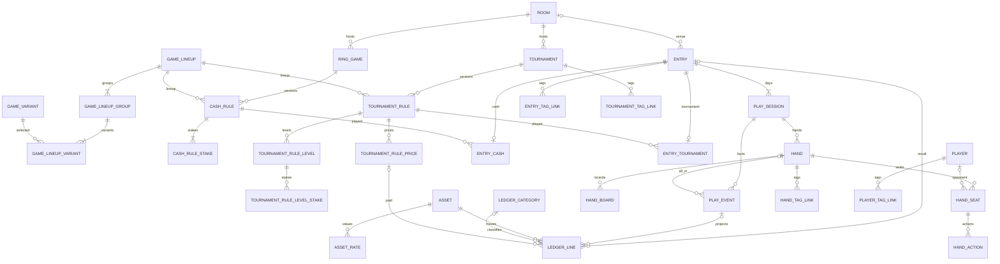
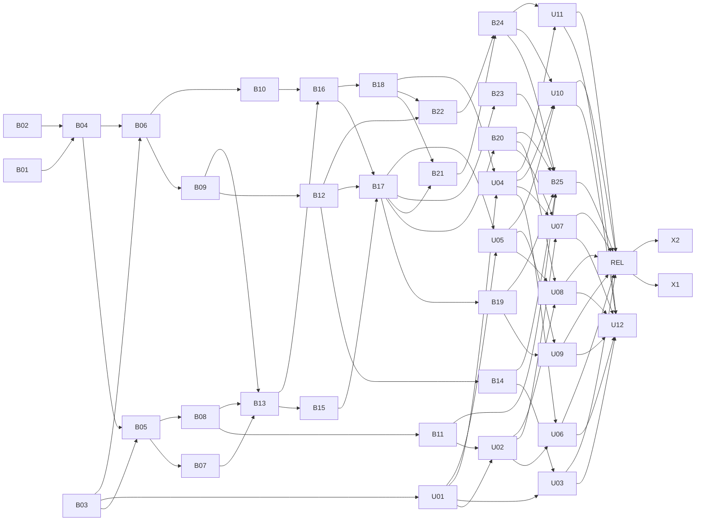

# Data Model v2

## 1. Overview

This is the final backend specification for data model v2. It separates participation and results (`entry`), time at the table (`play_session`), asset movements (`ledger_line`), immutable rules, and hand history. The end state is specified first; §16 defines the migration path. [Game lineups](game-lineups.md) owns rule-version and lineup detail. [API after data model v2](api-after-data-model-v2.md) owns procedure contracts and the MCP tool map.

Goals: multi-day participation and re-entry in one result; tickets and other non-currency assets; historical valuation; count, summary and full hand history; one source per fact; database-enforced ownership. Non-goals: imports, staking, sharing, and building the new UI.

**Release freeze (Z1):** production remains on the current release until the new UI is ready; current dev is not released before B01/B02 either (§20.1 item 9). All API tasks build the final contract directly, deleting replaced APIs in the same task. V2 and the new UI ship together once. The new UI belongs to the UI v3 project (phases U01–U12), outside this project. There is no obligation to keep the old UI, response shape, or MCP snapshot working between merges.

Assumptions: one production user; Cloudflare D1 / SQLite and Drizzle on Workers Paid (§20.1 item 10); foreign keys always enabled; no invariant triggers; at most 100 bound parameters per statement; runtime multi-statement changes use `db.batch()`. A migration file is applied statement by statement, not as a transaction. Production is at migration 0053 or earlier; 0054–0058 and all v2 tables are unreleased (§20.1 item 9). Those facts are the precondition for B01/B02, not a general license to drop populated tables.

## 2. Glossary

| Term | Meaning |
| --- | --- |
| entry | One participation, the unit of result and P/L; all re-entry bullets belong here |
| play_session | One continuous period at a table, with a local calendar date and optional times |
| play_event | A live-input fact; mutation or deletion requires atomic reprojection |
| projection | Derived play times, state, result, EV and event-sourced ledger lines |
| asset | Currency or item; quantities use its smallest integer unit |
| role / effect | Purpose of movement / whether it affects wallet balance |
| rule version | Immutable cash or tournament structure, including lineup and stakes |
| current rule | The version a master currently selects; historical entries retain their version |
| lineage | Optional parent version under the same master |
| lineup | Immutable grouping and order of variants by blind structure |
| real / virtual | Real currency lines only / all valued lines including items and virtual payments |
| settled | Every day ended and the last day ended finally, rather than bagged or held |
| Hero | The user's self player row, not a separate seat field |
| owned table | Domain table with `user_id`; references to it are composite FKs |

## 3. Final shape



The diagram omits `user_id` halves of composite references. Seat occupancy is folded from player events; there is no second mutable live-seat store. All final names below are physical names; temporary staging names are confined to migrations.

## 4. Invariants

A named audit is executable by B04 (§16.7), not a substitute for a constraint SQLite can express. Constraints do not replace API ownership checks. Aggregate cardinality, immutable write policy and contiguous sequences cannot be enforced by ordinary SQLite CHECKs without triggers, so the API and named audits cover them.

| ID | Final invariant | Guard |
| --- | --- | --- |
| INV-01 | Every domain row has `user_id NOT NULL`; every reference to an owned parent includes ownership | NOT NULL, composite FK, parent UNIQUE keys |
| INV-02 | **Retired.** The ADD COLUMN single-column-FK exception is removed | B01/B07/B08 composite FKs replace it; A-7 retired |
| INV-03 | At least one day per entry; `played_on = MIN(local_date)` | Atomic entry API; A-8 (including missing-day rows) |
| INV-04 | Days have contiguous seq starting at 1 | CHECK seq >= 1; UNIQUE(entry_id,seq); API; A-14 |
| INV-05 | At most one unfinished play_session per user | Partial UNIQUE(user_id) WHERE status <> 'ended' |
| INV-06 | Settled iff all days ended and highest seq is busted/cashed_out/finished; manual always settled | entry manual CHECK; projector/manual API; A-9 |
| INV-07 | bagged/busted tournament only; held/cashed_out cash only; bagged/held need end_stack | mirrored kind FK and play_session CHECKs |
| INV-08 | Nonzero integer ledger quantity, bound and sign by role | quantity and role CHECKs |
| INV-09 | Entry roles need an entry; wallet roles prohibit it | ledger role/column CHECKs |
| INV-10 | Virtual lines belong to entries and never affect balance or real P/L | ledger CHECK; §12 calculation |
| INV-11 | Exchange = two real lines, distinct assets, opposite signs, same transfer | API atomic pair writes; A-14 exchange grouping |
| INV-12 | Event projections are not directly editable and change atomically with the event | API batch; A-6 replay |
| INV-13 | Manual entries have no events or event-sourced lines | entry_source CHECK + FK; source_event composite FK |
| INV-14 | Live times, state, result and EV are projections only | API single write path; A-6 |
| INV-15 | Event/line's play_session belongs to its entry | three-column composite FKs |
| INV-16 | Rule versions and lineups are INSERT-only in application writes | immutable write API; A-14 structure and A-13 migration equivalence; DB cannot audit a past mutation without an independent history |
| INV-17 | Entry rule, parent rule and master references have matching ownership | composite ownership FKs plus same-master FKs (G1); API null-parent parity; A-14 |
| INV-18 | Hand numbers contiguous from 1; count is row count and button is last hand's button | CHECK/UNIQUE; atomic append/delete-renumber API; A-14 |
| INV-19 | At most one Hero seat, seats 0–9, action seat exists | CHECK, partial UNIQUE, composite hand_seat FK |
| INV-20 | Tags unique per owner/kind ignoring case and whitespace; owned links | expression UNIQUE and two composite FKs |
| INV-21 | Conversion only through the latest eligible asset_rate at line occurred_at | valuation.ts; asset_rate CHECKs (num/den bounds, effective_from ≥ 0) and UNIQUE; §19 unit contract |
| INV-22 | Referenced master cannot be deleted; versions alone do not make their own master undeletable | NO ACTION references; API archive guidance; version→master CASCADE; guarded aggregate delete |
| INV-23 | Stored JSON values are valid; no mutable relational collection is JSON | json_valid CHECK on event payload/hand stakes/filter_preset.payload; API registry; A-15 for event payloads; B22's final-filter-schema gate for presets |
| INV-24 | Rule versions referenced by linked entries and parent versions belong to the same master (G1) | ownership FK + (rule_id,master_id) FK; API NULL parity; A-14 |
| INV-25 | An inheriting level's effective lineup equals its rule lineup (G2) | mirror CHECK + composite FK |
| INV-26 | Exactly one detail of the entry kind (G3) | detail kind CHECK + FK prevents wrong kind; API creates one; A-14 detects absent detail |
| INV-27 | all_in hand belongs to the event play_session (G6) | three-column hand FK; API all_in-only link validation; A-15 |
| INV-28 | Every money line has an explicit asset; no new migration placeholders | NOT NULL + composite asset FK; API payments; A-16 |
| INV-29 | Hero is a self player, at most one per user and excluded from opponents | player partial UNIQUE; API self-row lifecycle; A-14 |

## 5. Tables 1: conventions, masters, rule versions and lineups

### 5.1 Conventions

The SQL in §5–§10 is normative final DDL, not migration execution order. Each independent CREATE is shown after expanding common columns. Authentication tables are unchanged and outside the owned-domain schema. Their `user(id)` is the only single-column ownership-root reference; **no single-column FK into an owned table is allowed**. UUID ids are generated by the application; migration ids are deterministic. Timestamps are epoch seconds. `updated_at` is maintained by application writes; immutable rows have only `created_at`. Date-only strings remain strings through the API.

Owned references use `(id,user_id)` UNIQUE parents. CASCADE is only for aggregate children; NO ACTION protects referenced masters and immutable snapshots. No RESTRICT or SET NULL is introduced. A compound SET NULL would also null user_id. All CHECKs appear in the Drizzle schema, including asset kind/decimals. Range descriptions in this specification are CHECKs; text length limits are API validation owned by the API reference, not destructive backfill gates. Integer JSON and payment schemas are shared between readers and writers.

### 5.2 Masters

Asset replaces currency in B02, before money is backfilled. Names are unique per user after `lower(trim(name))`; duplicates are renamed in `(created_at,id)` order with the first available numeric suffix, checking against all existing normalized names, not blindly adding `(2)`. Kind and decimals cannot change once referenced. Archive hides a row only from new-input choices; historical reads still resolve it. All master lists take `includeArchived`.

```sql
CREATE TABLE asset (
  id TEXT PRIMARY KEY NOT NULL,
  user_id TEXT NOT NULL REFERENCES user(id) ON DELETE CASCADE,
  created_at INTEGER NOT NULL DEFAULT (unixepoch()),
  updated_at INTEGER NOT NULL,
  name TEXT NOT NULL,
  unit TEXT,
  description TEXT,
  is_favorite INTEGER NOT NULL DEFAULT 0 CHECK (is_favorite IN (0,1)),
  kind TEXT NOT NULL DEFAULT 'currency' CHECK (kind IN ('currency','item')),
  decimals INTEGER NOT NULL DEFAULT 0 CHECK (decimals BETWEEN 0 AND 4),
  archived_at INTEGER,
  UNIQUE (id,user_id)
);
CREATE UNIQUE INDEX asset_name_uq ON asset(user_id,lower(trim(name)));
CREATE INDEX asset_user_kind_idx ON asset(user_id,kind);
```

```sql
CREATE TABLE room (
  id TEXT PRIMARY KEY NOT NULL,
  user_id TEXT NOT NULL REFERENCES user(id) ON DELETE CASCADE,
  created_at INTEGER NOT NULL DEFAULT (unixepoch()),
  updated_at INTEGER NOT NULL,
  name TEXT NOT NULL,
  memo TEXT,
  is_favorite INTEGER NOT NULL DEFAULT 0 CHECK (is_favorite IN (0,1)),
  latitude REAL,
  longitude REAL,
  archived_at INTEGER,
  CHECK ((latitude IS NULL) = (longitude IS NULL)),
  UNIQUE (id,user_id)
);
CREATE INDEX room_user_idx ON room(user_id);
```

```sql
CREATE TABLE ring_game (
  id TEXT PRIMARY KEY NOT NULL,
  user_id TEXT NOT NULL REFERENCES user(id) ON DELETE CASCADE,
  created_at INTEGER NOT NULL DEFAULT (unixepoch()),
  updated_at INTEGER NOT NULL,
  room_id TEXT,
  name TEXT NOT NULL,
  memo TEXT,
  is_favorite INTEGER NOT NULL DEFAULT 0 CHECK (is_favorite IN (0,1)),
  archived_at INTEGER,
  default_asset_id TEXT,
  current_rule_id TEXT NOT NULL,
  FOREIGN KEY (room_id,user_id) REFERENCES room(id,user_id) ON DELETE NO ACTION,
  FOREIGN KEY (default_asset_id,user_id) REFERENCES asset(id,user_id) ON DELETE NO ACTION,
  FOREIGN KEY (current_rule_id,user_id) REFERENCES cash_rule(id,user_id) ON DELETE NO ACTION,
  UNIQUE (id,user_id)
);
CREATE INDEX ring_game_room_idx ON ring_game(room_id);
CREATE INDEX ring_game_asset_idx ON ring_game(default_asset_id);
CREATE INDEX ring_game_rule_idx ON ring_game(current_rule_id);
```

```sql
CREATE TABLE tournament (
  id TEXT PRIMARY KEY NOT NULL,
  user_id TEXT NOT NULL REFERENCES user(id) ON DELETE CASCADE,
  created_at INTEGER NOT NULL DEFAULT (unixepoch()),
  updated_at INTEGER NOT NULL,
  room_id TEXT,
  name TEXT NOT NULL,
  memo TEXT,
  is_favorite INTEGER NOT NULL DEFAULT 0 CHECK (is_favorite IN (0,1)),
  archived_at INTEGER,
  default_asset_id TEXT,
  current_rule_id TEXT NOT NULL,
  FOREIGN KEY (room_id,user_id) REFERENCES room(id,user_id) ON DELETE NO ACTION,
  FOREIGN KEY (default_asset_id,user_id) REFERENCES asset(id,user_id) ON DELETE NO ACTION,
  FOREIGN KEY (current_rule_id,user_id) REFERENCES tournament_rule(id,user_id) ON DELETE NO ACTION,
  UNIQUE (id,user_id)
);
CREATE INDEX tournament_room_idx ON tournament(room_id);
CREATE INDEX tournament_asset_idx ON tournament(default_asset_id);
CREATE INDEX tournament_rule_idx ON tournament(current_rule_id);
```

The current-rule FK guards ownership; the API and A-13 master half additionally require that the chosen version belongs to that master. This permits the migration bootstrap in §16 without file-wide FK deferral. Entries and parent versions have the stronger same-master FK (G1). A master deletes its unreferenced version aggregate only after checking entry references and external version lineage. Delete children before parents where NO ACTION lineage would otherwise obstruct removal. Room deletion rejects referenced rows rather than cascading history. Legacy rule columns are absent from these rebuilt tables, not left for B25.

```sql
CREATE TABLE game_group (
  id TEXT PRIMARY KEY NOT NULL,
  user_id TEXT NOT NULL REFERENCES user(id) ON DELETE CASCADE,
  created_at INTEGER NOT NULL DEFAULT (unixepoch()),
  updated_at INTEGER NOT NULL,
  label TEXT NOT NULL,
  builtin_key TEXT,
  blind1_label TEXT,
  blind2_label TEXT,
  blind3_label TEXT,
  blind1_required INTEGER NOT NULL DEFAULT 0 CHECK (blind1_required IN (0,1)),
  blind2_required INTEGER NOT NULL DEFAULT 0 CHECK (blind2_required IN (0,1)),
  blind3_required INTEGER NOT NULL DEFAULT 0 CHECK (blind3_required IN (0,1)),
  archived_at INTEGER,
  UNIQUE (id,user_id)
);
CREATE UNIQUE INDEX game_group_label_uq ON game_group(user_id,lower(trim(label)));
CREATE UNIQUE INDEX game_group_builtin_uq ON game_group(user_id,builtin_key);
```

```sql
CREATE TABLE game_variant (
  id TEXT PRIMARY KEY NOT NULL,
  user_id TEXT NOT NULL REFERENCES user(id) ON DELETE CASCADE,
  created_at INTEGER NOT NULL DEFAULT (unixepoch()),
  updated_at INTEGER NOT NULL,
  group_id TEXT NOT NULL,
  label TEXT NOT NULL,
  short_label TEXT,
  builtin_key TEXT,
  sort_order INTEGER NOT NULL DEFAULT 0 CHECK (sort_order >= 0),
  archived_at INTEGER,
  FOREIGN KEY (group_id,user_id) REFERENCES game_group(id,user_id) ON DELETE NO ACTION,
  UNIQUE (id,user_id)
);
CREATE UNIQUE INDEX game_variant_label_uq ON game_variant(user_id,lower(trim(label)));
CREATE UNIQUE INDEX game_variant_builtin_uq ON game_variant(user_id,builtin_key);
CREATE INDEX game_variant_group_idx ON game_variant(group_id);
```

```sql
CREATE TABLE game_mix (
  id TEXT PRIMARY KEY NOT NULL,
  user_id TEXT NOT NULL REFERENCES user(id) ON DELETE CASCADE,
  created_at INTEGER NOT NULL DEFAULT (unixepoch()),
  updated_at INTEGER NOT NULL,
  label TEXT NOT NULL,
  builtin_key TEXT,
  archived_at INTEGER,
  UNIQUE (id,user_id)
);
CREATE UNIQUE INDEX game_mix_label_uq ON game_mix(user_id,lower(trim(label)));
CREATE UNIQUE INDEX game_mix_builtin_uq ON game_mix(user_id,builtin_key);
```

```sql
CREATE TABLE game_mix_variant (
  user_id TEXT NOT NULL REFERENCES user(id) ON DELETE CASCADE,
  mix_id TEXT NOT NULL,
  variant_id TEXT NOT NULL,
  position INTEGER NOT NULL CHECK (position >= 0),
  PRIMARY KEY (mix_id,variant_id),
  UNIQUE (mix_id,position),
  FOREIGN KEY (mix_id,user_id) REFERENCES game_mix(id,user_id) ON DELETE CASCADE,
  FOREIGN KEY (variant_id,user_id) REFERENCES game_variant(id,user_id) ON DELETE NO ACTION
);
CREATE INDEX game_mix_variant_variant_idx ON game_mix_variant(variant_id);
```

B05 removes normalized-label and JSON-mirror triggers and replaces same-table label uniqueness with the expression indexes above. Variant and mix namespaces are separate: id references remove the old text discriminator's need for shared labels. B05 deletes cross-table application checks/reserved labels and updates MCP descriptions to per-table uniqueness. `game_mix.games` is not final DDL; while retained as a retired NOT NULL column its sole write is `'[]'`, until B25.

```sql
CREATE TABLE player (
  id TEXT PRIMARY KEY NOT NULL,
  user_id TEXT NOT NULL REFERENCES user(id) ON DELETE CASCADE,
  created_at INTEGER NOT NULL DEFAULT (unixepoch()),
  updated_at INTEGER NOT NULL,
  name TEXT NOT NULL,
  memo TEXT,
  is_temporary INTEGER NOT NULL DEFAULT 0 CHECK (is_temporary IN (0,1)),
  is_self INTEGER NOT NULL DEFAULT 0 CHECK (is_self IN (0,1)),
  UNIQUE (id,user_id)
);
CREATE UNIQUE INDEX player_self_uq ON player(user_id) WHERE is_self=1;
CREATE INDEX player_user_idx ON player(user_id);
```

B15 creates the existing user's self row, ensures one when needed for a new user, prohibits client changes to is_self and deletion of that row, and hides it from player.list, opponent statistics and opponent pickers. tablePlayer includes Hero; its join/leave operations determine Hero's seat. There is no independent updateHeroSeat field. A hand seat for Hero refers to this player rather than a NULL-player convention.

### 5.3 Rule and lineup schema contract

[game-lineups.md](game-lineups.md) is the authoritative detailed DDL and write protocol for the following tables. They are created empty by B01, used by B07/B08/B13, and have the same ownership, integer, CHECK and immutable conventions as this section. This inventory fixes names and the constraints shared with other aggregates; it does not duplicate the detailed rule specification.

| Table | Final columns beyond common columns | Keys and guards |
| --- | --- | --- |
| game_lineup | game_mix_id nullable | owned mix FK NO ACTION; immutable |
| game_lineup_group | lineup_id, position, game_group_id, name nullable | owned lineup CASCADE, group NO ACTION; UNIQUE(lineup_id,position), UNIQUE(lineup_id,id) |
| game_lineup_variant | lineup_id, lineup_group_id, variant_id, position; user_id; no independent id | PK(group,variant), UNIQUE(group,position), UNIQUE(lineup_id,variant_id); owned group CASCADE and variant NO ACTION; (lineup_id,lineup_group_id)→group(lineup_id,id) |
| cash_rule | ring_game_id nullable, parent_rule_id nullable, lineup_id, min_buy_in/max_buy_in nullable, table_size nullable, house_rules nullable | master ownership FK CASCADE; parent ownership FK NO ACTION and (parent_rule_id,ring_game_id)→(id,ring_game_id); lineup owned NO ACTION; UNIQUE(id,ring_game_id), UNIQUE(id,lineup_id) |
| cash_rule_stake | rule_id, lineup_group_id, lineup_id, blind1/2/3, ante, ante_type | PK(rule_id,lineup_group_id); owned rule CASCADE plus (rule_id,lineup_id) FK; group/lineup FK |
| tournament_rule | tournament_id nullable, parent_rule_id nullable, lineup_id, starting_stack/table_size/bounty_amount/house_rules nullable | tournament and parent ownership + same-master parent FK; UNIQUE(id,tournament_id), UNIQUE(id,lineup_id) |
| tournament_rule_level | rule_id, ordinal, level nullable, is_break, minutes nullable, lineup_id, inherits_lineup, inherited_lineup_id nullable | owned rule CASCADE; UNIQUE(rule_id,ordinal), UNIQUE(id,lineup_id); G2 below |
| tournament_rule_level_stake | level_id, lineup_group_id, lineup_id, blind1/2/3, ante, ante_type | level ownership and level/lineup FKs; group/lineup FK; PK(level_id,lineup_group_id) |
| tournament_rule_price | rule_id, kind, label, asset_id NOT NULL, amount, fee, chips nullable, ordinal | owned rule CASCADE; owned asset NO ACTION; amount/fee/chips >=0; kind entry/reentry/addon; UNIQUE(rule_id,ordinal) |

G2 is a DB constraint, not an inheritance convention:

```sql
CHECK ((inherits_lineup=1 AND inherited_lineup_id IS NOT NULL
        AND inherited_lineup_id=lineup_id)
    OR (inherits_lineup=0 AND inherited_lineup_id IS NULL)),
FOREIGN KEY (rule_id,inherited_lineup_id)
  REFERENCES tournament_rule(id,lineup_id) ON DELETE CASCADE
```

Every rule FK also has an ownership FK, so nullable master ids cannot bypass ownership. G1 same-master FKs apply to both parent versions and entry details (§6). API validation rejects parent lineage whose NULL/non-NULL master relationship does not match. Complete stake coverage and no stakes on a break are API rules audited by A-14; duplicate lineup variants are prevented by UNIQUE(lineup_id,variant_id). All rule/price parents carry UNIQUE(id,user_id); indexes cover master id, parent_rule_id, lineup_id, rule_id/level_id, price.asset_id and every FK lookup. Entry rule-id, ledger price-id and master current-rule-id indexes are required (G7).

Prices are explicit assets, not NULL = main currency. A cash and a ticket entry option are separate `entry` prices. Tournament editing replaces the complete immutable structure, including levels and prices; row-level blindLevel and tournamentChipPurchase procedures are deleted by B08. B13 provides version creation/reuse, hydration and version-id drift services without router wiring; B16/B17 use them. B20 adds entry/live override/apply/push/relink and restoreRule operations. Restore only repoints existing versions without creating a version. [game-lineups.md](game-lineups.md) owns the detailed write protocol.

## 6. Tables 2: entry, details and play_session

```sql
CREATE TABLE entry (
  id TEXT PRIMARY KEY NOT NULL,
  user_id TEXT NOT NULL REFERENCES user(id) ON DELETE CASCADE,
  created_at INTEGER NOT NULL DEFAULT (unixepoch()),
  updated_at INTEGER NOT NULL,
  kind TEXT NOT NULL CHECK (kind IN ('cash','tournament')),
  source TEXT NOT NULL CHECK (source IN ('live','manual','import')),
  status TEXT NOT NULL CHECK (status IN ('open','settled')),
  room_id TEXT,
  asset_id TEXT,
  title TEXT,
  played_on TEXT NOT NULL CHECK (played_on GLOB '[0-9][0-9][0-9][0-9]-[0-9][0-9]-[0-9][0-9]'),
  memo TEXT,
  CHECK (source <> 'manual' OR status='settled'),
  UNIQUE (id,kind,user_id),
  UNIQUE (id,source,user_id),
  FOREIGN KEY (room_id,user_id) REFERENCES room(id,user_id) ON DELETE NO ACTION,
  FOREIGN KEY (asset_id,user_id) REFERENCES asset(id,user_id) ON DELETE NO ACTION,
  UNIQUE (id,user_id)
);
CREATE INDEX entry_page_idx ON entry(user_id,played_on,id);
CREATE INDEX entry_filter_idx ON entry(user_id,kind,status);
CREATE INDEX entry_room_idx ON entry(room_id);
CREATE INDEX entry_asset_idx ON entry(asset_id);
```

```sql
CREATE TABLE entry_cash (
  user_id TEXT NOT NULL REFERENCES user(id) ON DELETE CASCADE,
  entry_id TEXT PRIMARY KEY NOT NULL,
  kind TEXT NOT NULL CHECK (kind='cash'),
  ring_game_id TEXT,
  cash_rule_id TEXT NOT NULL,
  ev_diff INTEGER,
  FOREIGN KEY (entry_id,kind,user_id) REFERENCES entry(id,kind,user_id) ON DELETE CASCADE,
  FOREIGN KEY (ring_game_id,user_id) REFERENCES ring_game(id,user_id) ON DELETE NO ACTION,
  FOREIGN KEY (cash_rule_id,user_id) REFERENCES cash_rule(id,user_id) ON DELETE NO ACTION,
  FOREIGN KEY (cash_rule_id,ring_game_id) REFERENCES cash_rule(id,ring_game_id) ON DELETE NO ACTION
);
CREATE INDEX entry_cash_master_idx ON entry_cash(ring_game_id);
CREATE INDEX entry_cash_rule_idx ON entry_cash(cash_rule_id);
```

```sql
CREATE TABLE entry_tournament (
  user_id TEXT NOT NULL REFERENCES user(id) ON DELETE CASCADE,
  entry_id TEXT PRIMARY KEY NOT NULL,
  kind TEXT NOT NULL CHECK (kind='tournament'),
  tournament_id TEXT,
  tournament_rule_id TEXT NOT NULL,
  placement INTEGER CHECK (placement >= 1),
  total_entries INTEGER CHECK (total_entries >= 1),
  before_deadline INTEGER NOT NULL DEFAULT 0 CHECK (before_deadline IN (0,1)),
  CHECK (before_deadline=0 OR placement IS NULL),
  CHECK (placement IS NULL OR total_entries IS NULL OR placement<=total_entries),
  FOREIGN KEY (entry_id,kind,user_id) REFERENCES entry(id,kind,user_id) ON DELETE CASCADE,
  FOREIGN KEY (tournament_id,user_id) REFERENCES tournament(id,user_id) ON DELETE NO ACTION,
  FOREIGN KEY (tournament_rule_id,user_id) REFERENCES tournament_rule(id,user_id) ON DELETE NO ACTION,
  FOREIGN KEY (tournament_rule_id,tournament_id) REFERENCES tournament_rule(id,tournament_id) ON DELETE NO ACTION
);
CREATE INDEX entry_tournament_master_idx ON entry_tournament(tournament_id);
CREATE INDEX entry_tournament_rule_idx ON entry_tournament(tournament_rule_id);
```

The SQL above is the final B13 shape. B01 creates the two rule-id columns nullable as an explicitly interim schema because B06 precedes snapshot resolution. B13 backfills every rule id and rebuilds these leaf tables with NOT NULL; there are no inbound FKs to them, so no child staging is needed. Its end check proves equal row counts, no NULL and foreign_key_check. From B13 onward entry/live creates write the rule version first. NULL master means a standalone rule, not no rule; the API and A-14 require an unlinked entry's rule to be masterless. G3 kind CHECKs and three-column FKs reject the opposite detail. Exactly one matching detail is created even when the source detail was missing.

`entry.asset_id` is optional default/display metadata, not an entry's money source or a stats filter shortcut. Every payment has its own required assetId; an entry with no lines need not choose an asset. A referenced EV/BB normalization requires a defined table asset and reports exclusion if absent. No runtime API creates Unassigned or stand-in masters.

```sql
CREATE TABLE play_session (
  id TEXT PRIMARY KEY NOT NULL,
  user_id TEXT NOT NULL REFERENCES user(id) ON DELETE CASCADE,
  created_at INTEGER NOT NULL DEFAULT (unixepoch()),
  updated_at INTEGER NOT NULL,
  entry_id TEXT NOT NULL,
  kind TEXT NOT NULL CHECK (kind IN ('cash','tournament')),
  seq INTEGER NOT NULL CHECK (seq >= 1),
  label TEXT,
  local_date TEXT NOT NULL CHECK (local_date GLOB '[0-9][0-9][0-9][0-9]-[0-9][0-9]-[0-9][0-9]'),
  started_at INTEGER,
  ended_at INTEGER,
  break_minutes INTEGER NOT NULL DEFAULT 0 CHECK (break_minutes >= 0),
  status TEXT NOT NULL CHECK (status IN ('active','paused','ended')),
  end_state TEXT CHECK (end_state IN ('bagged','held','busted','cashed_out','finished')),
  end_stack INTEGER CHECK (end_stack >= 0),
  clock_started_at INTEGER,
  clock_start_level INTEGER CHECK (clock_start_level >= 1),
  UNIQUE (entry_id,seq),
  UNIQUE (id,entry_id,user_id),
  CHECK (started_at IS NULL OR ended_at IS NULL OR ended_at>=started_at),
  CHECK ((status='ended')=(end_state IS NOT NULL)),
  CHECK (end_state NOT IN ('bagged','busted') OR kind='tournament'),
  CHECK (end_state NOT IN ('held','cashed_out') OR kind='cash'),
  CHECK (end_state NOT IN ('bagged','held') OR end_stack IS NOT NULL),
  FOREIGN KEY (entry_id,kind,user_id) REFERENCES entry(id,kind,user_id) ON DELETE CASCADE,
  UNIQUE (id,user_id)
);
CREATE UNIQUE INDEX play_session_unfinished_uq ON play_session(user_id) WHERE status<>'ended';
CREATE INDEX play_session_local_idx ON play_session(user_id,local_date);
```

The API validates real calendar dates (GLOB only fixes representation), nonnegative net duration and contiguous sequences. Manual entries replace all submitted playSessions[] and payments[] in one batch; all manual days are ended. Highest-seq only deletion and undo rules are in §13. The first entry/day ids retain the legacy id during migration, but no old URL or tool contract is preserved by that identity choice.

## 7. Tables 3: asset_rate, ledger_category, ledger_line and user_setting

```sql
CREATE TABLE asset_rate (
  id TEXT PRIMARY KEY NOT NULL,
  user_id TEXT NOT NULL REFERENCES user(id) ON DELETE CASCADE,
  created_at INTEGER NOT NULL DEFAULT (unixepoch()),
  base_asset_id TEXT NOT NULL,
  quote_asset_id TEXT NOT NULL,
  rate_num INTEGER NOT NULL CHECK (rate_num BETWEEN 1 AND 1000000000000),
  rate_den INTEGER NOT NULL CHECK (rate_den BETWEEN 1 AND 1000000000000),
  effective_from INTEGER NOT NULL CHECK (effective_from >= 0),
  memo TEXT,
  CHECK (base_asset_id<>quote_asset_id),
  UNIQUE (user_id,base_asset_id,quote_asset_id,effective_from),
  FOREIGN KEY (base_asset_id,user_id) REFERENCES asset(id,user_id) ON DELETE CASCADE,
  FOREIGN KEY (quote_asset_id,user_id) REFERENCES asset(id,user_id) ON DELETE CASCADE,
  UNIQUE (id,user_id)
);
CREATE INDEX asset_rate_quote_idx ON asset_rate(quote_asset_id);
```

One smallest base unit is rate_num/rate_den smallest quote units. effective_from=0 means valid from the beginning; NULL is prohibited because UNIQUE would permit duplicates. Rates are immutable: correct by delete and recreate. Duplicate effectiveFrom for the same pair returns CONFLICT. Deleting an asset used only by rates requires explicit cleanup of those references; the API does not use CASCADE as permission to silently remove history.

```sql
CREATE TABLE ledger_category (
  id TEXT PRIMARY KEY NOT NULL,
  user_id TEXT NOT NULL REFERENCES user(id) ON DELETE CASCADE,
  created_at INTEGER NOT NULL DEFAULT (unixepoch()),
  updated_at INTEGER NOT NULL,
  name TEXT NOT NULL,
  archived_at INTEGER,
  UNIQUE (id,user_id)
);
CREATE UNIQUE INDEX ledger_category_name_uq ON ledger_category(user_id,lower(trim(name)));
```

B09 moves transaction_type with the same ids except the reserved Session Result row, which is not a category. Normalized duplicate names merge into the oldest (created_at,id) representative and all referencing lines use that representative. B09 only migrates categories; the old transactionType router keeps its own table until B14, which deletes the reserved-name machinery and DEFAULT_TRANSACTION_TYPES with that router and provides archive/restore and referenced-delete CONFLICT guidance.

```sql
CREATE TABLE ledger_line (
  id TEXT PRIMARY KEY NOT NULL,
  user_id TEXT NOT NULL REFERENCES user(id) ON DELETE CASCADE,
  created_at INTEGER NOT NULL DEFAULT (unixepoch()),
  updated_at INTEGER NOT NULL,
  asset_id TEXT NOT NULL,
  quantity INTEGER NOT NULL CHECK (quantity<>0 AND abs(quantity)<=1000000000000),
  role TEXT NOT NULL CHECK (role IN ('buy_in','reentry','fee','chip_purchase','addon','chip_remove','cash_out','prize','bounty','adjustment','exchange')),
  effect TEXT NOT NULL CHECK (effect IN ('real','virtual')),
  entry_id TEXT,
  play_session_id TEXT,
  source_event_id TEXT,
  price_id TEXT,
  category_id TEXT,
  transfer_id TEXT,
  occurred_at INTEGER NOT NULL,
  memo TEXT,
  CHECK (role NOT IN ('buy_in','reentry','fee','chip_purchase','addon') OR quantity<0),
  CHECK (role NOT IN ('cash_out','chip_remove','prize','bounty') OR quantity>0),
  CHECK ((role IN ('adjustment','exchange') AND entry_id IS NULL AND effect='real') OR (role NOT IN ('adjustment','exchange') AND entry_id IS NOT NULL)),
  CHECK (play_session_id IS NULL OR entry_id IS NOT NULL),
  CHECK (source_event_id IS NULL OR (entry_id IS NOT NULL AND play_session_id IS NOT NULL)),
  CHECK (category_id IS NULL OR role IN ('adjustment','exchange')),
  CHECK ((role='exchange')=(transfer_id IS NOT NULL)),
  CHECK (price_id IS NULL OR role IN ('buy_in','reentry','fee','chip_purchase')),
  CHECK (role NOT IN ('adjustment','exchange') OR (play_session_id IS NULL AND source_event_id IS NULL AND price_id IS NULL)),
  FOREIGN KEY (asset_id,user_id) REFERENCES asset(id,user_id) ON DELETE NO ACTION,
  FOREIGN KEY (entry_id,user_id) REFERENCES entry(id,user_id) ON DELETE CASCADE,
  FOREIGN KEY (play_session_id,entry_id,user_id) REFERENCES play_session(id,entry_id,user_id) ON DELETE CASCADE,
  FOREIGN KEY (source_event_id,entry_id,play_session_id,user_id) REFERENCES play_event(id,entry_id,play_session_id,user_id) ON DELETE CASCADE,
  FOREIGN KEY (price_id,user_id) REFERENCES tournament_rule_price(id,user_id) ON DELETE NO ACTION,
  FOREIGN KEY (category_id,user_id) REFERENCES ledger_category(id,user_id) ON DELETE NO ACTION,
  UNIQUE (id,user_id)
);
CREATE INDEX ledger_line_entry_idx ON ledger_line(user_id,entry_id);
CREATE INDEX ledger_line_asset_time_idx ON ledger_line(user_id,asset_id,occurred_at,id);
CREATE INDEX ledger_line_event_idx ON ledger_line(source_event_id);
CREATE INDEX ledger_line_play_idx ON ledger_line(play_session_id);
CREATE INDEX ledger_line_transfer_idx ON ledger_line(transfer_id);
CREATE INDEX ledger_line_price_idx ON ledger_line(price_id);
CREATE INDEX ledger_line_category_idx ON ledger_line(category_id);
```

G5 is enforced even for raw SQL writes. API additionally validates role against entry kind, price against the selected tournament rule, and payment amount/fee semantics; A-15 checks payload/price correspondence and A-14 manual lines. Wallet updates and deletes reject entry-owned lines with FORBIDDEN. createExchange takes `{ from, to }`, each with assetId and positive quantity; assets differ. One batch writes the two signed lines with one transfer_id. Updating common fields changes both; quantities keep each side's sign; deleting removes the pair. occurredAt is epoch seconds, not a date-only field.

The ledger is the sole money store after B09. Entry totals use grouped lines, not a net-result shadow transaction. Read services batch page enrichment with selectInChunks; keyset history sorts `(occurred_at,id)` and survives deletion of the cursor row. An entry's history item is dated at its first line. Every money line has an explicit asset, even if entry.asset_id is NULL.

```sql
CREATE TABLE user_setting (
  user_id TEXT NOT NULL REFERENCES user(id) ON DELETE CASCADE,
  base_asset_id TEXT,
  time_zone TEXT,
  updated_at INTEGER NOT NULL,
  PRIMARY KEY (user_id),
  FOREIGN KEY (base_asset_id,user_id) REFERENCES asset(id,user_id) ON DELETE NO ACTION
);

```

The base asset must be kind currency (API and A-14). time_zone is a validated IANA identifier; NULL means Asia/Tokyo. Changing it affects newly derived live dates; B23 corrects migrated dates by the recorded rule. It never silently reinterprets stored manual dates.

## 8. Tables 4: play_event

Events are mutable facts, not immutable summary rows. Every create/update/delete runs registry validation and recomputes projections in the same batch. v2 is the only final payload format; v1 exists solely as B15 migration input. The DDL has no schema_version default: every writer, including memo and table-player operations, explicitly sets 2. Until B15, only the projector and event registry understand v1, for B04's A-6 and B15's input. B17 lands after B15, so no API reads or writes v1.

```sql
CREATE TABLE play_event (
  id TEXT PRIMARY KEY NOT NULL,
  user_id TEXT NOT NULL REFERENCES user(id) ON DELETE CASCADE,
  created_at INTEGER NOT NULL DEFAULT (unixepoch()),
  updated_at INTEGER NOT NULL,
  entry_id TEXT NOT NULL,
  entry_source TEXT NOT NULL CHECK (entry_source='live'),
  play_session_id TEXT NOT NULL,
  type TEXT NOT NULL,
  schema_version INTEGER NOT NULL CHECK (schema_version>=1),
  occurred_at INTEGER NOT NULL,
  sort_order INTEGER NOT NULL CHECK (sort_order>=0),
  payload TEXT NOT NULL CHECK (json_valid(payload)),
  hand_id TEXT,
  UNIQUE (entry_id,sort_order),
  UNIQUE (id,entry_id,play_session_id,user_id),
  FOREIGN KEY (entry_id,entry_source,user_id) REFERENCES entry(id,source,user_id) ON DELETE CASCADE,
  FOREIGN KEY (play_session_id,entry_id,user_id) REFERENCES play_session(id,entry_id,user_id) ON DELETE CASCADE,
  FOREIGN KEY (hand_id,play_session_id,user_id) REFERENCES hand(id,play_session_id,user_id) ON DELETE NO ACTION,
  UNIQUE (id,user_id)
);
CREATE INDEX play_event_play_order_idx ON play_event(play_session_id,sort_order);
CREATE INDEX play_event_hand_idx ON play_event(hand_id);
```

The version column remains extensible; the final write/read registry accepts exactly version 2 and A-15 rejects any other stored version. type has no enum CHECK: the shared registry validates it so adding an event does not require a migration. hand_id is authoritative for an all_in link; any payload representation must agree with it. Only an unfinished play_session is a default append target; an ended day is never selected as fallback. Events fold by `(occurred_at,sort_order,id)` across the entry, with per-day state. Append sort_order is allocated inside INSERT as MAX+1, with UNIQUE as backstop.

## 9. Tables 5: hands

Every counted hand is one row. B10 migrates production's single-day counts to seq 1 before B17/B19 can create multi-day entries. hand.add and undoLast require an active play_session, not merely ownership; paused and ended both reject them. Detail editing is independent of that live counter gate.

```sql
CREATE TABLE hand (
  id TEXT PRIMARY KEY NOT NULL,
  user_id TEXT NOT NULL REFERENCES user(id) ON DELETE CASCADE,
  created_at INTEGER NOT NULL DEFAULT (unixepoch()),
  updated_at INTEGER NOT NULL,
  play_session_id TEXT NOT NULL,
  hand_no INTEGER NOT NULL CHECK (hand_no>=1),
  played_at INTEGER,
  detail TEXT NOT NULL CHECK (detail IN ('count','summary','full')),
  button_seat INTEGER CHECK (button_seat BETWEEN 0 AND 9),
  table_size INTEGER CHECK (table_size BETWEEN 2 AND 10),
  level_ordinal INTEGER CHECK (level_ordinal>=1),
  stakes TEXT CHECK (stakes IS NULL OR json_valid(stakes)),
  variant_id TEXT,
  pot INTEGER CHECK (pot>=0),
  rake INTEGER CHECK (rake>=0),
  memo TEXT,
  UNIQUE (play_session_id,hand_no),
  UNIQUE (id,play_session_id,user_id),
  FOREIGN KEY (play_session_id,user_id) REFERENCES play_session(id,user_id) ON DELETE CASCADE,
  FOREIGN KEY (variant_id,user_id) REFERENCES game_variant(id,user_id) ON DELETE NO ACTION,
  UNIQUE (id,user_id)
);
CREATE INDEX hand_user_time_idx ON hand(user_id,played_at);
CREATE INDEX hand_variant_idx ON hand(variant_id);
```

```sql
CREATE TABLE hand_board (
  user_id TEXT NOT NULL REFERENCES user(id) ON DELETE CASCADE,
  hand_id TEXT NOT NULL,
  board_no INTEGER NOT NULL CHECK (board_no BETWEEN 1 AND 4),
  cards TEXT NOT NULL CHECK (length(cards)<=14),
  PRIMARY KEY (hand_id,board_no),
  FOREIGN KEY (hand_id,user_id) REFERENCES hand(id,user_id) ON DELETE CASCADE
);

```

```sql
CREATE TABLE hand_seat (
  user_id TEXT NOT NULL REFERENCES user(id) ON DELETE CASCADE,
  hand_id TEXT NOT NULL,
  seat INTEGER NOT NULL CHECK (seat BETWEEN 0 AND 9),
  player_id TEXT,
  is_hero INTEGER NOT NULL DEFAULT 0 CHECK (is_hero IN (0,1)),
  start_stack INTEGER CHECK (start_stack>=0),
  hole_cards TEXT CHECK (hole_cards IS NULL OR length(hole_cards)<=20),
  net INTEGER,
  showed INTEGER NOT NULL DEFAULT 0 CHECK (showed IN (0,1)),
  PRIMARY KEY (hand_id,seat),
  UNIQUE (hand_id,seat,user_id),
  CHECK (showed=0 OR hole_cards IS NOT NULL),
  FOREIGN KEY (hand_id,user_id) REFERENCES hand(id,user_id) ON DELETE CASCADE,
  FOREIGN KEY (player_id,user_id) REFERENCES player(id,user_id) ON DELETE NO ACTION
);
CREATE UNIQUE INDEX hand_seat_hero_uq ON hand_seat(hand_id) WHERE is_hero=1;
CREATE INDEX hand_seat_player_idx ON hand_seat(player_id);
```

```sql
CREATE TABLE hand_action (
  user_id TEXT NOT NULL REFERENCES user(id) ON DELETE CASCADE,
  hand_id TEXT NOT NULL,
  seq INTEGER NOT NULL CHECK (seq>=1),
  street INTEGER NOT NULL CHECK (street BETWEEN 0 AND 7),
  seat INTEGER NOT NULL,
  action TEXT NOT NULL CHECK (action IN ('post','straddle','bring_in','fold','check','call','bet','raise','draw','show','muck')),
  amount INTEGER CHECK (amount>=0),
  all_in INTEGER NOT NULL DEFAULT 0 CHECK (all_in IN (0,1)),
  PRIMARY KEY (hand_id,seq),
  FOREIGN KEY (hand_id,user_id) REFERENCES hand(id,user_id) ON DELETE CASCADE,
  FOREIGN KEY (hand_id,seat,user_id) REFERENCES hand_seat(hand_id,seat,user_id) ON DELETE CASCADE
);

```

Count holds hand number/time/button/stakes/variant; summary adds Hero's seat, boards, pot/rake/memo but no actions; full adds all seats and actions. No statistic reads summary net values. Hands/hour and hand count use all detail levels; VPIP/PFR use only full hands. Stakes keys are blind1/blind2/blind3/ante/anteType, with meanings from the game group. Hero net is hand_seat.net, never a second column on hand.

Cards are `[2-9TJQKA][shdc]` separated by spaces. API validates at most 5 per board and 7 per seat, no duplicate within a board or seat; up to 4 full boards represent double-board/run-it-twice. Shared cards can repeat across runs. A full hand show action requires showed=1. Maximum 200 actions. Saving replaces hand, boards, seats and actions in one batch; lowering detail removes incompatible children and lowering to count clears pot/rake/memo.

Append hand_no is MAX+1 inside INSERT. Undo deletes only the highest count hand, so it never destroys entered details. Deleting a linked hand returns CONFLICT until the all_in link is removed; deleting an entire entry/play_session removes both aggregates. Arbitrary hand delete renumbers later hands atomically without transient UNIQUE collisions. Chunk widths derive from actual row shape; hand_seat has 9 columns and hand_action 8, so inserts fit 11 and 12 rows respectively under D1's 100-parameter limit. Hand list uses a string keyset cursor containing its hand-number boundary; it is not a lookup of a possibly deleted row.

## 10. Tables 6: tags and presets

`defineTagTables()` expands the following exact per-kind schema; `createTagRouter()` provides the same list/create/update/delete/reorder contract. Every tag has id/user_id/created_at/updated_at from §5, `name TEXT NOT NULL`, `sort_order INTEGER NOT NULL DEFAULT 0`, UNIQUE(id,user_id), and UNIQUE(user_id,lower(trim(name))). No polymorphic target FK is used.

```sql
CREATE TABLE entry_tag (
  id TEXT PRIMARY KEY NOT NULL,
  user_id TEXT NOT NULL REFERENCES user(id) ON DELETE CASCADE,
  created_at INTEGER NOT NULL DEFAULT (unixepoch()),
  updated_at INTEGER NOT NULL,
  name TEXT NOT NULL,
  sort_order INTEGER NOT NULL DEFAULT 0,
  UNIQUE (id,user_id)
);
CREATE UNIQUE INDEX entry_tag_name_uq ON entry_tag(user_id,lower(trim(name)));
```

```sql
CREATE TABLE entry_tag_link (
  user_id TEXT NOT NULL REFERENCES user(id) ON DELETE CASCADE,
  entry_id TEXT NOT NULL,
  tag_id TEXT NOT NULL,
  PRIMARY KEY (entry_id,tag_id),
  FOREIGN KEY (entry_id,user_id) REFERENCES entry(id,user_id) ON DELETE CASCADE,
  FOREIGN KEY (tag_id,user_id) REFERENCES entry_tag(id,user_id) ON DELETE CASCADE
);
CREATE INDEX entry_tag_link_tag_idx ON entry_tag_link(tag_id);
```

```sql
CREATE TABLE tournament_tag (
  id TEXT PRIMARY KEY NOT NULL,
  user_id TEXT NOT NULL REFERENCES user(id) ON DELETE CASCADE,
  created_at INTEGER NOT NULL DEFAULT (unixepoch()),
  updated_at INTEGER NOT NULL,
  name TEXT NOT NULL,
  sort_order INTEGER NOT NULL DEFAULT 0,
  UNIQUE (id,user_id)
);
CREATE UNIQUE INDEX tournament_tag_name_uq ON tournament_tag(user_id,lower(trim(name)));
```

```sql
CREATE TABLE tournament_tag_link (
  user_id TEXT NOT NULL REFERENCES user(id) ON DELETE CASCADE,
  tournament_id TEXT NOT NULL,
  tag_id TEXT NOT NULL,
  PRIMARY KEY (tournament_id,tag_id),
  FOREIGN KEY (tournament_id,user_id) REFERENCES tournament(id,user_id) ON DELETE CASCADE,
  FOREIGN KEY (tag_id,user_id) REFERENCES tournament_tag(id,user_id) ON DELETE CASCADE
);
CREATE INDEX tournament_tag_link_tag_idx ON tournament_tag_link(tag_id);
```

```sql
CREATE TABLE hand_tag (
  id TEXT PRIMARY KEY NOT NULL,
  user_id TEXT NOT NULL REFERENCES user(id) ON DELETE CASCADE,
  created_at INTEGER NOT NULL DEFAULT (unixepoch()),
  updated_at INTEGER NOT NULL,
  name TEXT NOT NULL,
  sort_order INTEGER NOT NULL DEFAULT 0,
  UNIQUE (id,user_id)
);
CREATE UNIQUE INDEX hand_tag_name_uq ON hand_tag(user_id,lower(trim(name)));
```

```sql
CREATE TABLE hand_tag_link (
  user_id TEXT NOT NULL REFERENCES user(id) ON DELETE CASCADE,
  hand_id TEXT NOT NULL,
  tag_id TEXT NOT NULL,
  reviewed_at INTEGER,
  PRIMARY KEY (hand_id,tag_id),
  FOREIGN KEY (hand_id,user_id) REFERENCES hand(id,user_id) ON DELETE CASCADE,
  FOREIGN KEY (tag_id,user_id) REFERENCES hand_tag(id,user_id) ON DELETE CASCADE
);
CREATE INDEX hand_tag_link_tag_idx ON hand_tag_link(tag_id);
```

```sql
CREATE TABLE player_tag (
  id TEXT PRIMARY KEY NOT NULL,
  user_id TEXT NOT NULL REFERENCES user(id) ON DELETE CASCADE,
  created_at INTEGER NOT NULL DEFAULT (unixepoch()),
  updated_at INTEGER NOT NULL,
  name TEXT NOT NULL,
  sort_order INTEGER NOT NULL DEFAULT 0,
  color TEXT NOT NULL DEFAULT 'gray',
  UNIQUE (id,user_id)
);
CREATE UNIQUE INDEX player_tag_name_uq ON player_tag(user_id,lower(trim(name)));
```

```sql
CREATE TABLE player_tag_link (
  user_id TEXT NOT NULL REFERENCES user(id) ON DELETE CASCADE,
  player_id TEXT NOT NULL,
  tag_id TEXT NOT NULL,
  position INTEGER NOT NULL DEFAULT 0,
  PRIMARY KEY (player_id,tag_id),
  FOREIGN KEY (player_id,user_id) REFERENCES player(id,user_id) ON DELETE CASCADE,
  FOREIGN KEY (tag_id,user_id) REFERENCES player_tag(id,user_id) ON DELETE CASCADE
);
CREATE INDEX player_tag_link_tag_idx ON player_tag_link(tag_id);
```

B18 retains source ids except deterministic normalized-name merges: oldest (created_at,id) is representative, links are remapped and deduplicated. Tournament tags use `tt:<user_id>:<hash(normalized-name)>`, keeping the oldest spelling. player_tag_link replaces player_to_player_tag, preserving color and position. If the old tournament_tag name still exists, create tournament_tag_def, migrate links and drop the old table before renaming; B25 guarantees no temporary name remains. A-12 compares the mapped expected link set per target, not the raw number of duplicate source rows.

Owners accept tagIds, never tag names. All four tag kinds expose MCP list/create. Classification derivable from rules (bounty, turbo) is not stored as a tag. B22 retains filter_preset's columns while rebuilding it with the JSON guard below, and migrates JSON keys and values from currency/type/session-tag names to final stats asset/kind/tag mode fields, validating the same stats filter schema on save and load. A legacy payload is transformed, not silently read through indefinite defaults. The final payload is a saved query, not a mutable relationship store.

B22 rebuilds the leaf `filter_preset` table while migrating its payloads, preserving every row and adding `CHECK (json_valid(payload))` in Drizzle and SQL. Its only FK is to user, with no inbound children to stage. End checks prove equal row counts and `foreign_key_check`; payloads also validate against the final filter schema.

## 11. Enumerated values

Enums live as `as const` arrays in packages/db/src/constants; CHECKs and Zod share those arrays. Event payload schemas share one registry between write validation, replay and B15 conversion.

| Field | Values |
| --- | --- |
| entry.kind / source / status | cash,tournament / live,manual,import / open,settled |
| play_session.status | active,paused,ended |
| end_state | bagged (tournament, open), held (cash, open), busted (tournament, final), cashed_out (cash, final), finished (either, final) |
| asset.kind / ledger.effect | currency,item / real,virtual |
| hand.detail | count,summary,full |
| tournament_rule_price.kind | entry,reentry,addon |
| hand_action.action | post,straddle,bring_in,fold,check,call,bet,raise,draw,show,muck |

| Ledger role | Sign | Entry kind / purpose |
| --- | --- | --- |
| buy_in | negative | both; initial payment |
| reentry | negative | tournament; later bullet |
| fee | negative | tournament; fee paired with initial/re-entry payment |
| chip_purchase | negative | tournament; price option kind addon |
| addon | negative | cash; extra chips |
| chip_remove | positive | cash; chips removed during play |
| cash_out | positive | cash; final receipt |
| prize / bounty | positive | tournament; distinct receipt roles |
| adjustment / exchange | either | wallet only; not an entry result |

A Payment is `{ assetId, quantity, role, effect, priceId? }`: quantity is positive integer 1…10^12, effect defaults real, and the projector derives sign. Empty payments express zero without inserting a forbidden zero line. Manual create/update uses the same payment schema with role subsets by kind. Prices use `amount` (not cost); addon price produces chip_purchase ledger role, which is distinct from cash addon role.

| Event type | v2 payload and allowed effects |
| --- | --- |
| session_start | payments[] (buy_in, plus tournament fee), timerStartedAt?, startLevel? |
| session_end | cash payments[] (cash_out); tournament payments[] (prize/bounty), beforeDeadline, placement?, totalEntries? |
| day_end | endState bagged/held, stackAmount |
| reentry | tournament payments[] (reentry/fee) |
| purchase_chips | priceId and payments[] (chip_purchase); immutable price supplies label/chips; API reference §5 owns the exact object |
| chips_add_remove | signed amount; positive adds chips (negative addon ledger), negative removes (positive chip_remove) |
| all_in | potSize, trials, equity, wins; handId? must equal the canonical hand_id link |
| update_stack | stackAmount, remainingPlayers?, totalEntries?, chipPurchaseCounts?; exact nullable fields and progress-only counts in API reference §5 |
| session_pause / session_resume | empty payload |
| table_change | tableLabel?, seatPosition? |
| player_join / player_leave | player id and seat transition; Hero uses the self player id |
| memo | text |

No prizeMoney/bountyPrizes or scalar buyInAmount is a v2 money field. They are only B15 source fields. Re-entry payments created by startNextPlay belong to the new day's session_start, which permits reentry/fee roles in this continuation context. Entry-level placement is final-result state, not an in-play remaining-player counter.

## 12. Calculation

### 12.1 Population, modes and money

`packages/api/src/services/valuation.ts` is the sole conversion/P&L implementation. Ledger reads return integer line groups; clients consume API values, not another monetary formula. Statistics (summary, breakdown and series) count **settled entries only** (C1). The historical B06 population including open entries ends at B22. Lists may show open entries and their paid amounts, but those are not realized result statistics.

Let L(e) be all lines of e, R(e) its real currency lines, and v(l) its value in the selected base asset. Real P/L = ΣR v(l); virtual P/L = ΣL v(l). BI = negative of the sum over negative lines in the respective set; CO = sum over positive lines. Aggregate ROI = ΣP/L / ΣBI × 100, not the mean of entry ROIs. ROI covers **tournament entries only**; cash uses cash win rate and bb/100. A zero denominator yields null, never infinity or zero masquerading as a valid rate.

The API exposes exactly one of three stats modes:

1. `assetId`: unconverted quantities of that asset. Match entries by their ledger lines, not entry.asset_id. Count an entry that has selected-asset lines even if other assets also occur; sum only the chosen lines and report multiAssetEntryCount and otherAssetIds (U3). Never zero an entry merely because it has another asset.
2. `valuation` real/virtual with `baseAssetId`: convert as below; absent baseAssetId uses userSetting.baseAssetId, and absent both is PRECONDITION_FAILED. Base must be a currency. Report excludedEntryCount and missingRates separately for the requested valuation.
3. `normalized: true`: separate cash(BB) and tournament(BI) branches, never an unlabelled sum of raw currencies. Missing unit denominator is excluded and reported as unavailableNormalizationEntryCount. This mode cannot be combined with assetId or valuation/baseAssetId.

API output has `lines[]`, per-asset/effect `totals[]` (roleTotals, buyIn, cashOut, profitLoss), and `valuation { baseAssetId, real, virtual, missingRates }`. Those names and complete shapes are owned by the API reference. Item quantities are not real currency P/L; virtual valuation includes them. Monetary groups must retain asset/effect identity.

| Entry | Lines (base pt, 1 ticket=20,000pt) | Real PL / BI | Virtual PL / BI |
| --- | --- | --- | --- |
| Satellite | −3,000 pt buy_in; +1 ticket prize | −3,000 / 3,000 | 17,000 / 3,000 |
| Main | −1 ticket buy_in; +45,000 pt prize | 45,000 / 0 | 25,000 / 20,000 |
| Freeroll | −5,000 pt virtual buy_in; +8,000 pt prize | 8,000 / 0 | 3,000 / 5,000 |
| Total | all tournament entries | 50,000 / 3,000 (ROI 1,667%) | 45,000 / 28,000 (ROI 161%) |

### 12.2 Conversion and rounding

Choose the latest effective_from <= line.occurred_at for each pair. Try direct a→B, then inverse B→a. Only for an item, allow a→c→B for a currency c (second hop can be inverse). Candidate intermediates sort by newest first-hop effective_from then currency id; use the first convertible path. No arbitrary multi-hop graph search. A line earlier than the first rate is unconvertible; effective_from=0 handles fixed historical rates.

An unconvertible entry is excluded from that valuation, with excludedEntryCount and missingRates; never silently substitute zero. Real and virtual exclusion are independent: an item with no rate does not invalidate real currency totals. missingRates deduplicates asset ids and includes the oldest unconvertible occurred_at. Group quantity by entry, asset and rate path; sum and round only once per group with BigInt rational arithmetic, half away from zero. P/L, BI and CO each round their own groups, so rounded PL can differ from rounded CO−BI. Updating a historical rate intentionally changes past valuation; quantities never change.

### 12.3 Time, units, hands and EV

`hours(e) = Σp (ended_at − started_at − 60*break_minutes)/3600`, evaluated **per play_session**, including every day with both endpoints. Do not use the first day's endpoints with all days' breaks (C6). Time between held/bagged days is outside play. Hourly PL uses only entries with usable time; hands/hour uses only play_sessions with at least one hand and usable time. Negative durations are invalid input, not values clamped into a statistic.

Cash BB = blind2 only when the rule's cash lineup has exactly one group and the blind is positive. Normalize real P/L in the table's asset, not a converted base currency. bb/100 = `100 * Σ(PL/BB) / Σhands`, over cash entries with known BB and hands. Hands count rows of every detail level. Missing table asset or BB is reported, not guessed.

Tournament **1 BI = first buy_in + its fee**, excluding re-entries, their fees and chip purchases (C7). Where initial payments span assets, valuation to the declared base must succeed before deriving a scalar BI; otherwise normalized output excludes/reports the entry. ROI's invested-money denominator still includes all applicable negative lines; 1 BI normalization is a distinct unit definition.

EV PL = real PL + ev_diff when EV exists; NULL means unrecorded. ev_diff is Math.round of the sum `potSize*equity/100 − potSize/trials*wins` across all all_in events, not separately rounded events. After B12 it is projected while open too; no all_in/EV record leaves NULL. B06's settled-only legacy bridge is removed by B12, whose migration projects ev_diff for open live cash entries with this formula from their all_in events, so A-6 replay agrees. EV uses the table asset and cannot be added to an unrelated currency total.

Breaks: sum finished pause/resume spans per day and floor total seconds/60. A pause open at day end closes at ended_at. An unfinished pause does not depend on wall clock; replay stays pure.

All date filters are inclusive `'YYYY-MM-DD'` comparisons on entry.played_on (C5). Weekday/month/year axes derive from that same string, not UTC event timestamps. local_date is supplied for manual days or derived server-side at live start using userSetting.timeZone, NULL→Asia/Tokyo. B06's historical migration alone assumes JST. Persisted filter presets migrate keys and values in B22, including mode, final ids and tag arrays.

### 12.4 Balance

For every asset, balance = Σquantity where effect='real', including entry and wallet lines, including open entries, and including items. asset.list returns zero for an asset without lines. There is no separate holding formula or currency-only balance. A buy-in reduces balance immediately, even before settlement; virtual lines never change it. This intentional change is separate from settled-only statistics. A-11 compares legacy balances only over settled entry lines plus wallet lines and reports historical drift rather than overwriting the ledger to match it.

## 13. Event-to-projection rules

### 13.1 Atomic algorithm

Load the owned entry, its days/events/rule/prices; apply the proposed event mutation in memory; call pure `projectEntry(events,context)`; write the event change, delete/reinsert projected ledger lines, update days, entry detail and entry in one `db.batch()`. Batch construction fails before any write if ownership, asset or payload validation fails. Insert chunks and IN selects use the shared 100-parameter helpers. Replacing lines deletes only source_event_id IS NOT NULL; manual lines never pass through the live projector.

Append order is allocated inside INSERT, not from a previously loaded MAX. Concurrent writes must not lose an event; unique order is DB-backed. A projection computed from a stale read may drift: the next write rebuilds the complete entry, and A-6 detects it at every dev deploy/release. This is the recorded concurrency limitation (R4), not a claim of serializable reads.

### 13.2 Fold and state machine

| Event | Projected state | Projected money/result |
| --- | --- | --- |
| session_start | first start; active; clock fields | payments; entry open |
| pause/resume | paused/active; per-day break recomputed | none |
| day_end | ended, bagged/held, end_stack required | entry stays open |
| session_end cash | ended, cashed_out; end_stack=sum cash_out payments | settled; receipt payments |
| session_end tournament | ended, finished if placement=1 else busted | highest-day final placement/total/before_deadline; receipts; settled |
| reentry | no implicit reopening of an ended day | reentry/fee lines on an active day; next-day payments instead belong to session_start |
| purchase_chips | no time state change | payment lines with price_id |
| chips_add_remove | no time state change | addon/chip_remove with derived sign |
| all_in | no time state change | recompute entry_cash.ev_diff |
| update_stack | live stack remains event fact | latest in-play totalEntries while no final result |
| player_join/leave | fold seat occupancy | Hero uses self player id |
| table_change/memo | no result change | none |

State validation reads **play_session.status**, including day_end, not just presence of session_end (F5). Append to ended days fails PRECONDITION_FAILED. Omitted target selects only an unfinished day; it never silently falls back to an ended highest day. A pause requires active, resume requires paused, and day_end/session_end requires active or paused. Edit/delete revalidates the resulting entire sequence, so a historical edit cannot make an impossible transition. day_end is written through endPlay; re-entry payments through startNextPlay in session_start, not arbitrary event insertion on an ended day.

B17 rejects a newly written event time later than server now + 60 seconds with BAD_REQUEST in playEvent.create/update and live.create/complete/endPlay/startNextPlay. This checks only the time being written, never revalidates existing rows against today's clock, and exempts non-event payload clocks such as timerStartedAt. A terminal session_end/day_end must sort last in its play_session: complete/endPlay rejects occurredAt earlier than any existing event of that day with BAD_REQUEST before writing.

Tournament live.create accepts optional nonnegative initialStack and writes its first update_stack in the same batch as entry, detail, day, session_start and payments (B17). This provides the chart's opening stack point.

B17 computes tournament progress server-side from the ordered event fold: currentStack, remainingPlayers, totalEntries, purchased-chip total (chipTotal), and averageStack. `averageStack = Math.round((startingStack * totalEntries + chipTotal) / remainingPlayers)`; unavailable inputs or nonpositive remainingPlayers yield NULL. chipTotal includes purchase_chips and the cumulative chipPurchaseCounts reported by update_stack; a reported cumulative snapshot replaces the prior count basis rather than double-counting those purchases, with subsequent purchases accumulated thereafter. Explicit NULL remainingPlayers/totalEntries clears the value; omission preserves it. Progress-only counts never create money lines. A-6 replays these values. The new UI's charts consume the API values, not another formula.

Events fold by `(occurred_at,sort_order,id)`. Each day takes its own first start and closing end; entry-wide totals fold all days. Final tournament result comes only from the highest-seq day's closing session_end. Without one, placement=NULL, before_deadline=0, total_entries=latest in-play total; a before-deadline final end has placement and total_entries NULL and before_deadline=1. All other before_deadline values are 0. Only a closing session_end produces receipts. Line ids are `<event_id>:<n>` in payment order, with event timestamp/day and explicit asset.

### 13.3 Multi-day, undo and manual editing

endPlay closes bagged/held only and releases the user's unfinished-day slot. startNextPlay creates the next contiguous day and its start event; optional re-entry payments are embedded in that new day's session_start in the **same batch** (U5). A busted tournament can re-enter; finished cannot start another day. A cash continuation after a mistaken final cash-out uses explicit undo/correction rather than double-counting a receipt. Held cash resumes as a new day with the prior stack context; keeping money at a venue can instead be represented by a venue-held asset and wallet exchange.

undoEndPlay deletes the last end event and reprojects the last day; it does not create a reopen API. undoStartNextPlay discards only the highest-seq day while it holds only its start event and no hands or other dependents. Because startNextPlay embeds re-entry payments in the start event, its undo removes those payments through reprojection atomically with that otherwise-empty day. Both undo paths check that no other unfinished day conflicts with the partial UNIQUE. User-entered details are never silently removed.

Manual entry create/update takes complete playSessions[] with per-day payments[] (top-level payments only for one day, never both), validates all referenced ids and the ended states, replaces them in a batch, and writes no event. Manual line ids are `m:<entry_id>:<role>:<n>` with per-role n. occurred_at is the relevant day's started_at or noon UTC of its local_date; this is a deterministic valuation fallback, not a date-filter axis. Editing a live-linked entry rewrites validated events and reprojects, never patches projection rows directly.

hand.add/undoLast only while active; tablePlayer and all_in links obey the same owned-day state validation. Hand detail saves replace seats/actions in full and do not write an independent live handCount/dealerSeat.

## 14. API and MCP

This section defines policy only; the sole procedure contracts and tool map are [api-after-data-model-v2.md](api-after-data-model-v2.md). There is no duplicate router map here.

P1/P2: each API task directly builds the final names and shapes, deletes its replaced path and updates MCP in the same PR. D1 names the participation API `entry`, D3 gives one `live` router, with `playEvent` and `tablePlayer` for their own concerns. Money uses assetId, rule/game references use ids, kind is cash/tournament, dates are playedOn/localDate strings, state is open/settled plus per-day status. No session alias, flat legacy-money fallback, stringified event payload, compatibility view or strict removed-input rejection is carried forward. B06 deletes the old session API, including unused session.profitLossSeries; B16 deletes privateData.

Every input id, including nested payments/rules/tags, reorder ids and cursor boundaries, is ownership checked; bulk WHERE and joined reads bind owner and parent. Missing and foreign-owned ids both return uniform FORBIDDEN. Invalid input is BAD_REQUEST; invalid state is PRECONDITION_FAILED; duplicate rates/labels and referenced master deletion are CONFLICT with archive guidance where available. DB constraints are the backstop, not an authorization oracle. Input timestamps are epoch seconds; JSON output timestamps are ISO strings through the existing transformer/serialization contract; date-only strings are never timestamp-normalized.

MCP is an untrimmed projection through appRouter.createCaller, using the identical router Zod objects and mapToolError, never direct DB access or a second schema. Every procedure is in TOOL_DEFINITIONS or DELIBERATELY_EXCLUDED with a current reason. Delete and cockpit/hand-write operations remain excluded; master archive/restore follows the established reversible-write policy; all four tag kinds expose list/create. Every API task updates docs/mcp.md and docs/mcp.ja.md and the coupling test in the same PR. Coupling enforces the **new** contract, not preservation of a legacy snapshot. Release notes map renamed tools once; no aliases remain.

## 15. The old UI, the freeze and the new UI

B03 deletes the old API-dependent UI once, before API-breaking tasks. It removes feature routes/screens/hooks and tests that call a v2-affected procedure or import its types, including the released Cryst cockpit. It keeps authentication and account flows (login, sign-up, passkeys, OAuth consent/continuation, linked accounts, set-password), authenticated shell with placeholder home, PWA/persisted-cache infrastructure, theme tokens including Cryst scope, production-used API-free shared primitives such as PageHeader and shadcn components, tRPC/QueryClient setup, and unaffected update notes. B03 points every kept navigation that targeted a deleted screen at the placeholder home `/`: the signed-in redirects of `/` and `/login`, post-sign-in, post-sign-up and preview auto-login n…

**SA2-427 (user decision, superseding B03's primitive-retention policy):** delete unused UI parts regardless of whether they are shadcn-standard or custom. Production-used parts stay until U12 (SA2-421). This includes deletion of the unused Cryst components and their otherwise-unused dependencies; the v2 UI phases re-add components from the design system when needed. The Cryst theme tokens and `.cryst` scope remain until U12; U01 owns the root Toaster's Cryst scope.

B03 records every deleted test's protected contract and the last old-UI SHA on U01; it updates AGENTS.md and rule reference implementations (web-architecture, web-ui, web-hooks-separation, web-forms, web-data-fetching, web-theme), keeping check:rules meaningful. It does not create a hidden replacement screen project.

All screen requirements, persisted-cache buster/reload behavior, client formula removal, new asset/statistics/entry/multi-day/hand/tag screens, lineup screens and self-player UI move to the UI v3 phases U01–U12, outside this project. Production does not deploy intermediate v2 API states. The new UI defines its own route structure and display names from the supplied `.dc.html`; v3.5.2 paths are not preserved and no redirect layer is added. Two paths stay fixed: `/login`, the MCP OAuth login page configured in `apps/server/src/auth-options.ts`, and `/`, the PWA `start_url`. Retired v3.5.2 paths render the router's default not-found fallback. Hotfixes during the freeze branch release/vX.Y.Z from origin/main and merge main back into dev. Current dev is not released before B01/B02 (§20.1 item 9); the next normal release is v2 plus the new UI.

## 16. Migration procedure

### 16.1 Order and one-home cutovers

The order is a dependency DAG (§18), not a requirement to serialize independent tasks. Its backbone is B01/B02 → B04 → B06 (also after B03) → B09/B10; B03 + B04 (after B01/B02) → B05 → B07/B08; B07/B08 + B09 → B13 → B15/B16 → B17 → B19/B20/B21/B23; B16 → B18 → B22 → B24; everything → B25 → REL. B04 lands before every data cutover and every populated rebuild except B02, so each of those is audited on the dev deploy that ships it; B02 runs before the runner exists and relies on its in-migration gates (counts, restored links, uniqueness, foreign_key_check). B01 and B02 are independent; whichever merges second rebases its schema/migration snapshot. PR #704 is closed: B06 ports only its migration and migration test from head 3d6f3dfa onto B01/B02, renumbers 0059 and writes before_deadline as 0/1. It does not port the router changes, legacy-output tests or old spec edits.

| Task | What it leaves authoritative | End-of-migration gate |
| --- | --- | --- |
| B01 | Final empty v2 schema, lineups and versions, with interim nullable detail rule ids | emptiness precondition, shape/constraint inventory, foreign_key_check |
| B02 | asset under its final name, constraints in Drizzle | source/target counts, restored links/children, name uniqueness, foreign_key_check |
| B06 | Port #704's migration/test; migrate entry, kind details, days and events; delete old entry/live APIs and MCP registrations | A-3, A-4 and foreign_key_check |
| B09 | Migrate ledger lines and categories; no API wiring | A-5; A-11 reported, not a failure gate |
| B10 | hand rows replace hand_count/dealer_seat | A-10 |
| B05 | game_variant composite ownership, expression label indexes | child counts/links, normalized uniqueness, foreign_key_check |
| B07 | ring_game with current_rule_id NOT NULL; immutable cash rules | no NULL current ids, A-13 master half, stake coverage, counts/FK |
| B08 | tournament current rule, whole levels/prices | no NULL current ids, A-13 master half, stake/price coverage, counts/FK |
| B11 | game_group required flags; built-in Big Bet without Straddle | abort if any Big Bet stake has blind3; built-in flag values |
| B12 | ev_diff projected for open live cash entries | A-6 open-entry EV comparison enabled in B04's runner |
| B13 | Entry versions, ledger price ids and final NOT NULL leaf details; rule creation/read services, not router wiring | no NULL ids, counts, A-13 entry half, coverage, foreign_key_check, no Big Bet stake with blind3 in any cash/tournament version, master or entry (B11's condition, repeated because B11 may precede B07/B13) |
| B18 | four tag definitions/links by id | A-12 mapped link sets and FK |
| B15 | Every payload v2; remove v1 from projector and registry before B17 | SQL version/count gates; A-6 replay and A-15 run by B04 after migration |
| B23 | rule-based stand-in cleanup, no seed exception | A-16, FK/lineup duplicate check, A-6 after migration |
| B22 | filter_preset rebuilt with json_valid CHECK and final stats-filter payloads | equal row counts, foreign_key_check, every payload parses with the final filter schema |
| B25 | All remaining retired schema/code removed, including todo | final table/column inventory, row preservation, FK, all final audits |

Runtime code reads and writes only its final tables. Retired tables are migration sources, not an intermediate backend for final APIs. Old routers whose replacements have not landed (including stats, currency, currencyTransaction, transactionType, sessionTag, ringGame and tournament) continue using their own old tables until their replacement PR. Rows those old routers write in dev after migration are not carried forward: every dev deploy rebuilds the database from production (`dev-deploy.yml:107`). Rebuilt tables omit retired columns; B13 rebuilds only leaf detail tables, and B25 removes all remaining retired tables/columns and code.

After B06, no code writes old entry child tables, so no compatibility parent row is created. B06 deletes the old entry/live routers and their MCP tools together. Dev has no entry/live API until B16/B17 add the final APIs; production remains on v3.5.2 until the joint release.

### 16.2 Empty-schema precondition and asset rebuild

B01 first asserts that all v2 target tables are empty. Migrations 0054–0058 are unreleased and services are not router-wired before B06, so every fresh production replay reaches it empty. A local test database with invented target rows is reset, not silently copied or discarded in production. B01 drops/recreates empty targets with every composite key, G1–G7 guard and index. A target whose existing DDL already equals its final shape is not recreated: user_setting and hand_board are unchanged, and play_session, entry, hand, hand_seat and ledger_category gain only their new UNIQUE indexes; the shape inventory in `schema-migrations.test.ts` and `db:generate` reporting no change prove the result is the final DDL either way. Referenced asset is currency or asset according to whether B02 already merged; rebase to one final snapshot, do not create a second asset table.

F3 is resolved by **B02 before B06**, not a file-wide rebuild trick. Enumerate and stage only legacy inbound children: currency_transaction rows and currency_id links on game_session, ring_game, tournament, plus anything the actual merge-time Drizzle schema adds. V2 entry/ledger/rate/price/setting children are still empty. Clear nullable legacy links and remove staged leaf children before DROP. Rebuild under `currency` with final kind/decimals CHECKs and name uniqueness; restore staged rows and links; then RENAME TO asset so SQLite rewrites child FK targets. Rename the Drizzle export/imports mechanically. Do not depend on disabling FK checks or a PRAGMA surviving across migration statements. Verify counts, exact restored ids/links and foreign_key_check, including duplicate-name suffix collisions.

### 16.3 Populated rebuild staging

D1 keeps FKs enabled and DROP TABLE fires inbound CASCADE/SET NULL. For **each** rebuild, enumerate inbound references from the actual Drizzle schema and classify CASCADE rows, SET NULL links and NO ACTION blockers, including transitive children. Stage rows/links in ordinary migration stage tables; detach or remove blockers before DROP; restore parents before dependents, and prove counts and links afterward. A stage is not a compatibility data store and is dropped after its gate. No migration file transaction, deferred-FK group, trigger or disabled-FK assumption is permitted.

B05 stages game_mix_variant and any hand.variant_id links (B10 may have merged). ring_game has session_cash_detail and entry_cash, plus its cash_rule ownership references. tournament has session_tournament_detail, entry_tournament, blind_level, tournament_chip_purchase, legacy tournament_tag, tournament tag links if already created, and tournament_rule. The snapshot is not an exhaustive future list: actual schema enumeration is an acceptance condition. Stage cascaded descendants too; never discover lost levels after rebuilding.

The master/current-version cycle uses nullable **version→master** links, never nullable current_rule_id. Before rebuilding, stage legacy masters, snapshots and children; insert the backfilled versions with master id NULL; detach existing version ownership links if necessary; rebuild the empty master with final NOT NULL current_rule_id and the owned current-version FK. Restore masters pointing at those existing versions, set the versions' master ids, then restore children. Migration-only assignment of the master id is the sole bootstrap update; runtime rule content remains INSERT-only. A-13 master half proves current version belongs to that master at every audit run. Runtime master create uses the same version(NULL master) → master → version-owner-link bootstrap in one batch. Entry/parent same-master FKs remain DB-enforced. Master legacy rule columns are omitted in B07/B08.

B13 resolves every entry rule and price id, then rebuilds entry_cash and entry_tournament with rule ids NOT NULL. They are leaves, so copy to final successor, drop old and rename; prove equal row counts and foreign_key_check. No placeholder rule-id default is introduced.

### 16.4 Migration authorship and abort gates

Use db:generate for shape changes, hand-written SQL for backfill/checks/renames/destructive choreography, and update Drizzle meta snapshots so a subsequent generation has no schema changes. Production streams statements; a failure leaves the prefix applied and d1_migrations unadvanced. The v2 exception uses restore-and-fix, **not** replay from the middle or applyThrough tests. Other migrations keep the repository's replay-safe rules.

Backfills must be unable to abort on known legacy dirt: owner-qualified joins; CASE before json_each on malformed/non-array JSON; deterministic duplicate merging; ROW_NUMBER renumbering; invalid optional values normalized to NULL and invalid nonnegative breaks to 0. Do not use INSERT OR IGNORE to hide data loss. Keep titles/memos/event type strings without adding destructive length/type CHECKs. Required source rows, mismatched ownership resolution and actual migration omissions are caught by explicit gates.

A migration gate is a final assertion on expected rows, not a procedural RAISE trigger:

```sql
CREATE TABLE _migration_check (v INTEGER NOT NULL);
INSERT INTO _migration_check(v)
SELECT NULL WHERE EXISTS (
  SELECT 1 FROM game_session gs
  LEFT JOIN entry e ON e.id=gs.id AND e.user_id=gs.user_id
  WHERE e.id IS NULL
);
DROP TABLE _migration_check;
```

Use the named cutover query in place of this example. Check foreign_key_check through an equivalent failing assertion or the migration runner's explicit result gate; merely printing nonempty rows is not success. On a failed gate restore the recorded database point, fix the migration and rerun the complete chain on a fresh copy.

### 16.5 Backfill SQL and normalization

B06 retains entry ids, seq-1 play_session ids and event ids. Port only PR #704's migration `packages/db/src/migrations/0059_entry_p1_cutover.sql` and its migration test from head 3d6f3dfa; its number changes after B01/B02. Do not port its router or legacy-output test changes. Representative final-name SQL follows. Legacy currency_id columns remain source names, but their parent is already asset.

```sql
INSERT INTO entry
 (id,user_id,kind,source,status,room_id,asset_id,title,played_on,memo,created_at,updated_at)
SELECT gs.id,gs.user_id,
 CASE gs.kind WHEN 'cash_game' THEN 'cash' ELSE 'tournament' END,
 gs.source,CASE gs.status WHEN 'completed' THEN 'settled' ELSE 'open' END,
 r.id,a.id,
 CASE WHEN scd.ring_game_id IS NULL AND std.tournament_id IS NULL
      THEN COALESCE(scd.rule_name,std.rule_name) END,
 CASE gs.source WHEN 'live' THEN
      strftime('%Y-%m-%d',COALESCE(gs.started_at,gs.session_date),'unixepoch','+9 hours')
      ELSE strftime('%Y-%m-%d',gs.session_date,'unixepoch') END,
 gs.memo,gs.created_at,gs.updated_at
FROM game_session gs
LEFT JOIN room r ON r.id=gs.room_id AND r.user_id=gs.user_id
LEFT JOIN asset a ON a.id=gs.currency_id AND a.user_id=gs.user_id
LEFT JOIN session_cash_detail scd ON scd.session_id=gs.id
LEFT JOIN session_tournament_detail std ON std.session_id=gs.id;
```

Every entry receives its kind detail even if the legacy detail was missing. entry_tournament is populated before deriving the day end_state, so normalized placement, not dirty legacy placement, decides finished/busted. Normalize total_entries below 1 to NULL; placement to NULL when below 1, beyond a valid total, or before_deadline=1. before_deadline is CASE old=1 THEN 1 ELSE 0, never NULL. Owner-mismatched optional room/asset/master references become NULL. Cash ev_diff is `CAST(floor(ev_cash_out - cash_out + 0.5) AS INTEGER)` to match Math.round (SQLite round(-0.5) differs); B06 sets it only when settled and recorded, then B12 replaces this bridge with always-on projection.

```sql
INSERT INTO play_session
 (id,user_id,entry_id,kind,seq,local_date,started_at,ended_at,break_minutes,
  status,end_state,end_stack,clock_started_at,created_at,updated_at)
SELECT gs.id,gs.user_id,e.id,e.kind,1,e.played_on,gs.started_at,
 CASE WHEN gs.ended_at>=gs.started_at OR gs.started_at IS NULL THEN gs.ended_at END,
 CASE WHEN gs.break_minutes>=0 THEN gs.break_minutes ELSE 0 END,
 CASE gs.status WHEN 'completed' THEN 'ended' WHEN 'paused' THEN 'paused' ELSE 'active' END,
 CASE WHEN gs.status<>'completed' THEN NULL
      WHEN e.kind='cash' THEN 'cashed_out'
      WHEN et.placement=1 THEN 'finished'
      WHEN e.source='live' OR et.placement>1 THEN 'busted'
      ELSE 'finished' END,
 CASE WHEN e.kind='cash' AND gs.status='completed' AND scd.cash_out>=0 THEN scd.cash_out END,
 std.timer_started_at,gs.created_at,gs.updated_at
FROM game_session gs JOIN entry e ON e.id=gs.id AND e.user_id=gs.user_id
LEFT JOIN entry_tournament et ON et.entry_id=e.id AND et.user_id=e.user_id
LEFT JOIN session_cash_detail scd ON scd.session_id=gs.id
LEFT JOIN session_tournament_detail std ON std.session_id=gs.id;
```

A live tournament without placement ends busted; a manual one without placement uses finished. An invalid ended_at becomes NULL, a negative cash end_stack becomes NULL, a negative break becomes 0. A-4 compares the declared normalized expectation, not invalid source bytes.

B06 copies v1 events as an explicitly temporary migration source; every row supplies its version and source mirror:

```sql
INSERT INTO play_event
 (id,user_id,entry_id,entry_source,play_session_id,type,schema_version,
  occurred_at,sort_order,payload,created_at,updated_at)
SELECT se.id,e.user_id,e.id,'live',e.id,se.event_type,1,
 se.occurred_at,se.sort_order,
 CASE WHEN json_valid(se.payload) THEN se.payload ELSE '{}' END,
 se.created_at,se.updated_at
FROM session_event se JOIN entry e ON e.id=se.session_id AND e.source='live';
```

Pre-audit identifies legacy events attached to non-live entries; normalize their source classification according to event-backed provenance before inserting rather than violating INV-13 or dropping facts. A-3 accounts for the resulting declared source normalization.

B09 first moves categories and maps duplicates, then money. Live lines are built in migration SQL from the v1 event payloads, reproducing the projector's v1 money fold with ids `<event_id>:<n>`; there is no TypeScript backfill step, and A-6 runs the real projector on every dev deploy and fails on any difference; manual lines come from columns. Missing legacy asset uses `unassigned:<user_id>` as an ordinary asset; new API writes must supply actual asset ids. Representative manual cash rows:

```sql
INSERT INTO ledger_line
 (id,user_id,asset_id,quantity,role,effect,entry_id,play_session_id,occurred_at,created_at,updated_at)
SELECT 'm:'||e.id||':'||v.role||':0',e.user_id,
 COALESCE(e.asset_id,'unassigned:'||e.user_id),v.qty,v.role,'real',e.id,ps.id,
 COALESCE(ps.started_at,CAST(strftime('%s',ps.local_date||' 12:00:00') AS INTEGER)),
 unixepoch(),unixepoch()
FROM entry e JOIN play_session ps ON ps.entry_id=e.id AND ps.seq=1 AND ps.user_id=e.user_id
JOIN (
 SELECT session_id,'buy_in' role,-buy_in qty FROM session_cash_detail WHERE buy_in>0
 UNION ALL SELECT session_id,'chip_remove',chip_remove_total FROM session_cash_detail WHERE chip_remove_total>0
 UNION ALL SELECT session_id,'cash_out',cash_out FROM session_cash_detail WHERE cash_out>0
) v ON v.session_id=e.id WHERE e.source='manual';
```

Tournament manual backfill similarly creates buy_in/fee/prize/bounty and expands purchase counts with a recursive CTE; zero amounts write no line. Wallet currency_transaction rows without a session become same-id adjustments; zero rows are counted/reported and excluded. Nonzero wallet rows whose only category was the excluded reserved category retain value with category_id NULL, not a fake reserved ledger category. B09 migrates and audits the ledger without API wiring: entry/live use it in B16/B17, balances in B12, and statistics in B22. B14 deletes currencyTransaction/transactionType routers, MCP registrations and DEFAULT_TRANSACTION_TYPES while adding the final wallet/category API.

B10 expands old hand_count to `h:<play_session_id>:<n>` count rows on seq 1, played_at NULL, last row button=dealer_seat. Pre-audit checks the maximum against the 5,000 expansion cap; a value above the cap must be fully handled, never silently truncated to make A-10 pass. B10 precedes B17 and therefore B19.

B07/B08 create deterministic master rules (`cr:<ring_game_id>` / `tr:<tournament_id>`); B13 shares identical snapshot versions under the same master or creates child versions (`cr:e:<entry_id>` / `tr:e:<entry_id>`). Unlinked snapshots create parentless rules. Price correspondence uses the resolved version and snapshot ordinal, not an assumed id prefix. B15 takes priceId from the ledger_line for the **same event**; master-shared prices need not have entry-prefixed ids. B15 also maps Hero seat events to the self player id and rewrites every payment/seat payload before deleting the v1 reader.

B23 starts with category counts posted to its issue and Needs Input. Only the owner's mapping of their rows is task-start input. Use rule-based transformations that rerun against the release-day production copy, never a hardcoded list of dev ids. Defaults: Unassigned stays an ordinary asset named Unassigned, archived stand-in masters stay archived unless the user names a target, migrated JST-derived live dates are recomputed where userSetting.timeZone differs (Asia/Tokyo is a no-op). Any asset/master remap updates event payload references as well as relational columns and reprojects. Recheck variant/lineup duplicates before merging master mappings. Remove the seed placeholder exception completely. B23 follows B15/B17/B13/B12/B04 and precedes B25, while original snapshots are available for comparison.

B18 backfills tags with mapped ids and deduped link sets (§10). B25 drops, child-first, everything retired that remains: session_chip_purchase_result, session_chip_purchase, session_blind_level, session_to_session_tag, currency_transaction, session_cash_detail, session_tournament_detail, session_event, game_session, session_tag, transaction_type, the old tournament_tag shape, player_to_player_tag, blind_level, tournament_chip_purchase, todo, and game_mix.games. The orphan todo table comes from migration 0000 and is absent from the Drizzle schema. Remove temporary tournament_tag_def by final rename if not already done. Actual table inventory decides whether an already-removed table needs a DROP, not whether an obsolete table may stay. No session_table_player table is invented: tablePlayer is an event fold; B06 already deletes its legacy router. Remove any actual residual store discovered in the merge-time schema. No compatibility views remain.

### 16.6 Dev rehearsal and pre-audit

Every dev-deploy rebuilds a fresh production copy and replays **all** unreleased migrations. The freeze grows that pending chain to all of v2. B04 adds an audit step after migrations and before marking deploy successful; a violating audit fails the deploy with its audit id and row counts. It does not patch data. Local D1 and remote D1 via wrangler run the same script and registry/projector.

Optional production pre-audit informs normalization: NULL/cross-owner links, malformed JSON, invalid placements/times, negative breaks, missing details, duplicate normalized asset/category/tag/game labels, events on non-live entries, NULL asset entries, zero wallet quantities, maximum hand counts, stand-in masters and date assumptions. B23's categorized counts are mandatory because they request the owner's mapping. Gates remain mandatory whether the optional pre-audit ran or not.

### 16.7 Audit catalogue

`scripts/audit-data-model.ts` (B04) owns **every** A-x below. A retired audit remains enumerated, not executable. Historical source comparisons operate on the cutover's migration-origin population and staged expected values while those sources exist; they never compare subsequently edited/new v2 rows with stale retired columns. Run each historical gate before its stage/source is discarded and record the result in its cutover issue. After B25, historical comparisons report not-applicable with the retirement task, never a fake zero. Every fresh dev production-copy replay exercises the same cutover gates again. Current-state guards (FK, A-6/8/9/14/15/16 and A-13 master membership) continue. B04 ships the runner with every check its schema and data can evaluate; a check that reads columns or data a later task creates is enabled by that task in the same PR and listed in its gate: A-6/A-8/A-9 by B06 (A-6's projected-line comparison by B09, its open-entry EV by B12); A-13's master half and A-14's master rule parity/stakes by B07 (ring games) and B08 (tournaments); A-13's entry half and A-14's line price ownership/provenance by B13; A-14's self-player/Hero consistency by B15; A-16 by B23. A-15 states its own versions. Until enabled, the runner reports a check as pending with its enabling task, never as pass or fail. A-11 is report-only; every other active violation fails dev-deploy/release.

| ID | Query/algorithm and lifecycle |
| --- | --- |
| A-1 | Retired: tournament.user_id NOT NULL since T02; NOT NULL replaces it |
| A-2 | Retired: ring_game.user_id NOT NULL since T02; NOT NULL replaces it |
| A-3 | Bidirectional id difference of source game_session↔entry/seq1 and source session_event↔play_event, with owner and declared source normalization (B06; historical until B25) |
| A-4 | Compare normalized source start/end/break/status to migrated seq1 (B06; historical) |
| A-5 | Settled per-entry real line PL equals old cash_out+chip_remove−buy_in or prize+bounty−buy_in−fee−Σpurchase cost*count (B09; historical) |
| A-6 | Replay projectEntry for every live entry using its stored events/rules; compare normalized rows of projected lines, all day times/state/clocks, played_on/status, result/EV, tournament progress (§13.2) and tablePlayer seat fold. Read-only TypeScript, not fake SQL replay |
| A-7 | **Retired:** single-column exception ownership audit replaced by B01/B07/B08 composite FKs and foreign_key_check |
| A-8 | Missing days or entry.played_on different from MIN(local_date) |
| A-9 | entry.status differs from settled iff no unfinished days and final highest-seq end_state; manual entries/days must be settled/ended |
| A-10 | Backfilled hand count and last button differ from source hand_count/dealer_seat on seq1 (B10; historical) |
| A-11 | Per-asset balance differs from legacy transactions over settled entries plus wallet lines; record as historical drift, never fail or copy drift into the ledger |
| A-12 | Mapped/deduplicated old tag-link set differs from new set per target (B18; historical) |
| A-13 | Master/entry rule content differs from staged/source snapshots at B07/B08/B13; permanently also checks selected current rule belongs to that master and entry rule same-master/standalone relationship |
| A-14 | Structural query suite: missing/wrong detail; contiguous play_session/hand/action/level ordinals; manual days ended; rule parent/master NULL parity; nonempty lineups/groups and complete stakes, breaks without stakes; exchange pair count/distinct asset/opposite sign/common metadata; line role-kind/price ownership and version provenance (historical prices survive rule changes); base setting currency; self-player/Hero consistency. INSERT-only application services plus migration fingerprints/A-13 protect immutable content; do not claim a query can reconstruct an unrecorded past mutation |
| A-15 | All stored events use schema_version=2 after B15, parse with the v2 registry and have owned payload references; canonical hand/price links match payload and immutable price provenance (historical payment prices survive later rule changes). Before B15, validate the explicitly supported migration-source versions; after B17 every new writer emits 2 |
| A-16 | B23 cleanup policy: mapped assets/masters/payload ids and recomputed migrated local dates match recorded rules; no seed placeholder special case or runtime placeholder creator remains; ordinary retained Unassigned/archived masters are allowed by the declared defaults, not exceptions |

Representative current-state SQL:

```sql
-- A-8: also catches entries with no day.
SELECT e.id FROM entry e LEFT JOIN play_session p
 ON p.entry_id=e.id AND p.user_id=e.user_id
GROUP BY e.id HAVING count(p.id)=0 OR e.played_on<>min(p.local_date);

-- A-9: final highest-seq state, never only seq 1.
SELECT e.id FROM entry e WHERE
 (e.status='settled') <> (
  NOT EXISTS (SELECT 1 FROM play_session p WHERE p.entry_id=e.id AND p.status<>'ended')
  AND EXISTS (SELECT 1 FROM play_session p WHERE p.entry_id=e.id
   AND p.seq=(SELECT max(q.seq) FROM play_session q WHERE q.entry_id=e.id)
   AND p.end_state IN ('busted','cashed_out','finished')));

-- A-14 exchange shape, in addition to line CHECKs.
SELECT transfer_id FROM ledger_line WHERE role='exchange'
GROUP BY user_id,transfer_id
HAVING count(*)<>2 OR count(DISTINCT asset_id)<>2
 OR sum(quantity>0)<>1 OR sum(quantity<0)<>1;

-- Current-rule membership, permanent A-13 master half.
SELECT r.id FROM ring_game r JOIN cash_rule v
 ON v.id=r.current_rule_id AND v.user_id=r.user_id
WHERE v.ring_game_id IS NOT r.id;
```

The script supplements these examples with the tournament twin, ownership-qualified joins and full metadata comparison. It runs PRAGMA foreign_key_check in addition to A-x, fails with actionable ids/counts, and never writes repairs. A-6 executes the real projector; SQL alone is not an implementation of replay.

### 16.8 Final release runbook

1. Finish the dependency graph and the new UI; rehearse the complete pending migration chain plus B04 on a fresh production copy. Record no unresolved failing audit.
2. Freeze data entry; record `wrangler d1 time-travel info sapphire2-db`'s restore point in the release issue immediately before migration. Keep the previous tag deployable.
3. Run `db:migrate:remote`. The old Worker must receive no writes during the migration/deploy window.
4. Run B04 against production, including A-6 replay and the final-state audit catalogue. **A failed migration or audit means Time Travel restore**, not patch-forward or deploying over it. Restore the previous tag with the database if needed, fix the migration and rehearse again.
5. Only after the audit passes, deploy the new Worker and new UI together; verify the release's actual user flows under the normal release process before allowing data entry. The new UI invalidates persisted old cache and reloads old bundles as its own release acceptance.

Time Travel loses writes after the restore point; avoid those writes and record any manual re-entry needed. Non-v2 fixes currently on dev (SA2-274/275/277/281/295 and tooling) wait for this joint release (§20.1 item 9). During the freeze hotfix branches start at main, not frozen dev.

## 17. Task breakdown

This is the final task list, numbered in execution order (rebuilt on 2026-10-17; the old T/L/UI identifiers map to these ids in §20.4). B is backend work, U is a new-UI phase, REL is the joint release and X are post-release issues. Estimates are XS=1, S=2, M=3, L=5; nothing is XL. Each API task owns its MCP registration, schema/description updates and both MCP catalogues in the same PR. DDL and runtime cutovers belong together except the deliberate empty-schema B01/B02 foundation. Completed prep migrations/services are inputs, not extra waiting tasks. Blocked by lists direct prerequisites only; §18 holds the same edges.

| Task | Issue | Project | Scope / end state | Estimate | Blocked by |
| --- | --- | --- | --- | --- | --- |
| B01 | SA2-385 | Data Model v2 | Empty final DDL, versions/lineups, G1–G7; interim nullable entry rule ids | 5 | — |
| B02 | SA2-386 | Data Model v2 | Early asset rebuild/rename; Drizzle CHECKs and unique names | 3 | — |
| B03 | SA2-387 | Data Model v2 | Delete API-dependent old UI, transfer test contracts and rule references | 5 | — |
| B04 | SA2-388 | Data Model v2 | All A-x audit runner, projector replay, dev-deploy/release gate | 3 | B01, B02 |
| B05 | SA2-389 | Non-NLH games | Game-master archive/restore and includeArchived, API only; composite game_variant rebuild, expression UNIQUE, no label/JSON triggers | 5 | B03, B04 |
| U01 | SA2-390 | UI v3 | Shell, route map, home, Undo toast base (`useUndoableMutation`), persisted-cache buster; receives B03's last old-UI SHA and test-contract ledger and assigns each row to a phase | 5 | B03 |
| B06 | SA2-391 | Data Model v2 | Port #704's migration/test, migrate entry/day/events, A-3/A-4; delete old entry/live APIs and MCP | 5 | B03, B04 |
| B07 | SA2-392 | Non-NLH games | Cash master version/lineup backfill and ring_game rebuild/final API | 5 | B05 |
| B08 | SA2-393 | Non-NLH games | Tournament version/levels/prices with invocation-budget maxima and master rebuild/final API | 5 | B05 |
| B09 | SA2-394 | Data Model v2 | Ledger/category migration, A-5 and A-11 reporting; no API wiring | 5 | B06 |
| B10 | SA2-395 | Data Model v2 | Hand backfill/final hand counter API, A-10, player delete guard | 5 | B06 |
| B11 | SA2-396 | Non-NLH games | Required blind flags and built-in defaults, remove Big Bet Straddle; shared new-stake validation, API/MCP, no UI | 5 | B08 |
| B12 | SA2-397 | Data Model v2 | Final asset/rate/settings API, always projected EV, delete currency API | 3 | B09 |
| B13 | SA2-398 | Non-NLH games | Entry versions, NOT NULL leaf details, price ids and rule creation/read services; no router wiring | 5 | B09, B07, B08 |
| U02 | SA2-399 | UI v3 | Games screens (archive/restore) and the shared id-based game/group/mix and stakes/lineup editors, including Must/Optional blind display and ante type input | 5 | U01, B11 |
| B14 | SA2-400 | Data Model v2 | Final wallet/category API and guarded archive/delete; delete currencyTransaction/transactionType routers, MCP and DEFAULT_TRANSACTION_TYPES | 3 | B12 |
| B15 | SA2-401 | Data Model v2 | Self-player DDL/backfill, getSelf and opponent exclusions; backend only; rewrite all v1 payloads with resolved price/self-player ids; remove v1 from projector and registry | 5 | B13 |
| B16 | SA2-402 | Data Model v2 | Final entry API, playSessions/payments with invocation-budget maxima; wire B13 services and drift; delete privateData only (old session API already removed) | 5 | B10, B13 |
| B17 | SA2-403 | Data Model v2 | Final live/playEvent/tablePlayer, including self/Hero seat source; B13 service wiring; no v1 branch; zoned dates, event-time/terminal-order guards, initialStack and server progress | 5 | B12, B15, B16 |
| B18 | SA2-404 | Data Model v2 | Four tag factories/backfill and APIs/MCP; mapped ids, A-12 | 5 | B16 |
| U03 | SA2-405 | UI v3 | Asset, wallet, rate and settings screens | 5 | U01, B14 |
| B19 | SA2-406 | Data Model v2 | endPlay/startNextPlay and undo, ended-day state machine | 3 | B17 |
| B20 | SA2-407 | Non-NLH games | Entry/live rule-operation APIs, including restoreRule and live.createAndAssignRingGame/Tournament | 3 | B17 |
| B21 | SA2-408 | Data Model v2 | Summary/full replacement writes and all_in hand link, hand.update tagIds/tagReviews, API only | 3 | B17, B18 |
| B22 | SA2-409 | Data Model v2 | Final settled-only stats modes/date axes/tags/presets/reporting; rebuild filter_preset with JSON CHECK and row-count/FK gates | 5 | B12, B18 |
| B23 | SA2-410 | Data Model v2 | Rule-based stand-in cleanup and seed-exception removal | 3 | B17 |
| U04 | SA2-411 | UI v3 | Management and pickers for the four tag kinds; the other screens use these pickers from the start | 3 | U01, B18 |
| U05 | SA2-412 | UI v3 | Live cockpit: table, events, summary and P/L | 5 | U01, B17 |
| B24 | SA2-413 | Data Model v2 | bb/100 and hands/hour; opponent full-hand count and VPIP/PFR, API only | 3 | B22, B21 |
| U06 | SA2-414 | UI v3 | Rooms and ring-game/tournament rule editing | 5 | U02, U04 |
| U07 | SA2-415 | UI v3 | Entry list, detail, share and manual entry wizard | 5 | U02, U04, B20 |
| U08 | SA2-416 | UI v3 | Live rules and blinds: Basics, Blinds and BlindLevelBar | 5 | U05, U02, B20 |
| U09 | SA2-417 | UI v3 | Live multi-day: end sheet, next day and resume | 3 | U05, B19 |
| B25 | SA2-418 | Data Model v2 | Remove every remaining retired schema/code path, including todo; final docs/rules, every SA2-334 compromise row and obsolete-name sweep | 5 | B14, B11, B19, B20, B24, B23 |
| U10 | SA2-419 | UI v3 | Hand and opponent screens | 5 | U05, U04, B24 |
| U11 | SA2-420 | UI v3 | Statistics and presets | 5 | U04, B24 |
| U12 | SA2-421 | UI v3 | Authentication/account/update notes moved to Cryst; remove the `.cryst` scope. Not a release condition | 3 | U03, U06, U07, U08, U09, U10, U11 |
| REL | SA2-422 | Data Model v2 | v4.0.0 joint release: gates, Time Travel restore point, `db:migrate:remote`, production B04 audit, Worker and new UI deploy | 2 | B25, U03, U06, U07, U08, U09, U10, U11 |
| X1 | SA2-423 | UI v3 | Balance-history sparkline (SA2-32). After the release | 3 | REL |
| X2 | SA2-424 | UI v3 | Automatic mix rotation every N hands. After the release | 3 | REL |
| Record | SA2-334 | Data Model v2 | Z1/Z2, principles, resolutions/tasks/cancellations and this documentation change | 2 | — |

B04 precedes every data cutover and populated rebuild except B02 (in-migration gates only), so each is audited on the dev deploy that ships it. U01 only needs B03; every other U phase waits for its final APIs. REL waits for B25 and the U phases except U12; U12, X1 and X2 are not release conditions. #704 is closed and its issue SA2-303 (the first T07) was canceled with it; the later T07 issue SA2-368 is a Duplicate of B06; B06 ports only #704's migration and migration test. SA2-334 records the restructure rather than adding another implementation phase.

Canceled work is fully reassigned: T16 (SA2-315)→B16/B17/U07/U05; T19 (SA2-317)→B19/U09; T20 (SA2-318)→B16/U07; T33 (SA2-320)→B22/B18/U04; L3 (SA2-246)→B07/B08/B13/B22/B16/B17; L4a/b/c (SA2-247/248/249)→U06/U08/U07 and U02; L5 (SA2-250)→B07/B08/B13/B05/B16/B17/B25. Historical T03→T02, T08/T09→T07, T34/T36 canceled, remain recorded in the decision log, not active tasks. SA2-242's design deliverable is complete; its old phase table is superseded by this one. B11 owns Must/Optional blind-field validation after B08; the screens are U02's shared stakes components.

### 17.1 Finding-to-task resolution

Every audit finding has a final resolution; none is a task-start design question. User row mappings in B23 are the only input exception, with explicit defaults.

| Finding | Final resolution and home | Owning task |
| --- | --- | --- |
| C1 | Settled-only stats (§12) | B22 |
| C2 | Default asset composite FK NO ACTION (§5) | B07, B08 |
| C3 | Live outputs use entry shape (§14/API reference) | B17 |
| C4 | Zoned live local_date; asset delete archive guidance (§7/12/14) | B17, B12 |
| C5 | Date strings/played_on date axes (§12) | B22 |
| C6 | Hours summed per day (§12.3) | B22 |
| C7 | 1 BI = first buy_in+fee, not re-entry (§12.3/20.1) | B22 |
| C8 | Delete row-level level/purchase routers; whole versions (§5) | B08 |
| C9 | Version NOT NULL without default; explicit v2 writers (§8) | B01, B17, B15 |
| C10 | Owned player_tag_link (§10) | B18 |
| C11 | Owned variant→group NO ACTION (§5) | B05 |
| C12 | Expression UNIQUE instead of label triggers (§5) | B05 |
| C13 | Delete unused series/privateData (§14) | B06, B16 |
| C14 | Asset names unique; category archive/unique; no reserved machinery (§5/7) | B02, B01, B09, B14 |
| C15 | Preset migration, id tags, four-kind MCP, includeArchived, string cursors (§10/14) | B22, B18, B05, B10 |
| F1 | Same-id category move and deterministic dedup/remap (§7/16) | B09 |
| F2 | Event price id from its existing ledger line (§16) | B15 |
| F3 | Asset rebuild before backfills (§16.2) | B02 |
| F4 | Every audit and real projector replay executed by one runner (§16.7) | B04 |
| F5 | State from day status including day_end (§13) | B19 |
| F6 | Rule-based cleanup after v2/zoned writers, before drop (§16) | B23 |
| F7 | Enumerate inbound children, counts+FK, concrete cyclic bootstrap (§16.3) | B07, B08, B05 |
| F8 | Hands precede live final API and multi-day (§18) | B10 |
| F9 | Manual playSessions[] API (§6/13) | B16 |
| F10 | API version-id drift, no web work (§5) | B13 services; B16/B17 wiring |
| F11 | Master current NOT NULL; every retired column dropped (§5/16) | B07, B08, B25 |
| F12 | Walk every SA2-334 compromise row (§19/20) | B25 |
| F13 | Coherent full documentation rewrite (§1–20) | SA2-334 |
| U1 | lines/totals/valuation (§12/API reference) | B16 |
| U2 | Three stats modes, tournament ROI (§12) | B22 |
| U3 | Selected-asset lines, report multi-asset entries (§12) | B22 |
| U4 | Undo last end/empty last day, no reopening wrapper (§13) | B19 |
| U5 | Continuation start and re-entry payments one batch (§13) | B19 |
| U6 | Apply/push/override/relink keepRule and restoreRule (§5/API reference) | B20 |
| U7 | Explicit asset prices entry/reentry/addon (§5) | B08 |
| U8 | Counter add/undo active only (§9) | B10 |
| U9 | Every line explicit asset; migration stand-ins only (§6/16) | B16, B23 |
| U10 | Balance, duplicate rate conflict, referenced kind immutable, epoch ledger times, from/to exchange (§7/12) | B12, B14 |
| G1 | Entry and parent same-master composite FKs; master current-rule ownership plus API/A-13 membership (§5/6) | B01, B07, B08 |
| G2 | Inherited lineup mirror CHECK+FK (§5) | B01 |
| G3 | Detail kind mirror CHECK+FK (§6) | B01 |
| G4 | Event source mirror CHECK+FK (§8) | B01 |
| G5 | Ledger role/column CHECKs (§7) | B01 |
| G6 | Same-play-session all_in hand FK (§8/9) | B01 |
| G7 | Rule/price/current-rule FK indexes (§5–9) | B01, B07, B08 |

## 18. Dependency graph

The graph contains every authoritative blockedBy edge between the tasks of §17 (direct prerequisites only; an edge implied by a longer path is omitted, and Linear holds the same edges).



## 19. Test strategy

Follow [testing.md](../../.claude/rules/testing.md): expectations come from this contract and known failures, never copied implementation output. Name the plausible regression and loss before admitting a permanent test. No declaration, forwarding/wiring, workflow-YAML restatement or superficial snapshot-preservation tests. Do not duplicate one contract at every layer.

| Contract / plausible regression | Best layer and observation | Tasks |
| --- | --- | --- |
| Composite ownership, G1–G6, CHECKs, partial UNIQUE | Real D1 API/DB integration: foreign owner's and missing ids uniformly forbidden; raw mismatched-owner/kind/master/day inserts rejected; read persisted rows | B01/B02, B07/B08/B13, B18 |
| Schema ledger matches final DDL | Existing schema-migrations test compares columns, FK column order/actions, expression-index contracts and Drizzle CHECKs; no separate declarations-only test | Every DDL task |
| Parent rebuild silently cascades history | Real migration SQLite plus real D1 rehearsal: representative inbound CASCADE/SET NULL/NO ACTION rows survive; row counts and foreign_key_check detect a lost child | B02, B05, B07/B08 |
| Bad legacy data aborts or is silently lost | migration-*.test.ts on real history: missing details, invalid placement/break/end, duplicate normalized names, dirty JSON, owned links and gates; statement-by-statement failure is not presented as rollback evidence | Cutovers |
| Event/projection partial failure | Real D1 batch: fail a middle statement and read back no event or projection change | B19/B17 |
| Replay/state machine errors | Pure unit tests for distinct event business transitions, day_end rejecting append, busted re-entry/bagged next day, undo and deterministic breaks; final v2 only; temporary v1 cases removed by B15 | B19/B15/B17 |
| Same-time concurrent append loses fact | Real concurrent pending writes, not sequential awaits; distinct event orders persist, A-6 exposes projection drift | B17/B04 |
| Monetary conversion and exclusions | Unit valuation: §12 example, inverse/two-hop, effective boundary including 0, old line without rate, real vs virtual exclusion, ±0.5 rational rounding | B22 |
| Multi-day stats use wrong population/time/date | Real caller/D1: open excluded; two timed days and differing breaks summed; date strings and weekday/month/year at UTC boundary; mixed-asset selected-line sums and reporting; first-buy-in BI excludes re-entry | B22/B24 |
| Wallet category move/exchange integrity | Real migration/caller/D1: duplicate categories remap, reserved category amount retained, referenced deletion rejected, pair update/delete atomic, entry lines forbidden | B09/B12/B14 |
| Hand count/source divergence or details destroyed by undo | Real D1 hand add/undo active gate, count-only undo, delete renumber, linked-hand CONFLICT; §12 stats over rows | B10/B21/B24 |
| D1 100-parameter failure after DELETE | Integration: large full hand and long purchase/line/level replacement, failure preserves prior data; use actual batch helpers | B10/B21/B08 |
| Tag identity/ownership/link loss | Migration and caller/D1: deterministic merge/remap with color/position/reviewed metadata, every tag kind owned; preset restored final ids | B18/B22 |
| Hero leaks into opponents or moves as separate state | D1 caller: one self row, hidden opponent lists, tablePlayer seat folding, payload backfill matches it | B15/B17 |
| Audit misses projector drift or source removal | Runner integration on local D1: plant projection/structural drift, observe named failing audits; historical sources become explicitly N/A only at B25; A-11 remains report-only | B04/B25 |
| MCP diverges from API | Existing coupling/serialization/auth tests use real caller and schema identity; update expected final catalogue and errors, no unchanged-snapshot criterion | Every API task |
| Old UI contract deletion | Record protected contract→replacement/existing check→remaining risk and last SHA on U01; no screen tests inside backend work | B03 |

Keep `test:unit --project=!api-integration` and migration test runner discovery by migration-*.test.ts glob. Types/lint/check:rules protect static rules instead of additional wiring assertions. D1-specific semantics need D1 evidence, not a transaction-wrapped local SQLite (`node:sqlite`) claim. A bug fix demonstrates the known failure at its direct layer; refactors reuse protection. Removing tests records the contract and replacement first, especially legacy fold, transaction sync and hand-count regressions. B25 walks every row of SA2-334's compromise table and the finding matrix; an old-name grep alone is insufficient.

Implementation PRs run types, lint, check:rules and the relevant Vitest/migration/integration scopes. This documentation restructure does not claim those implementation checks have been executed. Dev production-copy rehearsal and release production audit are operational gates in addition to tests, not replacements.

## 20. Risks, decision log and user decisions

### 20.1 Decisions confirmed by the user

The user confirmed all fourteen items on 2026-10-16: items 1–8 as recommended, item 9 declines the pre-B01/B02 release, item 10 changed from D1 Free to Workers Paid because the user's Cloudflare account subscribes to Workers Paid ($5/month), and items 11–14 fix required blinds, Undo, the deferred sparkline and data-first implementation. A later change updates the binding section/task before implementation proceeds. Item 9 is a release choice, not a product rule.

| Item | Decision | Rejected alternative | Binds |
| --- | --- | --- | --- |
| 1 (C7) | 1 BI is the first buy_in + fee; exclude re-entry and chip purchases | Include all bullets/purchases in the normalization unit | B22 |
| 2 (U2) | ROI over tournament entries only; cash uses bb/100 | Blend cash into ROI | B22, B24 |
| 3 (C14) | Asset names unique per user ignoring case/outer spaces; deterministic available numeric suffix for duplicates | Permit duplicate asset names | B02 |
| 4 (U4) | Undo by deleting the last end event / discarding the otherwise-empty highest day; no reopen API | Separate reopening operation retaining contradictory end facts | B19 |
| 5 (C15) | MCP list/create for all four tag kinds | Keep player/hand tag creation unexposed | B18 |
| 6 (C1) | Statistics count settled entries only (fix already approved; listed for visibility) | Count open paid buy-ins as current result | B22 |
| 7 (C4,Q7) | New live local_date from userSetting.timeZone, NULL→Asia/Tokyo; old migration assumes JST | Browser-local or fixed-JST dates for every new user | B17, B23 |
| 8 | B23 keeps Unassigned as an ordinary asset named Unassigned by default | User supplies a rule mapping all/by date/etc. to another asset | B23 |
| 9 (P7) | Do not release current dev before B01/B02; its unreleased non-v2 fixes (SA2-274/275/277/281/295 and tooling) and 0054–0058 wait for the joint v2/new-UI release | Ship current dev once before the first B01/B02 merge | Release owner; B01/B02 |
| 10 (D1 plan) | Target Workers Paid: D1 allows 1,000 queries per Worker invocation ([D1 limits](https://developers.cloudflare.com/d1/platform/limits/)); the higher default Workers subrequest limit is not relied on. Every mutation stays within 1,000 queries, counting auth/session reads and every batch statement. B08 fixes and enforces tournament levels × lineup groups/prices maxima; B16 does likewise for manual days/payments; both record them in the API reference. Every mutation's owning task proves its maximum admitted input (nested rules and days/payments at those maxima) with a real D1 integration test counting statements, and tightens only its own procedure if needed (API reference §1 lists the owners, e.g. B20 for live.createAndAssignTournament with its relink cost). B25 replaces the "Free plan OK" prerequisite in docs/deploy.md and docs/deploy.ja.md with Workers Paid | Target D1 Free's 50-query budget with correspondingly small maxima | B08, B16, B17, B18, B20, B21, B25 |
| 11 (SA2-396) | Limit Small Bet/Big Bet and Big Bet SB/BB are Must; Stud Small Bet/Big Bet are Must, Bring-in Optional. Remove Big Bet Straddle. User-created structures default all flags to Optional; ante is excluded. Enforce labeled/required fields on newly written stakes only; existing-version reuse is exempt. Reject required unlabeled fields with BAD_REQUEST and label removal with saved values with CONFLICT | UI-only required fields, retaining Straddle or revalidating historical versions | B11, B07/B08 shared write service, B13; U02 and the stakes forms of U06/U07/U08 |
| 12 (SA2-236) | Non-destructive new-UI mutations show an in-flight toast and Undo for 6 seconds after success. Build compensation from the pre-mutation cache snapshot used for optimistic rollback; last write wins (R4). A documented rejection shows "Couldn't undo" without changing state. No redo, hard-delete/live.discard Undo or non-persistent-operation Undo; hard deletes use a confirmation Dialog only. restoreRule reuses saved versions to preserve ids/drift | Optimistic concurrency control, delete Undo without an exact restore API | API reference §1; B16/B17/B12/B05/B07/B08/B20; U01 (base) and every UI phase |
| 13 (SA2-32) | Balance-history sparkline is a separate post-release issue, not a joint-release condition | Add the sparkline to the joint-release scope | X1; release owner |
| 14 (Data-first) | B06 deletes old entry/live APIs with migration; old tables remain migration sources. Final APIs wire once to migrated tables; B13 services precede B16/B17, B20 owns rule operations. B15 precedes B17, which has no v1 branch. No intermediate legacy-output API or compatibility parent rows; dev entry/live API gap is intentional | Rewire legacy APIs and tests to new tables, then replace them again; release intermediate dev states to production | §16–18; B06/B09/B10/B13/B20/B15/B16/B17/B14/B25 |

### 20.2 Stable question register

Every old Q identifier remains stable; decisions are not reopened merely because API names changed.

| ID | Resolution | Binding task |
| --- | --- | --- |
| Q1 | All tournament re-entry bullets remain one entry; per-bullet facts are lines/days | B19 |
| Q2 | Items excluded from real P/L, included only in virtual valuation | B22 |
| Q3 | Rates are effective-time history; historical correction intentionally revalues affected lines | B12 |
| Q4 | +1 is a hand row, count and button have one source | B10 |
| Q5 | Use immutable rule versions rather than copied per-owner stakes | B07/B08/B13 |
| Q6 | Missing legacy asset uses per-user Unassigned; default final cleanup is ordinary retained asset | B09/B23 |
| Q7 | Historical live dates assume JST; new writes use setting with Asia/Tokyo fallback | B06/B17/B23 |
| Q8 | Rename MCP tools without aliases, including entry, asset and tag names; publish final mapping once | B12/B18/B16/B17 |

### 20.3 Risks

| ID | Risk | Mitigation |
| --- | --- | --- |
| R1 | A write path still targets retired data | API cutover ownership checklist, end gates, B25 inventory and compromise walk |
| R2 | Stake migration is built twice | Rule-version design is authoritative; canceled parallel lineup paths are not implemented |
| R3 | Long transition grows dual writes | One home at each commit; production freeze; one final joint release |
| R4 | Concurrent reads compute stale projection | SQL append allocation prevents lost event; next write rebuilds; A-6 every deploy/release detects drift; optimistic locking is not claimed implemented |
| R5 | Mid-file D1 failure leaves committed prefix | Restore pre-release Time Travel point; do not retry partial migration |
| R6 | Balance drops during live buy-in | Explicit real-line balance contract and release explanation, independent settled-only stats |
| R7 | More joins slow queries | Required FK/filter indexes, page bulk enrichment, no N+1; profile representative 10,000-entry data |
| R8 | Historical JST assumption misdates foreign play | Rule-based B23 setting correction and recorded mapping; never silently reinterpret manual dates |
| R9 | Old PWA sends removed contract | U01 cache/reload acceptance; no old API aliases |
| R10 | Restore loses post-restore-point writes | No data entry during release; record/manual re-enter any exceptional writes |

### 20.4 Decision log

Every earlier decision is retained below with its present disposition. Historical rows are records, not competing final contracts; the numbered sections above govern implementation.

| Date | Decision | Reason / current disposition |
| --- | --- | --- |
| 2026-10-13 | The hand tables change before T22 wires them (T21, section 9): `hand.hero_net` is dropped for the net of Hero's seat; `hand.stakes` takes the rule stake keys `blind1-3 / ante / anteType`; boards move to the child table `hand_board` (up to 4, for run-it-twice and double board); `hand.rake` is added; `hand_seat.showed` means the hole cards are known because the seat showed them, and stays beside the `show` / `muck` actions | User decision after a review of the structure. hero_net and Hero's net held one value in two places. `{sb, bb, ante, straddle}` could not hold a Stud bring-in or Limit bet sizes, which the game groups already name. One board per hand could not hold a run-it-twice. The kinds of `post` (ante, small blind, big blind, dead) stay one value: the seats of the blinds are not enforced by the structure, so a finer kind could not be kept consistent |
| 2026-10-09 | A summary hand is a live note of a hand worth remembering, for the hand list, the all_in link, and a later raise to full. No statistic reads summary values: the hand count comes from rows of every detail, and VPIP / PFR from full hands only (T21, section 9) | User decision. The spec named the three levels but not what reads summary. Values typed at the table without the action are too uneven to aggregate, for example Hero's result by hole cards, so analysis stays on full hands. The alternatives were dropping summary (count and full only) and also analysing Hero's results from it |
| 2026-10-09 | The hand service renumbers the later hands when a hand is deleted, lets undo delete only a count hand, and refuses with CONFLICT to delete a hand that a play_event links (T21, section 9) | INV-18 makes hand_no a sequence, so a delete in the middle cannot leave a gap. Undo is the "−1" of the counter and should not destroy details. `play_event.hand_id` is NO ACTION, and dropping the link silently would orphan the all_in's `handId` |
| 2026-10-09 | The CHECKs on `currency.kind` (currency / item) and `currency.decimals` (0 to 4) are column constraints written by hand into the ADD COLUMN statements, outside the Drizzle schema. The schema test compares the expression index `UNIQUE (user_id, lower(name))` of ledger_category against a named expression contract (T10) | **Current disposition:** Superseded by T42: asset CHECKs are in Drizzle and the table is rebuilt before T07. **Original rationale:** Drizzle declares a CHECK only on the table, and adding one to an existing table makes `db:generate` rebuild it. currency is a parent, so its DROP would cascade into its children. The D1 integration test covers both CHECKs. RENAME TO asset (T35) keeps them; a rebuild must restate them |
| 2026-10-08 | T06 puts the SQL over the new tables in `services/entry-session.ts` and `services/entry-live-reads.ts`, and exports procedure-shaped prep functions next to each procedure (`createSessionViaEntry`, `updateSessionViaEntry`, `deleteSessionViaEntry`, `listSessionsViaEntries`, `getSessionViaEntry`, the live `*FromEntries` / `*FromEntry` readers, `listSessionEventsFromPlayEvents`). T07 replaces each procedure body with its prep function and deletes the old path | **Current disposition:** Prep history only; final API contract is T40/T41, with no legacy output preservation. **Original rationale:** The prep functions reuse the router's validation, rule resolution, and enrichment instead of copying them, and a service cannot import from a router. The detail planners split their patch into the moved columns (to the entry tables) and the rest (still to the detail tables), so one rule computation feeds both |
| 2026-10-08 | The minimal game_session row keeps its real kind and source, status `'completed'`, and a fixed session_date of 0 (T06) | kind and source cost nothing and keep the row readable when compared by hand. A date has no single true value once an entry spans days, so it gets the fixed value of a retired NOT NULL column (section 16.1) |
| 2026-10-08 | Today's output shapes are rebuilt from the entry tables as follows (T06). sessionDate: UTC midnight of played_on for manual input, the seq-1 play_session started_at (else entry.created_at) for live. status: `'completed'` for a settled entry, else the highest-seq play_session's status. breakMinutes: NULLIF of the summed play_session break_minutes, 0. evCashOut: cash_out + ev_diff | **Current disposition:** Superseded by P1/P2 and T40/T41: final outputs, not legacy assembly. **Original rationale:** Three values cannot be rebuilt 1:1, and these are the closest. An unfinished live session shows its first start instead of the instant it was created (they differ by seconds). A manual break of 0 reads as NULL, the same as an empty field. An end time before the start time reads as NULL, as the backfill stores it |
| 2026-10-09 | T06 writes live entries through `services/entry-live-writes.ts`: `buildLiveEntryStartStatements` (anchor row, entry, kind detail, first play_session, session_start, projection), `applyEntryEventChange` (append / update / delete of play_events plus the reprojection of every play_session, entry and detail row in one `db.batch`), and `updateEntryHeroSeat`. complete is an append of session_end, discard is `buildEntryDeleteStatements`. The service reads the entry's events, applies the change in memory, runs `projectEntry`, and writes the event statement and `buildProjectionStatements` together. It assigns explicit sort orders (max + 1) and never validates event state or payloads | **Current disposition:** Prep organization retained as history; final T41 validates v2 and T46 replaces updateEntryHeroSeat. **Original rationale:** The routers keep their validation (event state, payload shape, ordering), which T07 calls before the service. The projection is a pure function of the event list, so it is computed in memory and written in the same batch as the change: a failing statement leaves neither. Explicit sort orders let the `(entry_id, sort_order)` unique index reject a concurrent append instead of interleaving it. Statement count grows with play_sessions, not events, so the 100-parameter limit does not bind |
| 2026-10-08 | The projector closes a pause still open at a play_session's end at ended_at, instead of counting it up to the current time as `computeBreakMinutesFromEvents` does (T05) | `projectEntry` is a pure function and A-6 replays it, so break_minutes cannot depend on the clock. The legacy value of such a session kept growing after it ended |
| 2026-10-08 | entry_tournament holds only the result of the highest-seq play_session, and `entry_cash.ev_diff` stays NULL until the entry is settled (T05) | **Current disposition:** Superseded by T14: EV projected while open; before_deadline is 0/1 from T38. Highest-day result retained; EV timing superseded by T14, always projected. **Original rationale:** Both match what the legacy fold leaves in session_tournament_detail and evCashOut, so the T07 backfill and A-6 agree. A busted bullet followed by a re-entry is not the final result |
| 2026-10-08 | A v2 tournament session_end carries its prize and bounty only as payments, without the v1 `prizeMoney` / `bountyPrizes` (T05) | The same amount in two places would drift. Payments can also carry a ticket prize |
| 2026-10-08 | Move each phase in one cutover task instead of the expand, backfill, read switch, contract, and drop stages: no dual writes, no gate-only migrations, no re-runnable migrations or `applyThrough` tests, no compatibility views, no aliases, and no strict rejection of removed input. Retired tables and columns stay in the Drizzle schema until T35 drops them all. game_session keeps a minimal row per entry as the FK anchor of the children that have not moved yet. A large cutover gets an unwired prep task (T06, T11, T21). T08 and T09 are merged into T07, T34 and T36 are canceled, and P3 is split into T21 (prep) and T22 (cutover). In P4, L1 cuts over the masters and L2 the entries, adding ledger_line.price_id (SA2-330) | **Current disposition:** Superseded by 2026-10-16 data-first. **Original rationale:** Production has one user, the developer, and D1 Time Travel restores a failed release; the user confirmed both. The stages protected many users without downtime, at the cost of dual-write code in every phase and a fixed chain of releases. P3 is split because its tables, router, backfill, and web hand counter in one PR would be XL |
| 2026-10-07 | play_session carries the entry's `kind`, kept equal by the composite FK `(entry_id, kind, user_id)` to entry's `UNIQUE (id, kind, user_id)`, so a CHECK rejects the end_state and kind pairs that INV-07 forbids (T04) | INV-07 is enforced by the DB, but a CHECK sees only its own row and play_session had no kind. This is the pattern of the stake's lineup_id. A trigger was rejected: it lives outside the Drizzle ledger and the schema test. `entry.kind` cannot change once a play_session exists, which the API already assumes (kind is written only on create) |
| 2026-10-07 | T02 rebuilds ring_game and tournament with `user_id NOT NULL` and a composite FK `(room_id, user_id)` to room, staging their child rows and links, instead of a nullable ADD COLUMN followed by the T03 backfill. T03 is merged into T02, and A-1 / A-2 are retired | **Current disposition:** T02 result retained; its historical parent-rebuild limitation is removed by staged rebuilds in T42/L1/L1b/L6 (§16.2–§16.3). **Original rationale:** User-directed: the ideal table shape comes first. Staging keeps every child row. Trade-off: between the migration and the Worker deploy the old Worker cannot create a tournament (it does not write user_id), and a rollback to a pre-T02 Worker cannot create tournaments until it rolls forward |
| 2026-10-06 | Q5: revise SA2-242 L1 and later to rule versions (T26, game-lineups.md) | Stakes and rule fields get one home per version instead of a copy per owner. The stake tables go from 4 to 2, and drift becomes a version-id comparison |
| 2026-10-06 | tournament_rule_level stores its effective lineup_id (NOT NULL) plus inherits_lineup, instead of NULL = inherit (T26) | A NULL FK column is not checked, so level stakes of an inheriting level would escape the composite FK that ties a stake to its lineup |
| 2026-10-06 | (Superseded on 2026-10-08: T28 adds it) T27 also adds ledger_line.price_id, so T27 depends on T10 (T26) | **Current disposition:** Superseded: T38 creates price_id, L2 backfills it. **Original rationale:** T27 is the first task where both ledger_line and tournament_rule_price exist and the dual write can fill the column. T29 still ships in R5 |
| 2026-10-06 | Stakes have a second composite FK `(rule_id, lineup_id)` to their version (T26) | `(rule_id, user_id)` alone lets a stake name a group of a different lineup than its version's, the c02 / c04 bug class |
| 2026-10-06 | A rule version's reference to its master (`cash_rule.ring_game_id`, `tournament_rule.tournament_id`) is CASCADE, not NO ACTION (T26) | Every master has a current version from T27 on, so NO ACTION from its own versions would make every ring game, tournament and room delete fail with an FK error, even when no entry uses the master |
| 2026-10-06 | Express a fixed rate with one row with effective_from = 0. 0 means "valid from the beginning" and is the default for the first row of a pair | effective_from is required and means "valid from this time", so a fixed rate registered today cannot convert past lines. With NULL, UNIQUE cannot prevent duplicates |
| 2026-10-06 | Put entry and play_session (P1) before the ledger (P2). This is the reverse of the overview version | ledger_line references entry, play_session, and play_event. Re-pointing FKs later would require rebuilding tables |
| 2026-10-06 | Do not create a new asset table. Extend currency and rename it at the end | **Current disposition:** Superseded by T42 early rebuild and rename with staged legacy children. **Original rationale:** The currency_id of ring_game and tournament is a table-level FK that cannot be dropped, and parent tables cannot be rebuilt (confirmed on SQLite 3.53) |
| 2026-10-06 | Hold the unit price of an item in asset_rate too, and do not create an asset.unit_value column | The change in unit price is kept as history, and there is only one conversion mechanism |
| 2026-10-06 | The 6 columns added to existing tables with ADD COLUMN are single-column FKs, protected by the server and audits | **Current disposition:** Superseded by T38/L1/L1b; INV-02 and A-7 retired. **Original rationale:** ADD COLUMN cannot add a composite FK, and parent tables cannot be rebuilt |
| 2026-10-06 | (Superseded on 2026-10-08: each cutover stops them) Stop writes to the old tables only once, in T34 | The game_session family of old tables is read by all of P1 to P4. Until then, we can roll back to the previous Worker |
| 2026-10-06 | Create the per-user tournament tag as tournament_tag_def and rename it later | **Current disposition:** Temporary collision name only; T32 may finalize it after dropping the old shape, T35 guarantees final name. **Original rationale:** The old tournament_tag already uses that name |
| 2026-10-06 | Store `entry_cash.ev_diff` rounded, as an integer | The current code stores a decimal in evCashOut |
| 2026-10-06 | Fix the total real ROI of the overview version (+1,567%) to +1,667% | A calculation error in 50,000 ÷ 3,000 |
| 2026-10-05 | Do not share one table for tags. Use separate tables per kind | The 4 kinds are used differently, and each is expected to grow its own columns |
| 2026-10-16 | #704: new live local_date is server-derived using historical JST after T07; T41 replaces the offset with userSetting.timeZone (NULL→Asia/Tokyo) | Keeps the migration/date boundary coherent; C4 assigns the permanent correction explicitly |
| 2026-10-16 | #704: until T12, each live change recomputes remaining legacy money/purchase counts/transaction in the same batch as event+projection; open entry deletes legacy result transaction | Preserves the single old money home while closing SA2-192; after T12 none of these legacy money writes remains |
| 2026-10-16 | #704: optional playSessionId initially defaults to unfinished else latest; T41/T18 remove the ended fallback and validate state from play_session | Historical single-day bridge only; F5 prohibits reopening an ended day by append |
| 2026-10-16 | #704: unfinished live entries are still counted in T07 statistics, only until T17 | Superseded by C1 settled-only population, not retained as final behavior |
| 2026-10-16 | #704: normalize invalid placement/total, negative break/end-stack and before_deadline instead of aborting; always insert missing kind detail; derive end state from normalized placement; Math.round-compatible ev_diff | T38 changes before_deadline normalization to NOT NULL 0/1; A-3/A-4 compare declared normalized values; no optional bad value may abort the backfill |
| 2026-10-16 | D1: rename participation router and MCP session→entry | Backend contract follows the data unit; new UI owns its language/URLs |
| 2026-10-16 | D2: empty v2 tables get composite-FK DDL before T07 | T38 gates #704; no single-column owned FK exceptions remain |
| 2026-10-16 | D3: one live router | Shared entry/day/event semantics replace two kind-specific generations |
| 2026-10-16 | D4: clean migration stand-ins inside this project | T43 owns assets, archived masters, payload ids, date assumptions and seed exception |
| 2026-10-16 | Z1: freeze releases; directly implement final API; v2 and new UI release once | Old UI compatibility and intermediate production releases are dropped |
| 2026-10-16 | Z2: resolve every fixable audit finding now, with named owner | §17.1 covers C1–C15/F1–F13/U1–U10/G1–G7; §20.1 fixes provisional product choices |
| 2026-10-16 | P1: no output-shape preservation | End gates plus T45 audit replace unchanged MCP snapshots |
| 2026-10-16 | P2: one API generation, no aliases, no strict rejection of removed input | Each API PR deletes replaced procedures and migrates MCP together |
| 2026-10-16 | P3: T44 deletes old API-dependent UI early | apps/web is type-checked against AppRouter; dead callers cannot stay |
| 2026-10-16 | P4: no web feature work in this project | Every screen/cache/test-contract requirement goes to NEW-UI |
| 2026-10-16 | P5: one home per fact; rebuild omits retired columns; T35 drops all remaining retired schema | Supersedes keeping every retired column until the final drop and any may-remain escape |
| 2026-10-16 | P6: every dev merge rehearses full pending chain on a fresh production copy | T45 runs audits after migrations, not only a one-off final audit |
| 2026-10-16 | P7: restore point→migrate→T45 audit→deploy, failed audit restores | Production freeze, main-based hotfixes and the optional pre-T38/T42 release are explicit |
| 2026-10-16 | P8: final empty DDL first; T42 moves before T07 | F3 avoided by staging only legacy asset children; later populated rebuilds are L6, L1/L1b, L2 leaf details and T17's filter_preset leaf (§10) |
| 2026-10-16 | P9: every expressible invariant is a DB constraint, no invariant triggers | G1–G7 become FKs/CHECKs/indexes; API-only aggregate rules have named T45 audits |
| 2026-10-16 | Master current-rule FK guards ownership, membership is API+A-13; version owner is temporarily NULL during bootstrap | Allows statement-by-statement D1 master creation/rebuild with current_rule_id NOT NULL, no deferred FK reliance; entry/parent G1 stays DB-enforced |
| 2026-10-16 | Entry rule ids are nullable only in interim T38 shape; L2 rebuilds both leaf details with NOT NULL | Strong final DB guard without forcing T07 to invent rule versions |
| 2026-10-16 | T39 writes v2 payloads using the same event's resolved ledger price and self player id | No id-prefix guess, no v1 read/write format remains |
| 2026-10-16 | T46 makes Hero a player.is_self row; hand/player seat source is tablePlayer events | Removes parallel Hero-seat state and excludes Hero from opponent analysis |
| 2026-10-16 | T18 undoEndPlay deletes closing event; undoStartNextPlay deletes only otherwise-empty highest day, including embedded start payments | No reopen API; startNextPlay payments are atomic and undoable |
| 2026-10-16 | L2 exposes version-id drift and apply/push/override/relink keepRule | Same-master constraints require copying a kept rule under the new master, not dangling a former-master version |
| 2026-10-16 | Label uniqueness is per-table expression UNIQUE; variant/mix namespaces are separate, and L6 removes their cross-table checks/reserved labels/triggers and updates MCP descriptions | Id-based game references retire the old shared-label discriminator; no shared-label audit is needed. game_lineup_variant unique(lineup_id,variant_id) prevents duplicate variants structurally |
| 2026-10-16 | T43 uses category rules on the release-day copy, not development row ids; defaults preserve ordinary Unassigned and archived stand-ins | Only owner's mapping is deferred; date correction, payload references, duplicate check and seed exception removal are mandatory |
| 2026-10-16 | Add INV-24…INV-29 and A-14…A-16; retire INV-02/A-7 (A-1/A-2 remain retired) | Makes added DB guards and surviving API-only audits addressable without renumbering old citations |
| 2026-10-16 | User confirmed §20.1 items 1–8 as recommended; item 9: no release before T38/T42, so current dev's unreleased fixes wait for the joint release; item 10 targets Workers Paid's 1,000 D1 queries per invocation instead of Free's 50 | The user's Cloudflare account subscribes to Workers Paid ($5/month); budget-derived maxima and the statement-count test stay with L1b/T40/L2, the deploy prerequisite update with T37 |
| 2026-10-16 | SA2-241: built-in required blind flags and Big Bet Straddle removal; server validates newly written stakes. SA2-236: six-second success Undo via compensation, no delete Undo or redo, last write wins. SA2-32: defer balance sparkline until after release | User decisions; §20.1 items 11–13 and API reference §1 bind backend and new UI. Existing versions are reused for rule Undo, not recreated |
| 2026-10-16 | Data-first implementation replaces intermediate legacy-router cutovers: T07 ports only #704's migration/test and removes old entry/live APIs; L2 services → T40/T41 → L2b, T46 → T39 → T41 | Removes throwaway rewiring, compatibility parent rows, legacy payload branches and temporary Hero-seat API. Dev intentionally has no entry/live API between T07 and T40/T41; production migration, final APIs and audits are unchanged. Supersedes the #704 bridge rows above: no legacy money recompute, ended-day playSessionId fallback or unfinished-live T07 statistics exist, and new live local_date starts at T41 with userSetting.timeZone |
| 2026-10-17 | Rebuild every task of both projects in execution order (B01–B25, U01–U12, REL, X1, X2; issues SA2-385–SA2-424). Mapping: T38→B01; T42→B02; T44→B03; T45→B04; L0/L6→B05; UI-0→U01; T07→B06; L1→B07; L1b→B08; T12→B09; T22→B10; T47→B11; T14→B12; L2→B13; UI-2→U02; T15→B14; T46/T39→B15; T40→B16; T41→B17; T32→B18; UI-1→U03; T18→B19; L2b→B20; T24→B21; T17→B22; T43→B23; UI-7→U04; UI-5a→U05; T23/T25→B24; UI-3→U06; UI-4→U07; UI-5b→U08; UI-5c→U09; T35/T37→B25; UI-6→U10; UI-8→U11; UI-9→U12; SA2-370→REL; the NEW-UI hub SA2-367→U01 (its requirement tables; REL depends on each phase directly); SA2-383→X1; SA2-384→X2. The old issues are Duplicate of the new ones | User-directed: the old split followed issue creation order. B04's audit runner now precedes the first data cutover; the tag pickers (U04) precede every screen that uses them; four small pairs are merged (L0+L6, T46+T39, T23+T25, T35+T37); the UI hub issue is removed and REL depends on each phase directly; redundant edges are dropped (79 direct edges). Scope, acceptance criteria and recorded decisions are unchanged |
