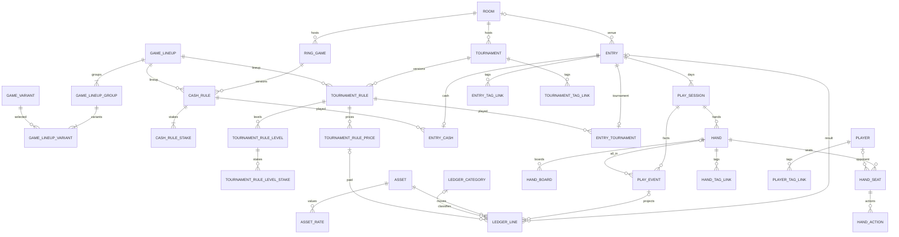

# Data Model

## 1. Overview

This backend specification separates participation and results (`entry`), time at the table (`play_session`), asset movements (`ledger_line`), immutable rules, and hand history. [Game lineups](game-lineups.md) owns rule-version and lineup detail. [API contracts](api.md) owns procedure contracts and the MCP tool map.

Goals: multi-day participation and re-entry in one result; tickets and other non-currency assets; historical valuation; count, summary and full hand history; one source per fact; database-enforced ownership. Non-goals: imports, staking, sharing, and building the new UI.


Assumptions: Cloudflare D1 / SQLite and Drizzle on Workers Paid; foreign keys always enabled; no invariant triggers; at most 100 bound parameters per statement; runtime multi-statement changes use `db.batch()`.

## 2. Glossary

| Term | Meaning |
| --- | --- |
| entry | One participation, the unit of result and P/L; all re-entry bullets belong here |
| play_session | One continuous period at a table, with a local calendar date and optional times |
| play_event | A live-input fact; mutation or deletion requires atomic reprojection |
| projection | Derived play times, state, result, EV and event-sourced ledger lines |
| asset | Currency or item; quantities use its smallest integer unit |
| role / effect | Purpose of movement / whether it affects wallet balance |
| rule version | Immutable cash or tournament structure, including lineup and stakes |
| current rule | The version a master currently selects; historical entries retain their version |
| lineage | Optional parent version under the same master |
| lineup | Immutable grouping and order of variants by blind structure |
| real / virtual | Real currency lines only / all valued lines including items and virtual payments |
| settled | Every day ended and the last day ended finally, rather than bagged or held |
| Hero | The user's self player row, not a separate seat field |
| owned table | Domain table with `user_id`; references to it are composite FKs |

## 3. Final shape



The diagram omits `user_id` halves of composite references. Seat occupancy is folded from player events; there is no second mutable live-seat store. All names below are physical names.

## 4. Invariants

Named audits supplement constraints, not replace constraints SQLite can express or API ownership checks. Aggregate cardinality, immutable write policy and contiguous sequences cannot be enforced by ordinary SQLite CHECKs without triggers, so the API and named audits cover them.

| ID | Final invariant | Guard |
| --- | --- | --- |
| INV-01 | Every domain row has `user_id NOT NULL`; every reference to an owned parent includes ownership | NOT NULL, composite FK, parent UNIQUE keys |

| INV-03 | At least one day per entry; `played_on = MIN(local_date)` | Atomic entry API; A-8 (including missing-day rows) |
| INV-04 | Days have contiguous seq starting at 1 | CHECK seq >= 1; UNIQUE(entry_id,seq); API; A-14 |
| INV-05 | At most one unfinished play_session per user | Partial UNIQUE(user_id) WHERE status <> 'ended' |
| INV-06 | Settled iff all days ended and highest seq is busted/cashed_out/finished; manual always settled | entry manual CHECK; projector/manual API; A-9 |
| INV-07 | bagged/busted tournament only; held/cashed_out cash only; bagged/held need end_stack | mirrored kind FK and play_session CHECKs |
| INV-08 | Nonzero integer ledger quantity, bound and sign by role | quantity and role CHECKs |
| INV-09 | Entry roles need an entry; wallet roles prohibit it | ledger role/column CHECKs |
| INV-10 | Virtual lines belong to entries and never affect balance or real P/L | ledger CHECK; §12 calculation |
| INV-11 | Exchange = two real lines, distinct assets, opposite signs, same transfer | API atomic pair writes; A-14 exchange grouping |
| INV-12 | Event projections are not directly editable and change atomically with the event | API batch; A-6 replay |
| INV-13 | Manual entries have no events or event-sourced lines | entry_source CHECK + FK; source_event composite FK |
| INV-14 | Live times, state, result and EV are projections only | API single write path; A-6 |
| INV-15 | Event/line's play_session belongs to its entry | three-column composite FKs |
| INV-16 | Rule versions and lineups are INSERT-only in application writes | immutable write API; A-14 structure; DB cannot audit a past mutation without an independent history |
| INV-17 | Entry rule, parent rule and master references have matching ownership | composite ownership FKs plus same-master FKs; API null-parent parity; A-14 |
| INV-18 | Hand numbers contiguous from 1; count is row count and button is last hand's button | CHECK/UNIQUE; atomic append/delete-renumber API; A-14 |
| INV-19 | At most one Hero seat, seats 0–9, action seat exists | CHECK, partial UNIQUE, composite hand_seat FK |
| INV-20 | Tags unique per owner/kind ignoring case and whitespace; owned links | expression UNIQUE and two composite FKs |
| INV-21 | Conversion only through the latest eligible asset_rate at line occurred_at | valuation.ts; asset_rate CHECKs (num/den bounds, effective_from ≥ 0) and UNIQUE; §12 conversion contract |
| INV-22 | Referenced master cannot be deleted; versions alone do not make their own master undeletable | NO ACTION references; API archive guidance; version→master CASCADE; guarded aggregate delete |
| INV-23 | Stored JSON values are valid; no mutable relational collection is JSON | json_valid CHECK on event payload/hand stakes/filter_preset.payload; API registry; A-15 for event payloads; filter schema validation for presets |
| INV-24 | Rule versions referenced by linked entries and parent versions belong to the same master | ownership FK + (rule_id,master_id) FK; API NULL parity; A-14 |
| INV-25 | An inheriting level's effective lineup equals its rule lineup | mirror CHECK + composite FK |
| INV-26 | Exactly one detail of the entry kind | detail kind CHECK + FK prevents wrong kind; API creates one; A-14 detects absent detail |
| INV-27 | all_in hand belongs to the event play_session | three-column hand FK; API all_in-only link validation; A-15 |
| INV-28 | Every money line has an explicit asset; no placeholders | NOT NULL + composite asset FK; API payments |
| INV-29 | Hero is a self player, at most one per user and excluded from opponents | player partial UNIQUE; API self-row lifecycle; A-14 |

The [data audits](data-audits.md) describe the numbered checks and when they run.

## 5. Tables 1: conventions, masters, rule versions and lineups

### 5.1 Conventions

The SQL in §5–§10 is normative DDL. Each independent CREATE is shown after expanding common columns. Authentication tables are unchanged and outside the owned-domain schema. Their `user(id)` is the only single-column ownership-root reference; **no single-column FK into an owned table is allowed**. UUID ids are generated by the application. Timestamps are epoch seconds. `updated_at` is maintained by application writes; immutable rows have only `created_at`. Date-only strings remain strings through the API.

Owned references use `(id,user_id)` UNIQUE parents. CASCADE is only for aggregate children; NO ACTION protects referenced masters and immutable snapshots. No RESTRICT or SET NULL is introduced. A compound SET NULL would also null user_id. All CHECKs appear in the Drizzle schema, including asset kind/decimals. Range descriptions in this specification are CHECKs; text length limits are API validation owned by the API reference. Integer JSON and payment schemas are shared between readers and writers.

### 5.2 Masters

Asset names are unique per user after `lower(trim(name))`. Kind and decimals cannot change once referenced. Archive hides a row only from new-input choices; historical reads still resolve it. All master lists take `includeArchived`.

```sql
CREATE TABLE asset (
  id TEXT PRIMARY KEY NOT NULL,
  user_id TEXT NOT NULL REFERENCES user(id) ON DELETE CASCADE,
  created_at INTEGER NOT NULL DEFAULT (unixepoch()),
  updated_at INTEGER NOT NULL,
  name TEXT NOT NULL,
  unit TEXT,
  description TEXT,
  is_favorite INTEGER NOT NULL DEFAULT 0 CHECK (is_favorite IN (0,1)),
  kind TEXT NOT NULL DEFAULT 'currency' CHECK (kind IN ('currency','item')),
  decimals INTEGER NOT NULL DEFAULT 0 CHECK (decimals BETWEEN 0 AND 4),
  archived_at INTEGER,
  UNIQUE (id,user_id)
);
CREATE UNIQUE INDEX asset_name_uq ON asset(user_id,lower(trim(name)));
CREATE INDEX asset_user_kind_idx ON asset(user_id,kind);
```

```sql
CREATE TABLE room (
  id TEXT PRIMARY KEY NOT NULL,
  user_id TEXT NOT NULL REFERENCES user(id) ON DELETE CASCADE,
  created_at INTEGER NOT NULL DEFAULT (unixepoch()),
  updated_at INTEGER NOT NULL,
  name TEXT NOT NULL,
  memo TEXT,
  is_favorite INTEGER NOT NULL DEFAULT 0 CHECK (is_favorite IN (0,1)),
  latitude REAL,
  longitude REAL,
  archived_at INTEGER,
  CHECK ((latitude IS NULL) = (longitude IS NULL)),
  UNIQUE (id,user_id)
);
CREATE INDEX room_user_idx ON room(user_id);
```

```sql
CREATE TABLE ring_game (
  id TEXT PRIMARY KEY NOT NULL,
  user_id TEXT NOT NULL REFERENCES user(id) ON DELETE CASCADE,
  created_at INTEGER NOT NULL DEFAULT (unixepoch()),
  updated_at INTEGER NOT NULL,
  room_id TEXT,
  name TEXT NOT NULL,
  memo TEXT,
  archived_at INTEGER,
  default_asset_id TEXT,
  current_rule_id TEXT NOT NULL,
  FOREIGN KEY (room_id,user_id) REFERENCES room(id,user_id) ON DELETE CASCADE,
  FOREIGN KEY (default_asset_id,user_id) REFERENCES asset(id,user_id) ON DELETE NO ACTION,
  FOREIGN KEY (current_rule_id,user_id) REFERENCES cash_rule(id,user_id) ON DELETE NO ACTION,
  UNIQUE (id,user_id)
);
CREATE INDEX ring_game_room_idx ON ring_game(room_id);
CREATE INDEX ring_game_asset_idx ON ring_game(default_asset_id);
CREATE INDEX ring_game_rule_idx ON ring_game(current_rule_id);
```

```sql
CREATE TABLE tournament (
  id TEXT PRIMARY KEY NOT NULL,
  user_id TEXT NOT NULL REFERENCES user(id) ON DELETE CASCADE,
  created_at INTEGER NOT NULL DEFAULT (unixepoch()),
  updated_at INTEGER NOT NULL,
  room_id TEXT,
  name TEXT NOT NULL,
  memo TEXT,
  is_favorite INTEGER NOT NULL DEFAULT 0 CHECK (is_favorite IN (0,1)),
  archived_at INTEGER,
  default_asset_id TEXT,
  current_rule_id TEXT NOT NULL,
  FOREIGN KEY (room_id,user_id) REFERENCES room(id,user_id) ON DELETE NO ACTION,
  FOREIGN KEY (default_asset_id,user_id) REFERENCES asset(id,user_id) ON DELETE NO ACTION,
  FOREIGN KEY (current_rule_id,user_id) REFERENCES tournament_rule(id,user_id) ON DELETE NO ACTION,
  UNIQUE (id,user_id)
);
CREATE INDEX tournament_room_idx ON tournament(room_id);
CREATE INDEX tournament_asset_idx ON tournament(default_asset_id);
CREATE INDEX tournament_rule_idx ON tournament(current_rule_id);
```

The current-rule FK guards ownership; the API and A-13 master half additionally require that the chosen version belongs to that master. Entries and parent versions have the stronger same-master FK. A master deletes its unreferenced version aggregate only after checking entry references and external version lineage. Delete children before parents where NO ACTION lineage would otherwise obstruct removal. Room deletion rejects referenced rows rather than cascading history.

```sql
CREATE TABLE game_group (
  id TEXT PRIMARY KEY NOT NULL,
  user_id TEXT NOT NULL REFERENCES user(id) ON DELETE CASCADE,
  created_at INTEGER NOT NULL DEFAULT (unixepoch()),
  updated_at INTEGER NOT NULL,
  label TEXT NOT NULL,
  builtin_key TEXT,
  blind1_label TEXT,
  blind2_label TEXT,
  blind3_label TEXT,
  blind1_required INTEGER NOT NULL DEFAULT 0 CHECK (blind1_required IN (0,1)),
  blind2_required INTEGER NOT NULL DEFAULT 0 CHECK (blind2_required IN (0,1)),
  blind3_required INTEGER NOT NULL DEFAULT 0 CHECK (blind3_required IN (0,1)),
  archived_at INTEGER,
  UNIQUE (id,user_id)
);
CREATE UNIQUE INDEX game_group_label_uq ON game_group(user_id,lower(trim(label)));
CREATE UNIQUE INDEX game_group_builtin_uq ON game_group(user_id,builtin_key);
```

```sql
CREATE TABLE game_variant (
  id TEXT PRIMARY KEY NOT NULL,
  user_id TEXT NOT NULL REFERENCES user(id) ON DELETE CASCADE,
  created_at INTEGER NOT NULL DEFAULT (unixepoch()),
  updated_at INTEGER NOT NULL,
  group_id TEXT NOT NULL,
  label TEXT NOT NULL,
  short_label TEXT,
  builtin_key TEXT,
  sort_order INTEGER NOT NULL DEFAULT 0 CHECK (sort_order >= 0),
  archived_at INTEGER,
  FOREIGN KEY (group_id,user_id) REFERENCES game_group(id,user_id) ON DELETE NO ACTION,
  UNIQUE (id,user_id)
);
CREATE UNIQUE INDEX game_variant_label_uq ON game_variant(user_id,lower(trim(label)));
CREATE UNIQUE INDEX game_variant_builtin_uq ON game_variant(user_id,builtin_key);
CREATE INDEX game_variant_group_idx ON game_variant(group_id);
```

```sql
CREATE TABLE game_mix (
  id TEXT PRIMARY KEY NOT NULL,
  user_id TEXT NOT NULL REFERENCES user(id) ON DELETE CASCADE,
  created_at INTEGER NOT NULL DEFAULT (unixepoch()),
  updated_at INTEGER NOT NULL,
  label TEXT NOT NULL,
  builtin_key TEXT,
  archived_at INTEGER,
  UNIQUE (id,user_id)
);
CREATE UNIQUE INDEX game_mix_label_uq ON game_mix(user_id,lower(trim(label)));
CREATE UNIQUE INDEX game_mix_builtin_uq ON game_mix(user_id,builtin_key);
```

```sql
CREATE TABLE game_mix_variant (
  user_id TEXT NOT NULL REFERENCES user(id) ON DELETE CASCADE,
  mix_id TEXT NOT NULL,
  variant_id TEXT NOT NULL,
  position INTEGER NOT NULL CHECK (position >= 0),
  PRIMARY KEY (mix_id,variant_id),
  UNIQUE (mix_id,position),
  FOREIGN KEY (mix_id,user_id) REFERENCES game_mix(id,user_id) ON DELETE CASCADE,
  FOREIGN KEY (variant_id,user_id) REFERENCES game_variant(id,user_id) ON DELETE NO ACTION
);
CREATE INDEX game_mix_variant_variant_idx ON game_mix_variant(variant_id);
```

Variant and mix namespaces are separate; labels are unique within each table.

```sql
CREATE TABLE player (
  id TEXT PRIMARY KEY NOT NULL,
  user_id TEXT NOT NULL REFERENCES user(id) ON DELETE CASCADE,
  created_at INTEGER NOT NULL DEFAULT (unixepoch()),
  updated_at INTEGER NOT NULL,
  name TEXT NOT NULL,
  memo TEXT,
  is_temporary INTEGER NOT NULL DEFAULT 0 CHECK (is_temporary IN (0,1)),
  is_self INTEGER NOT NULL DEFAULT 0 CHECK (is_self IN (0,1)),
  UNIQUE (id,user_id)
);
CREATE UNIQUE INDEX player_self_uq ON player(user_id) WHERE is_self=1;
CREATE INDEX player_user_idx ON player(user_id);
```

The API ensures a self row exists when needed, prohibits client changes to is_self and deletion of that row, and hides it from player.list, opponent statistics and opponent pickers. tablePlayer includes Hero; its join/leave operations determine Hero's seat. There is no independent updateHeroSeat field. A hand seat for Hero refers to this player rather than a NULL-player convention.

### 5.3 Rule and lineup schema contract

[game-lineups.md](game-lineups.md) is the authoritative detailed DDL and write protocol for the following tables, which have the same ownership, integer, CHECK and immutable conventions as this section. This inventory fixes names and the constraints shared with other aggregates; it does not duplicate the detailed rule specification.

| Table | Final columns beyond common columns | Keys and guards |
| --- | --- | --- |
| game_lineup | game_mix_id nullable | owned mix FK NO ACTION; immutable |
| game_lineup_group | lineup_id, position, game_group_id, name nullable | owned lineup CASCADE, group NO ACTION; UNIQUE(lineup_id,position), UNIQUE(lineup_id,id) |
| game_lineup_variant | lineup_id, lineup_group_id, variant_id, position; user_id; no independent id | PK(group,variant), UNIQUE(group,position), UNIQUE(lineup_id,variant_id); owned group CASCADE and variant NO ACTION; (lineup_id,lineup_group_id)→group(lineup_id,id) |
| cash_rule | ring_game_id nullable, parent_rule_id nullable, lineup_id, min_buy_in/max_buy_in nullable, table_size nullable, house_rules nullable | master ownership FK CASCADE; parent ownership FK NO ACTION and (parent_rule_id,ring_game_id)→(id,ring_game_id); lineup owned NO ACTION; UNIQUE(id,ring_game_id), UNIQUE(id,lineup_id) |
| cash_rule_stake | rule_id, lineup_group_id, lineup_id, blind1/2/3, ante, ante_type | PK(rule_id,lineup_group_id); owned rule CASCADE plus (rule_id,lineup_id) FK; group/lineup FK |
| tournament_rule | tournament_id nullable, parent_rule_id nullable, lineup_id, starting_stack/table_size/bounty_amount/house_rules nullable | tournament and parent ownership + same-master parent FK; UNIQUE(id,tournament_id), UNIQUE(id,lineup_id) |
| tournament_rule_level | rule_id, ordinal, level nullable, is_break, minutes nullable, lineup_id, inherits_lineup, inherited_lineup_id nullable | owned rule CASCADE; UNIQUE(rule_id,ordinal), UNIQUE(id,lineup_id); inheritance constraint below |
| tournament_rule_level_stake | level_id, lineup_group_id, lineup_id, blind1/2/3, ante, ante_type | level ownership and level/lineup FKs; group/lineup FK; PK(level_id,lineup_group_id) |
| tournament_rule_price | rule_id, kind, label, asset_id NOT NULL, amount, fee, chips nullable, ordinal | owned rule CASCADE; owned asset NO ACTION; amount/fee/chips >=0; kind entry/reentry/addon; UNIQUE(rule_id,ordinal) |

Inheritance is a DB constraint, not an inheritance convention:

```sql
CHECK ((inherits_lineup=1 AND inherited_lineup_id IS NOT NULL
        AND inherited_lineup_id=lineup_id)
    OR (inherits_lineup=0 AND inherited_lineup_id IS NULL)),
FOREIGN KEY (rule_id,inherited_lineup_id)
  REFERENCES tournament_rule(id,lineup_id) ON DELETE CASCADE
```

Every rule FK also has an ownership FK, so nullable master ids cannot bypass ownership. Same-master FKs apply to both parent versions and entry details (§6). API validation rejects parent lineage whose NULL/non-NULL master relationship does not match. Complete stake coverage and no stakes on a break are API rules audited by A-14; duplicate lineup variants are prevented by UNIQUE(lineup_id,variant_id). All rule/price parents carry UNIQUE(id,user_id); indexes cover master id, parent_rule_id, lineup_id, rule_id/level_id, price.asset_id and every FK lookup. Entry rule-id, ledger price-id and master current-rule-id indexes are required.

Prices are explicit assets, not NULL = main currency. A cash and a ticket entry option are separate `entry` prices. Tournament editing replaces the complete immutable structure, including levels and prices. Version services support creation/reuse, hydration and version-id drift; entry/live operations support override, apply, push, relink and restoreRule. Restore only repoints existing versions without creating a version. [game-lineups.md](game-lineups.md) owns the detailed write protocol.

## 6. Tables 2: entry, details and play_session

```sql
CREATE TABLE entry (
  id TEXT PRIMARY KEY NOT NULL,
  user_id TEXT NOT NULL REFERENCES user(id) ON DELETE CASCADE,
  created_at INTEGER NOT NULL DEFAULT (unixepoch()),
  updated_at INTEGER NOT NULL,
  kind TEXT NOT NULL CHECK (kind IN ('cash','tournament')),
  source TEXT NOT NULL CHECK (source IN ('live','manual','import')),
  status TEXT NOT NULL CHECK (status IN ('open','settled')),
  room_id TEXT,
  asset_id TEXT,
  title TEXT,
  played_on TEXT NOT NULL CHECK (played_on GLOB '[0-9][0-9][0-9][0-9]-[0-9][0-9]-[0-9][0-9]'),
  memo TEXT,
  CHECK (source <> 'manual' OR status='settled'),
  UNIQUE (id,kind,user_id),
  UNIQUE (id,source,user_id),
  FOREIGN KEY (room_id,user_id) REFERENCES room(id,user_id) ON DELETE NO ACTION,
  FOREIGN KEY (asset_id,user_id) REFERENCES asset(id,user_id) ON DELETE NO ACTION,
  UNIQUE (id,user_id)
);
CREATE INDEX entry_page_idx ON entry(user_id,played_on,id);
CREATE INDEX entry_filter_idx ON entry(user_id,kind,status);
CREATE INDEX entry_room_idx ON entry(room_id);
CREATE INDEX entry_asset_idx ON entry(asset_id);
```

```sql
CREATE TABLE entry_cash (
  user_id TEXT NOT NULL REFERENCES user(id) ON DELETE CASCADE,
  entry_id TEXT PRIMARY KEY NOT NULL,
  kind TEXT NOT NULL CHECK (kind='cash'),
  ring_game_id TEXT,
  cash_rule_id TEXT NOT NULL,
  ev_diff INTEGER,
  FOREIGN KEY (entry_id,kind,user_id) REFERENCES entry(id,kind,user_id) ON DELETE CASCADE,
  FOREIGN KEY (ring_game_id,user_id) REFERENCES ring_game(id,user_id) ON DELETE NO ACTION,
  FOREIGN KEY (cash_rule_id,user_id) REFERENCES cash_rule(id,user_id) ON DELETE NO ACTION,
  FOREIGN KEY (cash_rule_id,ring_game_id) REFERENCES cash_rule(id,ring_game_id) ON DELETE NO ACTION
);
CREATE INDEX entry_cash_master_idx ON entry_cash(ring_game_id);
CREATE INDEX entry_cash_rule_idx ON entry_cash(cash_rule_id);
```

```sql
CREATE TABLE entry_tournament (
  user_id TEXT NOT NULL REFERENCES user(id) ON DELETE CASCADE,
  entry_id TEXT PRIMARY KEY NOT NULL,
  kind TEXT NOT NULL CHECK (kind='tournament'),
  tournament_id TEXT,
  tournament_rule_id TEXT NOT NULL,
  placement INTEGER CHECK (placement >= 1),
  total_entries INTEGER CHECK (total_entries >= 1),
  before_deadline INTEGER NOT NULL DEFAULT 0 CHECK (before_deadline IN (0,1)),
  CHECK (before_deadline=0 OR placement IS NULL),
  CHECK (placement IS NULL OR total_entries IS NULL OR placement<=total_entries),
  FOREIGN KEY (entry_id,kind,user_id) REFERENCES entry(id,kind,user_id) ON DELETE CASCADE,
  FOREIGN KEY (tournament_id,user_id) REFERENCES tournament(id,user_id) ON DELETE NO ACTION,
  FOREIGN KEY (tournament_rule_id,user_id) REFERENCES tournament_rule(id,user_id) ON DELETE NO ACTION,
  FOREIGN KEY (tournament_rule_id,tournament_id) REFERENCES tournament_rule(id,tournament_id) ON DELETE NO ACTION
);
CREATE INDEX entry_tournament_master_idx ON entry_tournament(tournament_id);
CREATE INDEX entry_tournament_rule_idx ON entry_tournament(tournament_rule_id);
```

Entry/live creates write the rule version first. NULL master means a standalone rule, not no rule; the API and A-14 require an unlinked entry’s rule to be masterless. Kind CHECKs and three-column FKs reject the opposite detail. Exactly one matching detail is created.

`entry.asset_id` is optional default/display metadata, not an entry's money source or a stats filter shortcut. Every payment has its own required assetId; an entry with no lines need not choose an asset. A referenced EV/BB normalization requires a defined table asset and reports exclusion if absent. No runtime API creates Unassigned or stand-in masters.

```sql
CREATE TABLE play_session (
  id TEXT PRIMARY KEY NOT NULL,
  user_id TEXT NOT NULL REFERENCES user(id) ON DELETE CASCADE,
  created_at INTEGER NOT NULL DEFAULT (unixepoch()),
  updated_at INTEGER NOT NULL,
  entry_id TEXT NOT NULL,
  kind TEXT NOT NULL CHECK (kind IN ('cash','tournament')),
  seq INTEGER NOT NULL CHECK (seq >= 1),
  label TEXT,
  local_date TEXT NOT NULL CHECK (local_date GLOB '[0-9][0-9][0-9][0-9]-[0-9][0-9]-[0-9][0-9]'),
  started_at INTEGER,
  ended_at INTEGER,
  break_minutes INTEGER NOT NULL DEFAULT 0 CHECK (break_minutes >= 0),
  status TEXT NOT NULL CHECK (status IN ('active','paused','ended')),
  end_state TEXT CHECK (end_state IN ('bagged','held','busted','cashed_out','finished')),
  end_stack INTEGER CHECK (end_stack >= 0),
  clock_started_at INTEGER,
  clock_start_level INTEGER CHECK (clock_start_level >= 1),
  UNIQUE (entry_id,seq),
  UNIQUE (id,entry_id,user_id),
  CHECK (started_at IS NULL OR ended_at IS NULL OR ended_at>=started_at),
  CHECK ((status='ended')=(end_state IS NOT NULL)),
  CHECK (end_state NOT IN ('bagged','busted') OR kind='tournament'),
  CHECK (end_state NOT IN ('held','cashed_out') OR kind='cash'),
  CHECK (end_state NOT IN ('bagged','held') OR end_stack IS NOT NULL),
  FOREIGN KEY (entry_id,kind,user_id) REFERENCES entry(id,kind,user_id) ON DELETE CASCADE,
  UNIQUE (id,user_id)
);
CREATE UNIQUE INDEX play_session_unfinished_uq ON play_session(user_id) WHERE status<>'ended';
CREATE INDEX play_session_local_idx ON play_session(user_id,local_date);
```

The API validates real calendar dates (GLOB only fixes representation), nonnegative net duration and contiguous sequences. Manual entries replace all submitted playSessions[] and payments[] in one batch; all manual days are ended. Highest-seq only deletion and undo rules are in §13.

## 7. Tables 3: asset_rate, ledger_category, ledger_line and user_setting

```sql
CREATE TABLE asset_rate (
  id TEXT PRIMARY KEY NOT NULL,
  user_id TEXT NOT NULL REFERENCES user(id) ON DELETE CASCADE,
  created_at INTEGER NOT NULL DEFAULT (unixepoch()),
  base_asset_id TEXT NOT NULL,
  quote_asset_id TEXT NOT NULL,
  rate_num INTEGER NOT NULL CHECK (rate_num BETWEEN 1 AND 1000000000000),
  rate_den INTEGER NOT NULL CHECK (rate_den BETWEEN 1 AND 1000000000000),
  effective_from INTEGER NOT NULL CHECK (effective_from >= 0),
  memo TEXT,
  CHECK (base_asset_id<>quote_asset_id),
  UNIQUE (user_id,base_asset_id,quote_asset_id,effective_from),
  FOREIGN KEY (base_asset_id,user_id) REFERENCES asset(id,user_id) ON DELETE CASCADE,
  FOREIGN KEY (quote_asset_id,user_id) REFERENCES asset(id,user_id) ON DELETE CASCADE,
  UNIQUE (id,user_id)
);
CREATE INDEX asset_rate_quote_idx ON asset_rate(quote_asset_id);
```

One smallest base unit is rate_num/rate_den smallest quote units. effective_from=0 means valid from the beginning; NULL is prohibited because UNIQUE would permit duplicates. Rates are immutable: correct by delete and recreate. Duplicate effectiveFrom for the same pair returns CONFLICT. Deleting an asset used only by rates requires explicit cleanup of those references; the API does not use CASCADE as permission to silently remove history.

```sql
CREATE TABLE ledger_category (
  id TEXT PRIMARY KEY NOT NULL,
  user_id TEXT NOT NULL REFERENCES user(id) ON DELETE CASCADE,
  created_at INTEGER NOT NULL DEFAULT (unixepoch()),
  updated_at INTEGER NOT NULL,
  name TEXT NOT NULL,
  archived_at INTEGER,
  UNIQUE (id,user_id)
);
CREATE UNIQUE INDEX ledger_category_name_uq ON ledger_category(user_id,lower(trim(name)));
```

Ledger categories support archive/restore and referenced-delete conflict guidance.

```sql
CREATE TABLE ledger_line (
  id TEXT PRIMARY KEY NOT NULL,
  user_id TEXT NOT NULL REFERENCES user(id) ON DELETE CASCADE,
  created_at INTEGER NOT NULL DEFAULT (unixepoch()),
  updated_at INTEGER NOT NULL,
  asset_id TEXT NOT NULL,
  quantity INTEGER NOT NULL CHECK (quantity<>0 AND abs(quantity)<=1000000000000),
  role TEXT NOT NULL CHECK (role IN ('buy_in','reentry','fee','chip_purchase','addon','chip_remove','cash_out','prize','bounty','adjustment','exchange')),
  effect TEXT NOT NULL CHECK (effect IN ('real','virtual')),
  entry_id TEXT,
  play_session_id TEXT,
  source_event_id TEXT,
  price_id TEXT,
  category_id TEXT,
  transfer_id TEXT,
  occurred_at INTEGER NOT NULL,
  memo TEXT,
  CHECK (role NOT IN ('buy_in','reentry','fee','chip_purchase','addon') OR quantity<0),
  CHECK (role NOT IN ('cash_out','chip_remove','prize','bounty') OR quantity>0),
  CHECK ((role IN ('adjustment','exchange') AND entry_id IS NULL AND effect='real') OR (role NOT IN ('adjustment','exchange') AND entry_id IS NOT NULL)),
  CHECK (play_session_id IS NULL OR entry_id IS NOT NULL),
  CHECK (source_event_id IS NULL OR (entry_id IS NOT NULL AND play_session_id IS NOT NULL)),
  CHECK (category_id IS NULL OR role IN ('adjustment','exchange')),
  CHECK ((role='exchange')=(transfer_id IS NOT NULL)),
  CHECK (price_id IS NULL OR role IN ('buy_in','reentry','fee','chip_purchase')),
  CHECK (role NOT IN ('adjustment','exchange') OR (play_session_id IS NULL AND source_event_id IS NULL AND price_id IS NULL)),
  FOREIGN KEY (asset_id,user_id) REFERENCES asset(id,user_id) ON DELETE NO ACTION,
  FOREIGN KEY (entry_id,user_id) REFERENCES entry(id,user_id) ON DELETE CASCADE,
  FOREIGN KEY (play_session_id,entry_id,user_id) REFERENCES play_session(id,entry_id,user_id) ON DELETE CASCADE,
  FOREIGN KEY (source_event_id,entry_id,play_session_id,user_id) REFERENCES play_event(id,entry_id,play_session_id,user_id) ON DELETE CASCADE,
  FOREIGN KEY (price_id,user_id) REFERENCES tournament_rule_price(id,user_id) ON DELETE NO ACTION,
  FOREIGN KEY (category_id,user_id) REFERENCES ledger_category(id,user_id) ON DELETE NO ACTION,
  UNIQUE (id,user_id)
);
CREATE INDEX ledger_line_entry_idx ON ledger_line(user_id,entry_id);
CREATE INDEX ledger_line_asset_time_idx ON ledger_line(user_id,asset_id,occurred_at,id);
CREATE INDEX ledger_line_event_idx ON ledger_line(source_event_id);
CREATE INDEX ledger_line_play_idx ON ledger_line(play_session_id);
CREATE INDEX ledger_line_transfer_idx ON ledger_line(transfer_id);
CREATE INDEX ledger_line_price_idx ON ledger_line(price_id);
CREATE INDEX ledger_line_category_idx ON ledger_line(category_id);
```

Ledger role constraints are enforced even for raw SQL writes. API additionally validates role against entry kind, price against the selected tournament rule, and payment amount/fee semantics; A-15 checks payload/price correspondence and A-14 manual lines. Wallet updates and deletes reject entry-owned lines with FORBIDDEN. createExchange takes `{ from, to }`, each with assetId and positive quantity; assets differ. One batch writes the two signed lines with one transfer_id. Updating common fields changes both; quantities keep each side's sign; deleting removes the pair. occurredAt is epoch seconds, not a date-only field.

The ledger is the sole money store. Entry totals use grouped lines, not a net-result shadow transaction. Read services batch page enrichment with selectInChunks; keyset history sorts `(occurred_at,id)` and survives deletion of the cursor row. An entry's history item is dated at its first line. Every money line has an explicit asset, even if entry.asset_id is NULL.

```sql
CREATE TABLE user_setting (
  user_id TEXT NOT NULL REFERENCES user(id) ON DELETE CASCADE,
  base_asset_id TEXT,
  time_zone TEXT,
  updated_at INTEGER NOT NULL,
  PRIMARY KEY (user_id),
  FOREIGN KEY (base_asset_id,user_id) REFERENCES asset(id,user_id) ON DELETE NO ACTION
);

```

The base asset must be kind currency (API and A-14). time_zone is a validated IANA identifier; NULL means Asia/Tokyo. Changing it affects newly derived live dates; it never silently reinterprets stored dates.

## 8. Tables 4: play_event

Events are mutable facts, not immutable summary rows. Every create/update/delete runs registry validation and recomputes projections in the same batch. The DDL has no schema_version default: every writer, including memo and table-player operations, explicitly sets 2.

```sql
CREATE TABLE play_event (
  id TEXT PRIMARY KEY NOT NULL,
  user_id TEXT NOT NULL REFERENCES user(id) ON DELETE CASCADE,
  created_at INTEGER NOT NULL DEFAULT (unixepoch()),
  updated_at INTEGER NOT NULL,
  entry_id TEXT NOT NULL,
  entry_source TEXT NOT NULL CHECK (entry_source='live'),
  play_session_id TEXT NOT NULL,
  type TEXT NOT NULL,
  schema_version INTEGER NOT NULL CHECK (schema_version>=1),
  occurred_at INTEGER NOT NULL,
  sort_order INTEGER NOT NULL CHECK (sort_order>=0),
  payload TEXT NOT NULL CHECK (json_valid(payload)),
  hand_id TEXT,
  UNIQUE (entry_id,sort_order),
  UNIQUE (id,entry_id,play_session_id,user_id),
  FOREIGN KEY (entry_id,entry_source,user_id) REFERENCES entry(id,source,user_id) ON DELETE CASCADE,
  FOREIGN KEY (play_session_id,entry_id,user_id) REFERENCES play_session(id,entry_id,user_id) ON DELETE CASCADE,
  FOREIGN KEY (hand_id,play_session_id,user_id) REFERENCES hand(id,play_session_id,user_id) ON DELETE NO ACTION,
  UNIQUE (id,user_id)
);
CREATE INDEX play_event_play_order_idx ON play_event(play_session_id,sort_order);
CREATE INDEX play_event_hand_idx ON play_event(hand_id);
```

The version column remains extensible; writers validate version 2 payloads through the shared registry. Reads return the registry-parsed payload, falling back to stored JSON if parsing fails. type has no enum CHECK: the shared registry validates it so adding an event does not require a migration. hand_id is authoritative for an all_in link; any payload representation must agree with it. Only an unfinished play_session is a default append target; an ended day is never selected as fallback. Events fold by `(occurred_at,sort_order,id)` across the entry, with per-day state. Append sort_order is allocated inside INSERT as MAX+1, with UNIQUE as backstop.

## 9. Tables 5: hands

Every counted hand is one row. hand.add and undoLast require an active play_session, not merely ownership; paused and ended both reject them. Detail editing is independent of that live counter gate.

```sql
CREATE TABLE hand (
  id TEXT PRIMARY KEY NOT NULL,
  user_id TEXT NOT NULL REFERENCES user(id) ON DELETE CASCADE,
  created_at INTEGER NOT NULL DEFAULT (unixepoch()),
  updated_at INTEGER NOT NULL,
  play_session_id TEXT NOT NULL,
  hand_no INTEGER NOT NULL CHECK (hand_no>=1),
  played_at INTEGER,
  detail TEXT NOT NULL CHECK (detail IN ('count','summary','full')),
  button_seat INTEGER CHECK (button_seat BETWEEN 0 AND 9),
  table_size INTEGER CHECK (table_size BETWEEN 2 AND 10),
  level_ordinal INTEGER CHECK (level_ordinal>=1),
  stakes TEXT CHECK (stakes IS NULL OR json_valid(stakes)),
  variant_id TEXT,
  pot INTEGER CHECK (pot>=0),
  rake INTEGER CHECK (rake>=0),
  memo TEXT,
  UNIQUE (play_session_id,hand_no),
  UNIQUE (id,play_session_id,user_id),
  FOREIGN KEY (play_session_id,user_id) REFERENCES play_session(id,user_id) ON DELETE CASCADE,
  FOREIGN KEY (variant_id,user_id) REFERENCES game_variant(id,user_id) ON DELETE NO ACTION,
  UNIQUE (id,user_id)
);
CREATE INDEX hand_user_time_idx ON hand(user_id,played_at);
CREATE INDEX hand_variant_idx ON hand(variant_id);
```

```sql
CREATE TABLE hand_board (
  user_id TEXT NOT NULL REFERENCES user(id) ON DELETE CASCADE,
  hand_id TEXT NOT NULL,
  board_no INTEGER NOT NULL CHECK (board_no BETWEEN 1 AND 4),
  cards TEXT NOT NULL CHECK (length(cards)<=14),
  PRIMARY KEY (hand_id,board_no),
  FOREIGN KEY (hand_id,user_id) REFERENCES hand(id,user_id) ON DELETE CASCADE
);

```

```sql
CREATE TABLE hand_seat (
  user_id TEXT NOT NULL REFERENCES user(id) ON DELETE CASCADE,
  hand_id TEXT NOT NULL,
  seat INTEGER NOT NULL CHECK (seat BETWEEN 0 AND 9),
  player_id TEXT,
  is_hero INTEGER NOT NULL DEFAULT 0 CHECK (is_hero IN (0,1)),
  start_stack INTEGER CHECK (start_stack>=0),
  hole_cards TEXT CHECK (hole_cards IS NULL OR length(hole_cards)<=20),
  net INTEGER,
  showed INTEGER NOT NULL DEFAULT 0 CHECK (showed IN (0,1)),
  PRIMARY KEY (hand_id,seat),
  UNIQUE (hand_id,seat,user_id),
  CHECK (showed=0 OR hole_cards IS NOT NULL),
  FOREIGN KEY (hand_id,user_id) REFERENCES hand(id,user_id) ON DELETE CASCADE,
  FOREIGN KEY (player_id,user_id) REFERENCES player(id,user_id) ON DELETE NO ACTION
);
CREATE UNIQUE INDEX hand_seat_hero_uq ON hand_seat(hand_id) WHERE is_hero=1;
CREATE INDEX hand_seat_player_idx ON hand_seat(player_id);
```

```sql
CREATE TABLE hand_action (
  user_id TEXT NOT NULL REFERENCES user(id) ON DELETE CASCADE,
  hand_id TEXT NOT NULL,
  seq INTEGER NOT NULL CHECK (seq>=1),
  street INTEGER NOT NULL CHECK (street BETWEEN 0 AND 7),
  seat INTEGER NOT NULL,
  action TEXT NOT NULL CHECK (action IN ('post','straddle','bring_in','fold','check','call','bet','raise','draw','show','muck')),
  amount INTEGER CHECK (amount>=0),
  all_in INTEGER NOT NULL DEFAULT 0 CHECK (all_in IN (0,1)),
  PRIMARY KEY (hand_id,seq),
  FOREIGN KEY (hand_id,user_id) REFERENCES hand(id,user_id) ON DELETE CASCADE,
  FOREIGN KEY (hand_id,seat,user_id) REFERENCES hand_seat(hand_id,seat,user_id) ON DELETE CASCADE
);

```

Count holds hand number/time/button/stakes/variant; summary adds Hero's seat, boards, pot/rake/memo but no actions; full adds all seats and actions. No statistic reads summary net values. Hands/hour and hand count use all detail levels; VPIP/PFR use only full hands. Stakes keys are blind1/blind2/blind3/ante/anteType, with meanings from the game group. Hero net is hand_seat.net, never a second column on hand.

Cards are `[2-9TJQKA][shdc]` separated by spaces. API validates at most 5 per board and 7 per seat, no duplicate within a board or seat; up to 4 full boards represent double-board/run-it-twice. Shared cards can repeat across runs. A full hand show action requires showed=1. Maximum 200 actions. Saving replaces hand, boards, seats and actions in one batch; lowering detail removes incompatible children and lowering to count clears pot/rake/memo.

Append hand_no is MAX+1 inside INSERT. Undo deletes only the highest count hand, so it never destroys entered details. Deleting a linked hand returns CONFLICT until the all_in link is removed; deleting an entire entry/play_session removes both aggregates. Arbitrary hand delete renumbers later hands atomically without transient UNIQUE collisions. Chunk widths derive from actual row shape; hand_seat has 9 columns and hand_action 8, so inserts fit 11 and 12 rows respectively under D1's 100-parameter limit. Hand list uses a string keyset cursor containing its hand-number boundary; it is not a lookup of a possibly deleted row.

## 10. Tables 6: tags and presets

`defineTagTables()` expands the following exact per-kind schema; `createTagRouter()` provides the same list/create/update/delete/reorder contract. Every tag has id/user_id/created_at/updated_at from §5, `name TEXT NOT NULL`, `sort_order INTEGER NOT NULL DEFAULT 0`, UNIQUE(id,user_id), and UNIQUE(user_id,lower(trim(name))). No polymorphic target FK is used.


```sql
CREATE TABLE entry_tag (
  id TEXT PRIMARY KEY NOT NULL,
  user_id TEXT NOT NULL REFERENCES user(id) ON DELETE CASCADE,
  created_at INTEGER NOT NULL DEFAULT (unixepoch()),
  updated_at INTEGER NOT NULL,
  name TEXT NOT NULL,
  sort_order INTEGER NOT NULL DEFAULT 0,
  UNIQUE (id,user_id)
);
CREATE UNIQUE INDEX entry_tag_name_uq ON entry_tag(user_id,lower(trim(name)));
```

```sql
CREATE TABLE entry_tag_link (
  user_id TEXT NOT NULL REFERENCES user(id) ON DELETE CASCADE,
  entry_id TEXT NOT NULL,
  tag_id TEXT NOT NULL,
  PRIMARY KEY (entry_id,tag_id),
  FOREIGN KEY (entry_id,user_id) REFERENCES entry(id,user_id) ON DELETE CASCADE,
  FOREIGN KEY (tag_id,user_id) REFERENCES entry_tag(id,user_id) ON DELETE CASCADE
);
CREATE INDEX entry_tag_link_tag_idx ON entry_tag_link(tag_id);
```

```sql
CREATE TABLE tournament_tag (
  id TEXT PRIMARY KEY NOT NULL,
  user_id TEXT NOT NULL REFERENCES user(id) ON DELETE CASCADE,
  created_at INTEGER NOT NULL DEFAULT (unixepoch()),
  updated_at INTEGER NOT NULL,
  name TEXT NOT NULL,
  sort_order INTEGER NOT NULL DEFAULT 0,
  UNIQUE (id,user_id)
);
CREATE UNIQUE INDEX tournament_tag_name_uq ON tournament_tag(user_id,lower(trim(name)));
```

```sql
CREATE TABLE tournament_tag_link (
  user_id TEXT NOT NULL REFERENCES user(id) ON DELETE CASCADE,
  tournament_id TEXT NOT NULL,
  tag_id TEXT NOT NULL,
  PRIMARY KEY (tournament_id,tag_id),
  FOREIGN KEY (tournament_id,user_id) REFERENCES tournament(id,user_id) ON DELETE CASCADE,
  FOREIGN KEY (tag_id,user_id) REFERENCES tournament_tag(id,user_id) ON DELETE CASCADE
);
CREATE INDEX tournament_tag_link_tag_idx ON tournament_tag_link(tag_id);
```

```sql
CREATE TABLE hand_tag (
  id TEXT PRIMARY KEY NOT NULL,
  user_id TEXT NOT NULL REFERENCES user(id) ON DELETE CASCADE,
  created_at INTEGER NOT NULL DEFAULT (unixepoch()),
  updated_at INTEGER NOT NULL,
  name TEXT NOT NULL,
  sort_order INTEGER NOT NULL DEFAULT 0,
  UNIQUE (id,user_id)
);
CREATE UNIQUE INDEX hand_tag_name_uq ON hand_tag(user_id,lower(trim(name)));
```

```sql
CREATE TABLE hand_tag_link (
  user_id TEXT NOT NULL REFERENCES user(id) ON DELETE CASCADE,
  hand_id TEXT NOT NULL,
  tag_id TEXT NOT NULL,
  reviewed_at INTEGER,
  PRIMARY KEY (hand_id,tag_id),
  FOREIGN KEY (hand_id,user_id) REFERENCES hand(id,user_id) ON DELETE CASCADE,
  FOREIGN KEY (tag_id,user_id) REFERENCES hand_tag(id,user_id) ON DELETE CASCADE
);
CREATE INDEX hand_tag_link_tag_idx ON hand_tag_link(tag_id);
```

```sql
CREATE TABLE player_tag (
  id TEXT PRIMARY KEY NOT NULL,
  user_id TEXT NOT NULL REFERENCES user(id) ON DELETE CASCADE,
  created_at INTEGER NOT NULL DEFAULT (unixepoch()),
  updated_at INTEGER NOT NULL,
  name TEXT NOT NULL,
  sort_order INTEGER NOT NULL DEFAULT 0,
  color TEXT NOT NULL DEFAULT 'gray',
  UNIQUE (id,user_id)
);
CREATE UNIQUE INDEX player_tag_name_uq ON player_tag(user_id,lower(trim(name)));
```

```sql
CREATE TABLE player_tag_link (
  user_id TEXT NOT NULL REFERENCES user(id) ON DELETE CASCADE,
  player_id TEXT NOT NULL,
  tag_id TEXT NOT NULL,
  position INTEGER NOT NULL DEFAULT 0,
  PRIMARY KEY (player_id,tag_id),
  FOREIGN KEY (player_id,user_id) REFERENCES player(id,user_id) ON DELETE CASCADE,
  FOREIGN KEY (tag_id,user_id) REFERENCES player_tag(id,user_id) ON DELETE CASCADE
);
CREATE INDEX player_tag_link_tag_idx ON player_tag_link(tag_id);
```


Owners accept tagIds, never tag names. All four tag kinds expose MCP list/create. Classification derivable from rules (bounty, turbo) is not stored as a tag. The filter preset payload is a saved query, not a mutable relationship store; it is validated against the same stats filter schema on save and load.

The `filter_preset` table requires `CHECK (json_valid(payload))`; payloads also validate against the filter schema.


## 11. Enumerated values

Enums live as `as const` arrays in packages/db/src/constants; CHECKs and Zod share those arrays. Event payload schemas share one registry between write validation, and replay.

| Field | Values |
| --- | --- |
| entry.kind / source / status | cash,tournament / live,manual,import / open,settled |
| play_session.status | active,paused,ended |
| end_state | bagged (tournament, open), held (cash, open), busted (tournament, final), cashed_out (cash, final), finished (either, final) |
| asset.kind / ledger.effect | currency,item / real,virtual |
| hand.detail | count,summary,full |
| tournament_rule_price.kind | entry,reentry,addon |
| hand_action.action | post,straddle,bring_in,fold,check,call,bet,raise,draw,show,muck |

| Ledger role | Sign | Entry kind / purpose |
| --- | --- | --- |
| buy_in | negative | both; initial payment |
| reentry | negative | tournament; later bullet |
| fee | negative | tournament; fee paired with initial/re-entry payment |
| chip_purchase | negative | tournament; price option kind addon |
| addon | negative | cash; extra chips |
| chip_remove | positive | cash; chips removed during play |
| cash_out | positive | cash; final receipt |
| prize / bounty | positive | tournament; distinct receipt roles |
| adjustment / exchange | either | wallet only; not an entry result |

A Payment is `{ assetId, quantity, role, effect, priceId? }`: quantity is positive integer 1…10^12, effect defaults real, and the projector derives sign. Empty payments express zero without inserting a forbidden zero line. Manual create/update uses the same payment schema with role subsets by kind. Prices use `amount` (not cost); addon price produces chip_purchase ledger role, which is distinct from cash addon role.

| Event type | v2 payload and allowed effects |
| --- | --- |
| session_start | payments[] (buy_in, plus tournament fee; a startNextPlay re-entry start carries reentry/fee instead), timerStartedAt?, startLevel? |
| session_end | cash payments[] (cash_out); tournament payments[] (prize/bounty), beforeDeadline, placement?, totalEntries? |
| day_end | endState bagged/held, stackAmount |
| reentry | tournament payments[] (reentry/fee) |
| purchase_chips | priceId and payments[] (chip_purchase); immutable price supplies label/chips; API reference §5 owns the exact object |
| chips_add_remove | signed amount, nonzero with absolute value at most 1,000,000,000,000; positive adds chips (negative addon ledger), negative removes (positive chip_remove) |
| all_in | potSize, trials, equity, wins; handId? must equal the canonical hand_id link |
| update_stack | stackAmount, remainingPlayers?, totalEntries?, chipPurchaseCounts?; exact nullable fields and progress-only counts in API reference §5 |
| session_pause / session_resume | empty payload |
| table_change | tableLabel?, seatPosition? |
| player_join / player_leave | player id and seat transition; Hero uses the self player id |
| memo | text |

Re-entry payments created by startNextPlay belong to the new day’s session_start, which permits reentry/fee roles in this continuation context. Entry-level placement is final-result state, not an in-play remaining-player counter.

## 12. Calculation

### 12.1 Population, modes and money

`packages/api/src/services/valuation.ts` is the sole conversion/P&L implementation. Ledger reads return integer line groups; clients consume API values, not another monetary formula. Statistics (summary, breakdown and series) count **settled entries only**. Lists may show open entries and their paid amounts, but those are not realized result statistics.

Let L(e) be all lines of e, R(e) its real currency lines, and v(l) its value in the selected base asset. Real P/L = ΣR v(l); virtual P/L = ΣL v(l). BI = negative of the sum over negative lines in the respective set; CO = sum over positive lines. Aggregate ROI = ΣP/L / ΣBI × 100, not the mean of entry ROIs. ROI covers **tournament entries only**; cash uses cash win rate and bb/100. A zero denominator yields null, never infinity or zero masquerading as a valid rate.

The API exposes exactly one of three stats modes:

1. `assetId`: unconverted quantities of that asset. Match entries by their ledger lines, not entry.asset_id. Count an entry that has selected-asset lines even if other assets also occur; sum only the chosen lines and report multiAssetEntryCount and otherAssetIds. Never zero an entry merely because it has another asset.
2. `valuation` real/virtual with `baseAssetId`: convert as below; absent baseAssetId uses userSetting.baseAssetId, and absent both is PRECONDITION_FAILED. Base must be a currency. Report excludedEntryCount and missingRates separately for the requested valuation.
3. `normalized: true`: separate cash(BB) and tournament(BI) branches, never an unlabelled sum of raw currencies. Missing unit denominator is excluded and reported as unavailableNormalizationEntryCount. This mode cannot be combined with assetId or valuation/baseAssetId.

API output has `lines[]`, per-asset/effect `totals[]` (roleTotals, buyIn, cashOut, profitLoss), and `valuation { baseAssetId, real, virtual, missingRates }`. Those names and complete shapes are owned by the API reference. Item quantities are not real currency P/L; virtual valuation includes them. Monetary groups must retain asset/effect identity.

| Entry | Lines (base pt, 1 ticket=20,000pt) | Real PL / BI | Virtual PL / BI |
| --- | --- | --- | --- |
| Satellite | −3,000 pt buy_in; +1 ticket prize | −3,000 / 3,000 | 17,000 / 3,000 |
| Main | −1 ticket buy_in; +45,000 pt prize | 45,000 / 0 | 25,000 / 20,000 |
| Freeroll | −5,000 pt virtual buy_in; +8,000 pt prize | 8,000 / 0 | 3,000 / 5,000 |
| Total | all tournament entries | 50,000 / 3,000 (ROI 1,667%) | 45,000 / 28,000 (ROI 161%) |

### 12.2 Conversion and rounding

Choose the latest effective_from <= line.occurred_at for each pair. Try direct a→B, then inverse B→a. Only for an item, allow a→c→B for a currency c (second hop can be inverse). Candidate intermediates sort by newest first-hop effective_from then currency id; use the first convertible path. No arbitrary multi-hop graph search. A line earlier than the first rate is unconvertible; effective_from=0 handles fixed historical rates.

An unconvertible entry is excluded from that valuation, with excludedEntryCount and missingRates; never silently substitute zero. Real and virtual exclusion are independent: an item with no rate does not invalidate real currency totals. missingRates deduplicates asset ids and includes the oldest unconvertible occurred_at. Group quantity by entry, asset and rate path; sum and round only once per group with BigInt rational arithmetic, half away from zero. P/L, BI and CO each round their own groups, so rounded PL can differ from rounded CO−BI. Updating a historical rate intentionally changes past valuation; quantities never change.

### 12.3 Time, units, hands and EV

`hours(e) = Σp (ended_at − started_at − 60*break_minutes)/3600`, evaluated **per play_session**, including every day with both endpoints. Do not use the first day's endpoints with all days' breaks. Time between held/bagged days is outside play. Hourly PL uses only entries with usable time; hands/hour uses only play_sessions with at least one hand and usable time. Negative durations are invalid input, not values clamped into a statistic.

Cash BB = blind2 only when the rule's cash lineup has exactly one group and the blind is positive. Normalize real P/L in the table's asset, not a converted base currency. bb/100 = `100 * Σ(PL/BB) / Σhands`, over cash entries with known BB and hands. Hands count rows of every detail level. Missing table asset or BB is reported, not guessed.

Tournament **1 BI = first buy_in + its fee**, excluding re-entries, their fees and chip purchases. If the first priced buy-in's fee is unpriced, use the earliest unpaired fee on the same play session. Where initial payments span assets, valuation to the declared base must succeed before deriving a scalar BI; otherwise normalized output excludes/reports the entry. ROI's invested-money denominator still includes all applicable negative lines; 1 BI normalization is a distinct unit definition.

EV PL = real PL + ev_diff when EV exists; NULL means unrecorded. ev_diff is Math.round of the sum `potSize*equity/100 − potSize/trials*wins` across all all_in events, not separately rounded events. It is projected while open too; no all_in/EV record leaves NULL. EV uses the table asset and cannot be added to an unrelated currency total.

Breaks: sum finished pause/resume spans per day and floor total seconds/60. A pause open at day end closes at ended_at. An unfinished pause does not depend on wall clock; replay stays pure.

All date filters are inclusive `'YYYY-MM-DD'` comparisons on entry.played_on. Weekday/month/year axes derive from that same string, not UTC event timestamps. local_date is supplied for manual days or derived server-side at live start using userSetting.timeZone, NULL→Asia/Tokyo.

### 12.4 Balance

For every asset, balance = Σquantity where effect='real', including entry and wallet lines, including open entries and items. An asset without lines has zero balance. Virtual lines never change it. This differs intentionally from settled-only statistics.

## 13. Event-to-projection rules

### 13.1 Atomic algorithm

Load the owned entry, its days/events/rule/prices; apply the proposed event mutation in memory; call pure `projectEntry(events,context)`; write the event change, delete/reinsert projected ledger lines, update days, entry detail and entry in one `db.batch()`. Batch construction fails before any write if ownership, asset or payload validation fails. Insert chunks and IN selects use the shared 100-parameter helpers. Replacing lines deletes only source_event_id IS NOT NULL; manual lines never pass through the live projector.

Append order is allocated inside INSERT, not from a previously loaded MAX. Concurrent writes must not lose an event; unique order is DB-backed. A projection computed from a stale read may drift: the next write rebuilds the complete entry, and A-6 detects it at every dev deploy/release. This is the recorded concurrency limitation, not a claim of serializable reads.

### 13.2 Fold and state machine

| Event | Projected state | Projected money/result |
| --- | --- | --- |
| session_start | first start; active; clock fields | payments; entry open |
| pause/resume | paused/active; per-day break recomputed | none |
| day_end | ended, bagged/held, end_stack required | entry stays open |
| session_end cash | ended, cashed_out; end_stack=sum cash_out payments | settled; receipt payments |
| session_end tournament | ended, finished if placement=1 else busted | highest-day final placement/total/before_deadline; receipts; settled |
| reentry | no implicit reopening of an ended day | reentry/fee lines on an active day; next-day payments instead belong to session_start |
| purchase_chips | no time state change | payment lines with price_id |
| chips_add_remove | no time state change | addon/chip_remove with derived sign |
| all_in | no time state change | recompute entry_cash.ev_diff |
| update_stack | live stack remains event fact | latest in-play totalEntries while no final result |
| player_join/leave | fold seat occupancy | Hero uses self player id |
| table_change/memo | no result change | none |

State validation reads **play_session.status**, including day_end, not just presence of session_end. Append to ended days fails PRECONDITION_FAILED. Omitted target selects only an unfinished day; it never silently falls back to an ended highest day. A pause requires active, resume requires paused, and day_end/session_end requires active or paused. Edit/delete revalidates the resulting entire sequence, so a historical edit cannot make an impossible transition. day_end is written through endPlay; re-entry payments through startNextPlay in session_start, not arbitrary event insertion on an ended day.

The API rejects a newly written event time later than server now + 60 seconds with BAD_REQUEST in playEvent.create/update and live.create/complete/endPlay/startNextPlay. This checks only the time being written, never revalidates existing rows against today's clock, and exempts non-event payload clocks such as timerStartedAt. A terminal session_end/day_end must sort last in its play_session: complete/endPlay rejects occurredAt earlier than any existing event of that day with BAD_REQUEST before writing.

Tournament live.create accepts optional nonnegative initialStack and writes its first update_stack in the same batch as entry, detail, day, session_start and payments. This provides the chart's opening stack point.

The API computes tournament progress server-side from the ordered event fold: currentStack, remainingPlayers, totalEntries, purchased-chip total (chipTotal), and averageStack. `averageStack = Math.round((startingStack * totalEntries + chipTotal) / remainingPlayers)`; unavailable inputs or nonpositive remainingPlayers yield NULL. chipTotal includes purchase_chips and the cumulative chipPurchaseCounts reported by update_stack; a reported cumulative snapshot replaces the prior count basis rather than double-counting those purchases, with subsequent purchases accumulated thereafter. Explicit NULL remainingPlayers/totalEntries clears the value; omission preserves it. Progress-only counts never create money lines. A-6 replays these values. The new UI's charts consume the API values, not another formula.

Events fold by `(occurred_at,sort_order,id)`. Each day takes its own first start and closing end; entry-wide totals fold all days. Final tournament result comes only from the highest-seq day's closing session_end. Without one, placement=NULL, before_deadline=0, total_entries=latest in-play total; a before-deadline final end has placement and total_entries NULL and before_deadline=1. All other before_deadline values are 0. Only a closing session_end produces receipts. Line ids are `<event_id>:<n>` in payment order, with event timestamp/day and explicit asset.

### 13.3 Multi-day, undo and manual editing

endPlay closes bagged/held only and releases the user's unfinished-day slot. startNextPlay creates the next contiguous day and its start event; optional re-entry payments are embedded in that new day's session_start in the **same batch**. A busted tournament can re-enter; finished cannot start another day. A cash continuation after a mistaken final cash-out uses explicit undo/correction rather than double-counting a receipt. Held cash resumes as a new day with the prior stack context; keeping money at a venue can instead be represented by a venue-held asset and wallet exchange.

undoEndPlay deletes the last end event and reprojects the last day; it does not create a reopen API. undoStartNextPlay discards only the highest-seq day while it holds only its start event and no hands or other dependents. Because startNextPlay embeds re-entry payments in the start event, its undo removes those payments through reprojection atomically with that otherwise-empty day. Both undo paths check that no other unfinished day conflicts with the partial UNIQUE. User-entered details are never silently removed.

Manual entry create/update takes complete playSessions[] with per-day payments[] (top-level payments only for one day, never both), validates all referenced ids and the ended states, replaces them in a batch, and writes no event. Manual line ids are `m:<entry_id>:<role>:<n>` with per-role n. occurred_at is the relevant day's started_at or noon UTC of its local_date; this is a deterministic valuation fallback, not a date-filter axis. `entry.update` rejects event-derived fields on live-linked entries; change events through their dedicated operations, which reproject atomically.

hand.add/undoLast only while active; tablePlayer and all_in links obey the same owned-day state validation. Hand detail saves replace seats/actions in full and do not write an independent live handCount/dealerSeat.

## 14. API and MCP

This section defines policy only; the sole procedure contracts and tool map are [api.md](api.md). There is no duplicate router map here.

The participation API is `entry`; `live`, `playEvent` and `tablePlayer` handle their respective concerns. Money uses assetId, rule/game references use ids, kind is cash/tournament, dates are playedOn/localDate strings, state is open/settled plus per-day status.

Every input id, including nested payments/rules/tags, reorder ids and cursor boundaries, is ownership checked; bulk WHERE and joined reads bind owner and parent. Missing and foreign-owned ids both return uniform FORBIDDEN. Invalid input is BAD_REQUEST; invalid state is PRECONDITION_FAILED; duplicate rates/labels and referenced master deletion are CONFLICT with archive guidance where available. DB constraints are the backstop, not an authorization oracle. Input timestamps are epoch seconds; JSON output timestamps are ISO strings through the existing transformer/serialization contract; date-only strings are never timestamp-normalized.

MCP is an untrimmed projection through appRouter.createCaller, using the identical router Zod objects and mapToolError, never direct DB access or a second schema. Every procedure is in TOOL_DEFINITIONS or DELIBERATELY_EXCLUDED with a current reason. Delete and cockpit/hand-write operations remain excluded; master archive/restore follows the established reversible-write policy; all four tag kinds expose list/create.
