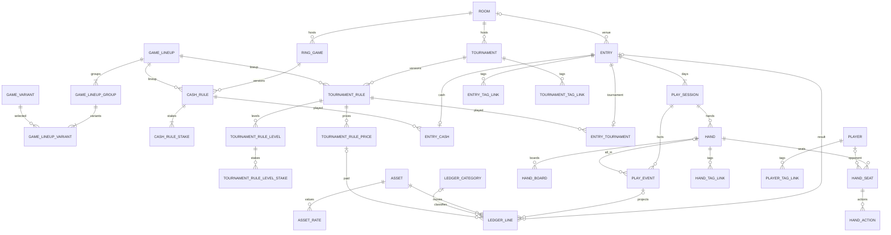

# Data Model

## 1. Overview

This backend specification separates participation and results (`entry`), time at the table (`play_session`), asset movements (`ledger_line`), immutable rules, and hand history. [Game lineups](game-lineups.md) owns rule-version and lineup detail. [API contracts](api.md) owns procedure contracts and the MCP tool map.

Goals: multi-day participation and re-entry in one result; tickets and other non-currency assets; historical valuation; count, summary and full hand history; one source per fact; database-enforced ownership. Non-goals: imports, staking and sharing.

Assumptions: Cloudflare D1 / SQLite and Drizzle on Workers Paid; foreign keys always enabled; no invariant triggers; at most 100 bound parameters per statement; runtime multi-statement changes use `db.batch()`.

## 2. Glossary

| Term | Meaning |
| --- | --- |
| entry | One participation, the unit of result and P/L; all re-entry bullets belong here |
| play_session | One continuous period at a table, with a local calendar date and optional times |
| play_event | A live-input fact; mutation or deletion requires atomic reprojection |
| projection | Derived play times, state, result, EV and event-sourced ledger lines |
| asset | Currency or item; quantities use its smallest integer unit |
| role / effect | Purpose of movement / whether it affects wallet balance |
| rule version | Immutable cash or tournament structure, including lineup and stakes |
| current rule | The version a master currently selects; historical entries retain their version |
| lineage | Optional parent version under the same master |
| lineup | Immutable grouping and order of variants by blind structure |
| real / virtual | Real currency lines only / all valued lines including items and virtual payments |
| settled | Every day ended and the last day ended finally, rather than bagged or held |
| Hero | The user's self player row, not a separate seat field |
| owned table | Domain table with `user_id`; references to it are composite FKs |

## 3. Structure

The diagram omits `user_id` halves of composite references. Seat occupancy is folded from player events; there is no second mutable live-seat store. All names below are physical names.

## 4. Invariants

Named audits supplement constraints, not replace constraints SQLite can express or API ownership checks. Aggregate cardinality, immutable write policy and contiguous sequences cannot be enforced by ordinary SQLite CHECKs without triggers, so the API and named audits cover them.

| ID | Invariant | Guard |
| --- | --- | --- |
| INV-01 | Every domain row has `user_id NOT NULL`; every reference to an owned parent includes ownership | NOT NULL, composite FK, parent UNIQUE keys |
| INV-03 | At least one day per entry; `played_on = MIN(local_date)` | Atomic entry API; A-8 (including missing-day rows) |
| INV-04 | Days have contiguous seq starting at 1 | CHECK seq >= 1; UNIQUE(entry_id,seq); API; A-14 |
| INV-05 | At most one unfinished play_session per user | Partial UNIQUE(user_id) WHERE status <> 'ended' |
| INV-06 | Settled iff all days ended and highest seq is busted/cashed_out/finished; manual always settled | entry manual CHECK; projector/manual API; A-9 |
| INV-07 | bagged/busted tournament only; held/cashed_out cash only; bagged/held need end_stack | mirrored kind FK and play_session CHECKs |
| INV-08 | Nonzero integer ledger quantity, bound and sign by role | quantity and role CHECKs |
| INV-09 | Entry roles need an entry; wallet roles prohibit it | ledger role/column CHECKs |
| INV-10 | Virtual lines belong to entries and never affect balance or real P/L | ledger CHECK; §12 calculation |
| INV-11 | Exchange = two real lines, distinct assets, opposite signs, same transfer | API atomic pair writes; A-14 exchange grouping |
| INV-12 | Event projections are not directly editable and change atomically with the event | API batch; A-6 replay |
| INV-13 | Manual entries have no events or event-sourced lines | entry_source CHECK + FK; source_event composite FK |
| INV-14 | Live times, state, result and EV are projections only | API single write path; A-6 |
| INV-15 | Event/line's play_session belongs to its entry | three-column composite FKs |
| INV-16 | Rule versions and lineups are INSERT-only in application writes | immutable write API; A-14 structure; DB cannot audit a past mutation without an independent history |
| INV-17 | Entry rule, parent rule and master references have matching ownership | composite ownership FKs plus same-master FKs; API null-parent parity; A-14 |
| INV-18 | Hand numbers contiguous from 1; count is row count and button is last hand's button | CHECK/UNIQUE; atomic append/delete-renumber API; A-14 |
| INV-19 | At most one Hero seat, seats 0–9, action seat exists | CHECK, partial UNIQUE, composite hand_seat FK |
| INV-20 | Tags unique per owner/kind ignoring case and whitespace; owned links | expression UNIQUE and two composite FKs |
| INV-21 | Conversion only through the latest eligible asset_rate at line occurred_at | valuation.ts; asset_rate CHECKs (num/den bounds, effective_from ≥ 0) and UNIQUE; §12 conversion contract |
| INV-22 | Referenced master cannot be deleted; versions alone do not make their own master undeletable | NO ACTION references; API archive guidance; version→master CASCADE; guarded aggregate delete |
| INV-23 | Stored JSON values are valid; no mutable relational collection is JSON | json_valid CHECK on event payload/hand stakes/filter_preset.payload; API registry; A-15 for event payloads; filter schema validation for presets |
| INV-24 | Rule versions referenced by linked entries and parent versions belong to the same master | ownership FK + (rule_id,master_id) FK; API NULL parity; A-14 |
| INV-25 | An inheriting level's effective lineup equals its rule lineup | mirror CHECK + composite FK |
| INV-26 | Exactly one detail of the entry kind | detail kind CHECK + FK prevents wrong kind; API creates one; A-14 detects absent detail |
| INV-27 | all_in hand belongs to the event play_session | three-column hand FK; API all_in-only link validation; A-15 |
| INV-28 | Every money line has an explicit asset; no placeholders | NOT NULL + composite asset FK; API payments |
| INV-29 | Hero is a self player, at most one per user and excluded from opponents | player partial UNIQUE; API self-row lifecycle; A-14 |

The [data audits](data-audits.md) describe the numbered checks and when they run.

## 5. Schema conventions and masters

### 5.1 Conventions

The authoritative table definitions, constraints and indexes are the Drizzle [schema](../../packages/db/src/schema.ts) and its modules in [`packages/db/src/schema/`](../../packages/db/src/schema/); the latest migration snapshot records the deployed schema shape. Owned references use composite ownership keys. Aggregate children cascade; references across aggregates generally use NO ACTION to protect historical facts. UUIDs are generated by the application; timestamps are epoch seconds and date-only values remain strings.

Some API-validated properties are not database CHECKs: room favorite boolean and paired coordinates, player temporary boolean, hand level ordinal, event sort order and play-session clock start level. `game_mix_variant.user_id` has composite owner foreign keys, not a direct user FK.

### 5.2 Masters

Asset names are unique per user after `lower(trim(name))`. Game groups, variants and mixes have separate normalized label namespaces, including archived rows; see [game masters](game-masters.md). Archive hides a master from new selections while historical references remain readable. Immutable rule and lineup structure, same-master references and write semantics are described in [game lineups](game-lineups.md).

## 6. Entries and play sessions

An entry has one kind-specific detail and at least one play session. A live entry derives its state and event-sourced money from its events; a manual entry stores ended days and payments directly. See [sessions and live editing](sessions-and-live-editing.md) and the invariants above.

## 7. Ledger and valuation

Each line has an explicit owned asset and a nonzero signed quantity; role and effect distinguish entry results from wallet movements and real from virtual money. Rates are effective-dated rational conversions. See §11 for roles and §12 for valuation and balance.

## 8. Play events

Events are mutable facts whose changes require reprojection in the same batch. Writers set schema version 2 explicitly; the event registry validates payloads, and A-15 audits persisted versions and references.

## 9. Hands

Each hand is one row regardless of detail level. Hand append and undo require an active play session; detail editing is separate. Hero is represented by the user's self-player row. The `CHECK(json_valid(stakes))` permits NULL because a SQLite CHECK accepts NULL.

## 10. Tags and presets

Tag links use owned foreign keys rather than a polymorphic target reference. Filter presets store validated JSON for statistics filters.

## 11. Enumerated values

Enums live as `as const` arrays in packages/db/src/constants; CHECKs and Zod share those arrays. Event payload schemas share one registry between write validation, and replay.

| Field | Values |
| --- | --- |
| entry.kind / source / status | cash,tournament / live,manual,import / open,settled |
| play_session.status | active,paused,ended |
| end_state | bagged (tournament, open), held (cash, open), busted (tournament, final), cashed_out (cash, final), finished (either, final) |
| asset.kind / ledger.effect | currency,item / real,virtual |
| hand.detail | count,summary,full |
| tournament_rule_price.kind | entry,reentry,addon |
| hand_action.action | post,straddle,bring_in,fold,check,call,bet,raise,draw,show,muck |

| Ledger role | Sign | Entry kind / purpose |
| --- | --- | --- |
| buy_in | negative | both; initial payment |
| reentry | negative | tournament; later bullet |
| fee | negative | tournament; fee paired with initial/re-entry payment |
| chip_purchase | negative | tournament; price option kind addon |
| addon | negative | cash; extra chips |
| chip_remove | positive | cash; chips removed during play |
| cash_out | positive | cash; final receipt |
| prize / bounty | positive | tournament; distinct receipt roles |
| adjustment / exchange | either | wallet only; not an entry result |

A Payment is `{ assetId, quantity, role, effect, priceId? }`: quantity is positive integer 1…10^12, effect defaults real, and the projector derives sign. Empty payments express zero without inserting a forbidden zero line. Manual create/update uses the same payment schema with role subsets by kind. Prices use `amount` (not cost); addon price produces chip_purchase ledger role, which is distinct from cash addon role.

| Event type | v2 payload and allowed effects |
| --- | --- |
| session_start | payments[] (buy_in, plus tournament fee; a startNextPlay re-entry start carries reentry/fee instead), timerStartedAt?, startLevel? |
| session_end | cash payments[] (cash_out); tournament payments[] (prize/bounty), beforeDeadline, placement?, totalEntries? |
| day_end | endState bagged/held, stackAmount |
| reentry | tournament payments[] (reentry/fee) |
| purchase_chips | priceId and payments[] (chip_purchase, fee); immutable price supplies label/chips; API reference §5 owns the exact object |
| chips_add_remove | signed amount, nonzero with absolute value at most 1,000,000,000,000; positive adds chips (negative addon ledger), negative removes (positive chip_remove) |
| all_in | potSize, trials, equity, wins; handId? must equal the canonical hand_id link |
| update_stack | stackAmount, remainingPlayers?, totalEntries?, chipPurchaseCounts?; exact nullable fields and progress-only counts in API reference §5 |
| session_pause / session_resume | empty payload |
| table_change | tableLabel?, seatPosition? |
| player_join / player_leave | player id and seat transition; Hero uses the self player id |
| memo | text |

Re-entry payments created by startNextPlay belong to the new day’s session_start, which permits reentry/fee roles in this continuation context. Entry-level placement is final-result state, not an in-play remaining-player counter.

## 12. Calculation

### 12.1 Population, modes and money

`packages/api/src/services/valuation.ts` is the sole conversion/P&L implementation. Ledger reads return integer line groups; clients consume API values, not another monetary formula. Statistics (summary, breakdown and series) count **settled entries only**. Lists may show open entries and their paid amounts, but those are not realized result statistics.

Let L(e) be all lines of e, R(e) its real currency lines, and v(l) its value in the selected base asset. Real P/L = ΣR v(l); virtual P/L = ΣL v(l). BI = negative of the sum over negative lines in the respective set; CO = sum over positive lines. Aggregate ROI = ΣP/L / ΣBI × 100, not the mean of entry ROIs. ROI covers **tournament entries only**; cash uses cash win rate and bb/100. A zero denominator yields null, never infinity or zero masquerading as a valid rate.

The API exposes exactly one of three stats modes:

1. `assetId`: unconverted real quantities of that asset. Match entries with at least one real line in the selected asset, not by entry.asset_id. Count an entry even if other assets also occur; sum only the chosen asset's real lines and report multiAssetEntryCount and otherAssetIds.
2. `valuation` real/virtual with `baseAssetId`: convert as below; absent baseAssetId uses userSetting.baseAssetId, and absent both is PRECONDITION_FAILED. Base must be a currency. Report excludedEntryCount and missingRates separately for the requested valuation.
3. `normalized: true`: separate cash(BB) and tournament(BI) branches, never an unlabelled sum of raw currencies. Missing unit denominator is excluded and reported as unavailableNormalizationEntryCount. This mode cannot be combined with assetId or valuation/baseAssetId.

API output has `lines[]`, per-asset/effect `totals[]` (roleTotals, buyIn, cashOut, profitLoss), and `valuation { baseAssetId, real, virtual, missingRates }`. Those names and complete shapes are owned by the API reference. Item quantities are not real currency P/L; virtual valuation includes them. Monetary groups must retain asset/effect identity.

| Entry | Lines (base pt, 1 ticket=20,000pt) | Real PL / BI | Virtual PL / BI |
| --- | --- | --- | --- |
| Satellite | −3,000 pt buy_in; +1 ticket prize | −3,000 / 3,000 | 17,000 / 3,000 |
| Main | −1 ticket buy_in; +45,000 pt prize | 45,000 / 0 | 25,000 / 20,000 |
| Freeroll | −5,000 pt virtual buy_in; +8,000 pt prize | 8,000 / 0 | 3,000 / 5,000 |
| Total | all tournament entries | 50,000 / 3,000 (ROI 1,667%) | 45,000 / 28,000 (ROI 161%) |

### 12.2 Conversion and rounding

Choose the latest effective_from <= line.occurred_at for each pair. Try direct a→B, then inverse B→a. Only for an item, allow a→c→B for a currency c (second hop can be inverse). Candidate intermediates sort by newest first-hop effective_from then currency id; use the first convertible path. No arbitrary multi-hop graph search. A line earlier than the first rate is unconvertible; effective_from=0 handles fixed historical rates.

An unconvertible entry is excluded from that valuation, with excludedEntryCount and missingRates; never silently substitute zero. Real and virtual exclusion are independent: an item with no rate does not invalidate real currency totals. missingRates deduplicates asset ids and includes the oldest unconvertible occurred_at. Group quantity by entry, asset and rate path; sum and round only once per group with BigInt rational arithmetic, half away from zero. P/L, BI and CO each round their own groups, so rounded PL can differ from rounded CO−BI. Updating a historical rate intentionally changes past valuation; quantities never change.

### 12.3 Time, units, hands and EV

`hours(e) = Σp (ended_at − started_at − 60*break_minutes)/3600`, evaluated **per play_session**, including every day with both endpoints. Do not use the first day's endpoints with all days' breaks. Time between held/bagged days is outside play. Hourly PL uses only entries with usable time; hands/hour uses only play_sessions with at least one hand and usable time. Negative durations are invalid input, not values clamped into a statistic.

Cash BB = blind2 only when the rule's cash lineup has exactly one group and the blind is positive. Normalize real P/L in the table's asset, not a converted base currency. bb/100 = `100 * Σ(PL/BB) / Σhands`, over cash entries with known BB and hands. Hands count rows of every detail level. Missing table asset or BB is reported, not guessed.

Tournament normalization uses the first buy-in and its paired fee, not later re-entries or add-ons. [Statistics](statistics.md) owns fee pairing, currency conversion and the separate ROI denominator.

EV PL = real PL + ev_diff when EV exists; NULL means unrecorded. A live cash entry projects ev_diff as Math.round of the sum `potSize*equity/100 − potSize/trials*wins` across all all_in events, not separately rounded events. The empty sum is 0, including while open. A manual cash entry without evDiff has NULL. EV uses the table asset and cannot be added to an unrelated currency total.

Breaks: sum finished pause/resume spans per day and floor total seconds/60. A pause open at day end closes at ended_at. An unfinished pause does not depend on wall clock; replay stays pure.

All date filters are inclusive `'YYYY-MM-DD'` comparisons on entry.played_on. Weekday/month/year axes derive from that same string, not UTC event timestamps. local_date is supplied for manual days or derived server-side at live start using userSetting.timeZone, NULL→Asia/Tokyo.

### 12.4 Balance

For every asset, balance = Σquantity where effect='real', including entry and wallet lines, including open entries and items. An asset without lines has zero balance. Virtual lines never change it. This differs intentionally from settled-only statistics.

## 13. Event-to-projection rules

### 13.1 Atomic algorithm

Load the owned entry, its days/events/rule/prices; apply the proposed event mutation in memory; call pure `projectEntry(events,context)`; write the event change, delete/reinsert projected ledger lines, update days, entry detail and entry in one `db.batch()`. Batch construction fails before any write if ownership, asset or payload validation fails. Insert chunks and IN selects use the shared 100-parameter helpers. Replacing lines deletes only source_event_id IS NOT NULL; manual lines never pass through the live projector.

Append order is allocated inside INSERT, not from a previously loaded MAX. Concurrent writes must not lose an event; unique order is DB-backed. A projection computed from a stale read may drift: the next write rebuilds the complete entry, and A-6 detects it at every dev deploy/release. This is the recorded concurrency limitation, not a claim of serializable reads.

### 13.2 Fold and state machine

| Event | Projected state | Projected money/result |
| --- | --- | --- |
| session_start | first start; active; clock fields | payments; entry open |
| pause/resume | paused/active; per-day break recomputed | none |
| day_end | ended, bagged/held, end_stack required | entry stays open |
| session_end cash | ended, cashed_out; end_stack=sum cash_out payments | settled; receipt payments |
| session_end tournament | ended, finished if placement=1 else busted | highest-day final placement/total/before_deadline; receipts; settled |
| reentry | no implicit reopening of an ended day | reentry/fee lines on an active day; next-day payments instead belong to session_start |
| purchase_chips | no time state change | payment lines with price_id |
| chips_add_remove | no time state change | addon/chip_remove with derived sign |
| all_in | no time state change | recompute entry_cash.ev_diff |
| update_stack | live stack remains event fact | latest in-play totalEntries while no final result |
| player_join/leave | fold seat occupancy | Hero uses self player id |
| table_change/memo | no result change | none |

State validation reads **play_session.status**, including day_end, not just presence of session_end. Append to ended days fails PRECONDITION_FAILED. Omitted target selects only an unfinished day; it never silently falls back to an ended highest day. A pause requires active, resume requires paused, and day_end/session_end requires active or paused. Edit/delete revalidates the resulting entire sequence, so a historical edit cannot make an impossible transition. day_end is written through endPlay; re-entry payments through startNextPlay in session_start, not arbitrary event insertion on an ended day.

The API rejects a newly written event time later than server now + 60 seconds with BAD_REQUEST in playEvent.create/update and live.create/complete/endPlay/startNextPlay. This checks only the time being written, never revalidates existing rows against today's clock, and exempts non-event payload clocks such as timerStartedAt. A terminal session_end/day_end must sort last in its play_session: complete/endPlay rejects occurredAt earlier than any existing event of that day with BAD_REQUEST before writing.

Tournament live.create accepts optional nonnegative initialStack and writes its first update_stack in the same batch as entry, detail, day, session_start and payments. This provides the chart's opening stack point.

The API computes tournament progress on read from the ordered event fold: currentStack, remainingPlayers, totalEntries, purchased-chip total (chipTotal), and averageStack. `averageStack = Math.round((startingStack * totalEntries + chipTotal) / remainingPlayers)`; unavailable inputs or nonpositive remainingPlayers yield NULL. chipTotal includes purchase_chips and cumulative chipPurchaseCounts reported by update_stack; a cumulative snapshot replaces the prior count basis, with subsequent purchases accumulated thereafter. Explicit NULL remainingPlayers/totalEntries clears the value; omission preserves it. Progress-only counts never create money lines. Charts consume the API values.

Events fold by `(occurred_at,sort_order,id)`. Each day takes its own first start and closing end; entry-wide totals fold all days. Final tournament result comes only from the highest-seq day's closing session_end. Without one, placement=NULL, before_deadline=0, total_entries=latest in-play total; a before-deadline final end has placement and total_entries NULL and before_deadline=1. All other before_deadline values are 0. Only a closing session_end produces receipts. Line ids are `<event_id>:<n>` in payment order, with event timestamp/day and explicit asset.

### 13.3 Multi-day, undo and manual editing

endPlay closes bagged/held only and releases the user's unfinished-day slot. startNextPlay creates the next contiguous day and its start event; optional re-entry payments are embedded in that new day's session_start in the **same batch**. A busted tournament can re-enter; finished cannot start another day. A cash continuation after a mistaken final cash-out uses explicit undo/correction rather than double-counting a receipt. Held cash resumes as a new day with the prior stack context; keeping money at a venue can instead be represented by a venue-held asset and wallet exchange.

undoEndPlay deletes the last end event and reprojects the last day; it does not create a reopen API. undoStartNextPlay discards only the highest-seq day while it holds only its start event and no hands or other dependents. Because startNextPlay embeds re-entry payments in the start event, its undo removes those payments through reprojection atomically with that otherwise-empty day. Both undo paths check that no other unfinished day conflicts with the partial UNIQUE. User-entered details are never silently removed.

Manual entry create/update takes complete playSessions[] with per-day payments[] (top-level payments only for one day, never both), validates all referenced ids and the ended states, replaces them in a batch, and writes no event. Manual line ids are `m:<entry_id>:<role>:<n>` with per-role n. occurred_at is the relevant day's started_at or noon UTC of its local_date; this is a deterministic valuation fallback, not a date-filter axis. `entry.update` rejects event-derived fields on live-linked entries; change events through their dedicated operations, which reproject atomically.

hand.add/undoLast only while active; tablePlayer and all_in links obey the same owned-day state validation. Hand detail saves replace seats/actions in full and do not write an independent live handCount/dealerSeat.

## 14. API and MCP

This section defines policy only; the sole procedure contracts and tool map are [api.md](api.md). There is no duplicate router map here.

The participation API is `entry`; `live`, `playEvent` and `tablePlayer` handle their respective concerns. Money uses assetId, rule/game references use ids, kind is cash/tournament, dates are playedOn/localDate strings, state is open/settled plus per-day status.

Every input id, including nested payments/rules/tags, reorder ids and cursor boundaries, is ownership checked; bulk WHERE and joined reads bind owner and parent. Missing and foreign-owned ids both return uniform FORBIDDEN. Invalid input is BAD_REQUEST; invalid state is PRECONDITION_FAILED; duplicate rates/labels and referenced master deletion are CONFLICT with archive guidance where available. DB constraints are the backstop, not an authorization oracle. Input timestamps are epoch seconds; in-process callers receive Date objects and JSON serialization produces ISO strings. Date-only strings are never timestamp-normalized.

MCP is an untrimmed projection through appRouter.createCaller, using the identical router Zod objects and mapToolError, never direct DB access or a second schema. Every procedure is in TOOL_DEFINITIONS or DELIBERATELY_EXCLUDED with a current reason. Delete and cockpit/hand-write operations remain excluded; master archive/restore follows the established reversible-write policy; all four tag kinds expose list/create.
